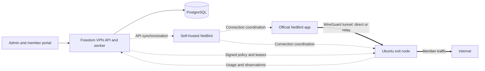

# Freedom VPN

**English** · [繁體中文](README.zh-TW.md)

[Project website](https://ted-h-com.github.io/Freedom-VPN/en/) · [專案網站](https://ted-h-com.github.io/Freedom-VPN/) · [Delivery guide](docs/DELIVERY.en.md)

**Membership, usage and exit-node management for a self-hosted VPN.**

Freedom VPN brings members and Ubuntu exit nodes across locations into one control
plane. It is built for operators developing a member-based VPN service, with a web
portal for administration and member self-service.

NetBird provides the overlay network and official client apps. Freedom VPN adds
membership and subscription integration, usage accounting, policy enforcement and
node lifecycle management through upstream APIs and the CLI.

**Status: development and validation. This is not a production-ready release.**
The [delivery guide](docs/DELIVERY.en.md) separates implemented features, recorded
verification and remaining deployment prerequisites. Windows, macOS, Android and
iOS apps still require real-device validation; Linux lab results do not establish
their compatibility.

## What it does

| Area | Existing implementation |
|---|---|
| Members and access | Member and administrator portals, subscription integration, device authorization and access withdrawal |
| Exit nodes | Enrollment, readiness and publication, with manual exit selection through official NetBird apps |
| Usage and policy | Cross-device and cross-exit usage accounting, fair-use shaping, server-side Internet-only isolation and DNS/domain policies |
| Operations | Signed node updates, health checks, recovery and rollback, plus deployment and restore runbooks |

The isolation boundary is the member's VPN path through an exit node. It does not
provide an OS kill switch or control the member device's local Wi-Fi/LAN. DNS
protection uses domain policies without TLS interception. Acceptance gaps and
hardware measurements remain documented in the delivery guide.

## How it fits together



The control plane manages identity, configuration and accounting; ordinary member
traffic travels through the selected exit. Each exit runs the node agent and
updater, with nftables and traffic control for enforcement. The
[version matrix](docs/netbird/VERSIONS.md) records pinned components and candidate
client versions; the [product specification](docs/spec/PROJECT_SPEC.zh-TW.md)
(Traditional Chinese) defines the full architecture and its boundaries.

## Start here

| Task | Guide |
|---|---|
| Understand this delivery and its limits | [Delivery guide](docs/DELIVERY.en.md) · [交付導覽](docs/DELIVERY.md) |
| Run the isolated development stack | [Dev-stack bring-up and teardown](docs/e2e/README.md#bring-up) |
| Prepare a deployment | [Deployment](docs/handover/deploy.md) and [configuration calibration](docs/handover/calibration.md) |
| Operate members and nodes | [Operator guide](docs/handover/operator-guide.md) |
| Connect a member device | [Member guide](docs/handover/member-guide.md) (Traditional Chinese and English) |
| Back up and recover | [Restore drill](docs/handover/restore-drill.md) |
| Develop against the API | [API contracts](docs/contracts/README.md) |

### Development lab

Review the [lab setup](docs/e2e/README.md) and [runtime prerequisites and assigned
port slots](docs/e2e/RUN.md) before starting. From the repository root, the documented
bring-up, acceptance and cleanup sequence is:

```sh
make -f mk/e2e.mk e2e-up
make -f mk/e2e.mk e2e-test
make -f mk/e2e.mk e2e-down
```

The Docker lab uses test identities, payment fixtures and policy settings, and
includes privileged node containers. Run teardown even when validation fails.
Production IdP/MFA, payment, domains/TLS, DNS lists and operating parameters need
separate configuration and verification.

## Repository map

The central API, worker and node services use Go; the portal uses TypeScript,
React and Vite. Central state is in PostgreSQL; nodes keep durable local state
in SQLite. The node target is Ubuntu 24.04 LTS on amd64 and arm64; cross-compilation
does not replace hardware validation.

| Location | Responsibility |
|---|---|
| `apps/control`, `apps/worker` | Central API and background work |
| `apps/portal` | Administrator and member interface |
| `internal`, `pkg` | Domain services and shared libraries |
| `node/agent`, `node/updater` | Node enforcement, accounting and updates |
| `contracts`, `db/migrations` | API definitions and persistent data |
| `deploy`, `packaging`, `tests` | Deployment, release tooling and verification |
| `docs` | Specifications, component guides, runbooks and evidence |

## Contributing

Read the [product specification](docs/spec/PROJECT_SPEC.zh-TW.md),
[engineering contract](AGENTS.md) and [API documentation](docs/contracts/README.md)
before changing behavior. Keep code, contracts and documentation aligned, run the
checks relevant to the change, and distinguish observed results from planned or
unmeasured behavior. Optional diagnostic and architecture work remains later work;
the delivery guide describes the preserved extension points.

## Evidence and history

**Current cut:** [follow-up 49](docs/handover/follow-up-49.md), #482–#485 at aaffdc7f.
**Previous cut:** [follow-up 48](docs/handover/follow-up-48.md), #478–#481 at b921c75f.
The [findings and decisions](docs/handover/README.md), [acceptance records](docs/e2e/README.md)
and [roadmap](docs/ROADMAP.md) retain the detailed engineering history.

## License

Apache License 2.0; see [LICENSE](LICENSE). Third-party components, including
NetBird, retain their own licenses, recorded in the [version matrix](docs/netbird/VERSIONS.md).
