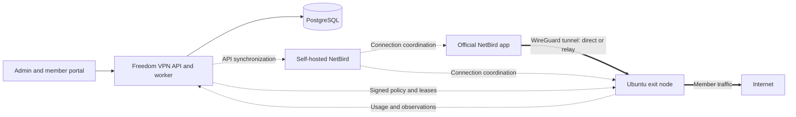

# Freedom VPN

**English** · [繁體中文](README.zh-TW.md)

[Project website](https://ted-h-com.github.io/Freedom-VPN/en/) · [專案網站](https://ted-h-com.github.io/Freedom-VPN/) · [Delivery guide](docs/DELIVERY.en.md)

**Your nodes. Your VPN service.**

Freedom VPN is an open-source platform for teams building a membership-based VPN
on their own infrastructure. It brings subscriptions, devices, usage and Ubuntu
exit nodes across locations into one place, using self-hosted NetBird and its
official apps for VPN connections.

- **Members** review subscriptions, manage devices and track usage in the portal,
  then connect through the official NetBird app.
- **Administrators** manage membership and decide which exits are available to
  each member group.
- **Operators** enroll and maintain nodes through shared deployment, update and
  recovery workflows.

NetBird provides the overlay network and connection coordination. Freedom VPN adds
the membership, accounting, policy and node management around it.

## What it does

| Area | Capabilities |
|---|---|
| Membership and devices | Connect subscriptions to service access, manage device allowances, suspend members and revoke devices |
| Exits across locations | Enroll Ubuntu nodes, assign member groups, check readiness and choose when to publish or disable exits |
| Usage and fair use | View usage across a member's devices and exits, with configurable fair-use speed adjustments |
| Exit isolation | Apply Internet-only forwarding rules at the node to separate member traffic from the host, private networks and other members |
| DNS and domain policies | Manage domain block and allow lists and malicious-domain protection through the service's DNS resolvers |
| Updates and recovery | Assign target releases, track signed updates and health checks, and recover from update failures with rollback and restore guides |

## Connect with the official app

For a configured service, your operator supplies the member portal and NetBird
management URLs. The portal manages your account; the app handles the VPN connection.

1. **Sign in to the member portal.** Confirm active service access, your device
   allowance and the exits available to you.
2. **Set up NetBird.** Install the official app version listed in the
   [member guide](docs/handover/member-guide.md), set its **Management URL** to your
   operator's address, and sign in with the same identity used in the portal.
3. **Check device authorization.** Return to the portal's device list and wait for
   the device to show **authorized**. Authorization is automatic when identity,
   membership and device allowance checks pass; contact the operator if it stays pending.
4. **Choose an exit.** Manually select an available exit in NetBird to send traffic
   through it. Use the portal to review usage and fair-use status.

See the [member guide](docs/handover/member-guide.md) for platform-specific setup
and DNS settings, and the [version matrix](docs/netbird/VERSIONS.md) for app versions.

## How it fits together



The control plane manages identity, configuration and accounting; ordinary member
traffic travels through the selected exit. Each exit runs the node agent and
updater, with nftables and traffic control for enforcement. The
[product specification](docs/spec/PROJECT_SPEC.zh-TW.md) (Traditional Chinese)
describes the full architecture.

## Start here

| Task | Guide |
|---|---|
| Explore the service and its current scope | [Delivery guide](docs/DELIVERY.en.md) · [交付導覽](docs/DELIVERY.md) |
| Run the isolated development stack | [Dev-stack bring-up and teardown](docs/e2e/README.md#bring-up) |
| Prepare a deployment | [Deployment](docs/handover/deploy.md) and [configuration calibration](docs/handover/calibration.md) |
| Operate members and nodes | [Operator guide](docs/handover/operator-guide.md) |
| Connect a member device | [Member guide](docs/handover/member-guide.md) (Traditional Chinese and English) |
| Back up and recover | [Restore drill](docs/handover/restore-drill.md) |
| Develop against the API | [API contracts](docs/contracts/README.md) |

## Project status and support

Freedom VPN is under development and validation; it is **not a production-ready
release**. Windows, macOS, Android and iOS apps still need real-device validation.
Linux lab results and arm64 cross-compilation do not establish platform or hardware
support. Production identity/MFA, payment, domains/TLS, DNS lists and operating
parameters also need configuration and verification. The
[delivery guide](docs/DELIVERY.en.md) records the remaining work.

Server-side isolation covers traffic passing through an exit; it does not provide
an OS kill switch or control a member device's local Wi-Fi/LAN. If the VPN route is
lost, the device may use its ordinary Internet connection. DNS protection applies
domain policies without TLS interception. See the
[member guide](docs/handover/member-guide.md) for connection and DNS limitations.

## Development lab

Review the [lab setup](docs/e2e/README.md) and [runtime prerequisites and assigned
port slots](docs/e2e/RUN.md) before starting. From the repository root, the documented
bring-up, acceptance and cleanup sequence is:

```sh
make -f mk/e2e.mk e2e-up
make -f mk/e2e.mk e2e-test
make -f mk/e2e.mk e2e-down
```

The Docker lab uses test identities, payment fixtures and policy settings, and
includes privileged node containers. Run teardown even when validation fails.

## Repository map

The central API, worker and node services use Go; the portal uses TypeScript,
React and Vite. Central state is in PostgreSQL; nodes keep durable local state
in SQLite. The node target is Ubuntu 24.04 LTS on amd64 and arm64.

| Location | Responsibility |
|---|---|
| `apps/control`, `apps/worker` | Central API and background work |
| `apps/portal` | Administrator and member interface |
| `internal`, `pkg` | Domain services and shared libraries |
| `node/agent`, `node/updater` | Node enforcement, accounting and updates |
| `contracts`, `db/migrations` | API definitions and persistent data |
| `deploy`, `packaging`, `tests` | Deployment, release tooling and verification |
| `docs` | Specifications, component guides, runbooks and evidence |

## Contributing

Read the [product specification](docs/spec/PROJECT_SPEC.zh-TW.md),
[engineering contract](AGENTS.md) and [API documentation](docs/contracts/README.md)
before changing behavior. Keep code, contracts and documentation aligned, run the
checks relevant to the change, and describe how the result was verified.

## Project history

The [delivery guide](docs/DELIVERY.en.md) and [roadmap](docs/ROADMAP.md) describe
current implementation and verification limits. [Findings and decisions](docs/handover/README.md)
and [acceptance records](docs/e2e/README.md) retain the engineering history.

<details>
<summary>Recorded engineering checkpoints</summary>

**Latest archived checkpoint:** [follow-up 50](docs/handover/follow-up-50.md), #486–#518 and #520–#523 at fe9bb436.
**Previous archived checkpoint:** [follow-up 49](docs/handover/follow-up-49.md), #482–#485 at aaffdc7f.

</details>

## License

Apache License 2.0; see [LICENSE](LICENSE). Third-party components, including
NetBird, retain their own licenses, recorded in the [version matrix](docs/netbird/VERSIONS.md).
