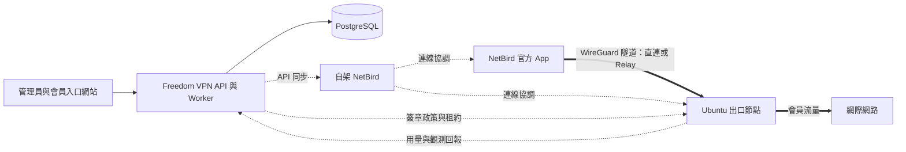

# Freedom VPN

[English](README.md) · **繁體中文**

[專案網站](https://ted-h-com.github.io/Freedom-VPN/) · [Project website](https://ted-h-com.github.io/Freedom-VPN/en/) · [交付導覽](docs/DELIVERY.md)

**以自己的節點，管理會員 VPN。**

Freedom VPN 是供團隊在自有基礎設施上建立會員制 VPN 的開源平台，集中管理訂閱、
裝置、用量與不同地點的 Ubuntu 出口節點，採用自架 NetBird 與官方 App 提供 VPN 連線。

- **會員**在入口網站查看訂閱、管理裝置與掌握用量，再透過 NetBird 官方 App 連線。
- **管理員**管理會員資格，決定各會員群組可使用哪些出口。
- **維運者**依同一套部署、更新與復原流程，註冊及維護節點。

NetBird 提供覆疊網路與連線協調；Freedom VPN 在此基礎上加入會員、帳務、政策
與節點管理。

## 提供哪些功能

| 領域 | 功能 |
|---|---|
| 會員與裝置 | 將訂閱與服務資格串接，管理裝置額度、會員停權與裝置撤銷 |
| 各地出口 | 註冊 Ubuntu 節點、指定會員群組、檢查就緒狀態，並決定出口上架或停用 |
| 用量與公平使用 | 彙總同一會員跨裝置、跨出口的用量，搭配可設定的公平使用調速政策 |
| 出口隔離 | 在節點套用 Internet-only 轉送規則，將會員流量與宿主、內網及其他會員分開 |
| DNS 與網域政策 | 經由服務的 DNS 解析器，管理網域封鎖、允許清單與惡意網域防護 |
| 更新與復原 | 指定目標版本、追蹤簽章更新與健康檢查，並依版本回退及還原指南處理更新失敗 |

## 使用官方 App 連線

服務設定完成後，營運人員會提供會員入口與 NetBird 管理伺服器網址。
入口網站管理帳號，App 負責 VPN 連線。

1. **登入會員入口。** 確認有效的服務資格、裝置額度與可使用的出口。
2. **設定 NetBird。** 依[會員指南](docs/handover/member-guide.md)安裝指定版本的官方
   App，將 **Management URL（管理伺服器網址）** 設為營運人員提供的位址，並使用
   與會員入口相同的身分登入。
3. **確認裝置授權。** 回到入口網站的裝置清單，等待狀態顯示為 **authorized（已授權）**。
   身分、會員資格與裝置額度檢查通過後，系統會自動授權；若持續待處理，請聯絡營運人員。
4. **選擇出口。** 在 NetBird 手動選擇可使用的出口，讓流量經由該節點轉送。
   回到會員入口即可查看用量與公平使用狀態。

各平台安裝及 DNS 設定詳見[會員指南](docs/handover/member-guide.md)；
App 版本列於[版本表](docs/netbird/VERSIONS.md)（英文）。

## 架構如何運作



控制平台管理身分、設定與帳務；一般會員流量經由選定的出口轉送。每個出口執行
Node Agent 與 Updater，並透過 nftables 和流量控制執行政策。
[產品規格](docs/spec/PROJECT_SPEC.zh-TW.md) 說明完整架構。

## 從哪裡開始

| 目的 | 文件入口 |
|---|---|
| 認識服務與目前範圍 | [交付導覽](docs/DELIVERY.md) · [Delivery guide](docs/DELIVERY.en.md) |
| 啟動隔離開發環境 | [開發環境啟停程序](docs/e2e/README.md#bring-up)（英文） |
| 準備部署 | [部署指南](docs/handover/deploy.md)與[參數校準表](docs/handover/calibration.md)（英文） |
| 管理會員與節點 | [營運指南](docs/handover/operator-guide.md)（英文） |
| 連線會員裝置 | [會員指南](docs/handover/member-guide.md)（繁體中文與英文） |
| 備份與故障復原 | [還原演練](docs/handover/restore-drill.md)（英文） |
| 串接或開發 API | [API 契約](docs/contracts/README.md)（英文） |

## 專案狀態與支援範圍

Freedom VPN 仍在開發與驗證中，**尚未達到正式營運條件**。
Windows、macOS、Android 與 iOS App 仍待真機驗收；Linux 實驗結果與 arm64
交叉編譯不能代表平台或硬體支援已驗證。正式身分服務／MFA、付款、網域／TLS、
DNS 清單與營運參數也需設定及驗證。待完成項目詳見[交付導覽](docs/DELIVERY.md)。

伺服器端隔離管理經出口轉送的流量，不提供會員裝置的 OS kill switch，也不控制
裝置本身的 Wi-Fi／LAN；VPN 路由中斷時，裝置可能改走原有的網際網路連線。
DNS 防護採用網域政策，不進行 TLS 中間人解密。連線與 DNS 限制詳見
[會員指南](docs/handover/member-guide.md)。

## 開發實驗環境

執行前先閱讀[實驗環境說明](docs/e2e/README.md)及[執行條件與連接埠分配](docs/e2e/RUN.md)
（英文）。在儲存庫根目錄，依文件執行啟動、驗收與清理：

```sh
make -f mk/e2e.mk e2e-up
make -f mk/e2e.mk e2e-test
make -f mk/e2e.mk e2e-down
```

Docker 實驗環境使用測試身分、付款替身與政策設定，並包含具有特權的節點容器。
即使驗證失敗，也應執行清理。

## 儲存庫導覽

中央 API、Worker 與節點服務使用 Go；入口網站使用 TypeScript、React 和 Vite。
中央狀態存於 PostgreSQL，節點以 SQLite 保存本機持久狀態。節點目標環境為
Ubuntu 24.04 LTS 的 amd64 與 arm64。

| 路徑 | 職責 |
|---|---|
| `apps/control`、`apps/worker` | 中央 API 與背景工作 |
| `apps/portal` | 管理員與會員介面 |
| `internal`、`pkg` | 領域服務與共用函式庫 |
| `node/agent`、`node/updater` | 節點政策執行、計量與更新 |
| `contracts`、`db/migrations` | API 定義與資料庫結構 |
| `deploy`、`packaging`、`tests` | 部署、發行工具與驗證 |
| `docs` | 規格、元件指南、維運文件與證據 |

## 參與開發

變更行為前，請先閱讀[產品規格](docs/spec/PROJECT_SPEC.zh-TW.md)、
[工程規範](AGENTS.md)與 [API 文件](docs/contracts/README.md)（後兩者為英文）。
程式、契約與文件應同步更新，執行與變更相關的檢查，並說明結果如何驗證。

## 專案歷史

[交付導覽](docs/DELIVERY.md)與[開發路線](docs/ROADMAP.md)說明目前實作及驗證界線。
[問題與決策紀錄](docs/handover/README.md)及[驗收紀錄](docs/e2e/README.md)
保留詳細工程歷史（英文）。

<details>
<summary>工程交付紀錄</summary>

**最近封存的交付切點：**[follow-up 51](docs/handover/follow-up-51.md)，#524–#526，版本 66de6a24。
**前次封存的交付切點：**[follow-up 50](docs/handover/follow-up-50.md)，#486–#518 與 #520–#523，版本 fe9bb436。

</details>

## 授權

本專案採用 Apache License 2.0，詳見 [LICENSE](LICENSE)。NetBird 等第三方元件
各自保留原有授權，主要元件資訊列於[版本表](docs/netbird/VERSIONS.md)（英文）。
