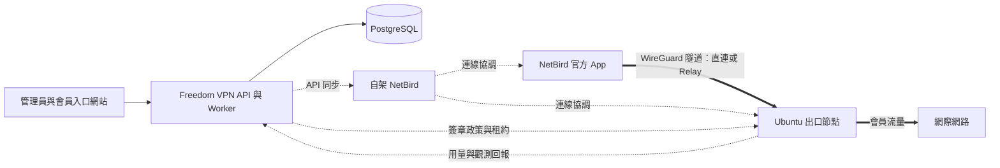

# Freedom VPN

[English](README.md) · **繁體中文**

[專案網站](https://ted-h-com.github.io/Freedom-VPN/) · [Project website](https://ted-h-com.github.io/Freedom-VPN/en/) · [交付導覽](docs/DELIVERY.md)

**自架 VPN 的會員、用量與出口節點管理平台。**

Freedom VPN 以單一控制平台管理跨地區的會員與 Ubuntu 出口節點，供開發會員制 VPN
服務的營運團隊使用，並提供管理員後台與會員自助入口網站。

NetBird 提供覆疊網路與官方客戶端 App；Freedom VPN 透過上游 API 和 CLI，加入
會員資格與訂閱整合、用量計量、政策執行，以及節點生命週期管理。

**目前仍是開發與驗證版本，尚未達到正式營運條件。**
[交付導覽](docs/DELIVERY.md) 分列現有實作、已取得的驗證與待完成的部署條件。
Windows、macOS、Android 和 iOS 官方 App 仍待真機驗收；Linux 實驗環境的結果
不能代表這些平台的相容性已驗證。

## 提供哪些功能

| 領域 | 現有實作 |
|---|---|
| 會員與存取 | 會員入口、管理員後台、訂閱整合、裝置授權與撤權 |
| 出口節點 | 節點註冊、就緒檢查與上架，並透過 NetBird 官方 App 手動選擇出口 |
| 用量與政策 | 跨裝置、跨出口用量彙總，公平使用調速，伺服器端 Internet-only 隔離與 DNS／網域政策 |
| 維運 | 節點簽章更新、健康檢查、復原與版本回退，以及部署和還原演練文件 |

隔離範圍是會員經出口節點的 VPN 路徑，不提供會員裝置的 OS kill switch，也不管理
裝置本身的 Wi-Fi／LAN。DNS 防護採用網域政策，不進行 TLS 中間人解密。
尚未完成的驗收與硬體實測項目詳列於交付導覽。

## 架構如何運作



控制平台管理身分、設定與帳務；一般會員流量經由選定的出口轉送。每個出口執行
Node Agent 與 Updater，並透過 nftables 和流量控制執行政策。
[版本表](docs/netbird/VERSIONS.md)（英文）列出固定元件與候選客戶端版本；
[產品規格](docs/spec/PROJECT_SPEC.zh-TW.md) 定義完整架構與責任界線。

## 從哪裡開始

| 目的 | 文件入口 |
|---|---|
| 了解交付內容與限制 | [交付導覽](docs/DELIVERY.md) · [Delivery guide](docs/DELIVERY.en.md) |
| 啟動隔離開發環境 | [開發環境啟停程序](docs/e2e/README.md#bring-up)（英文） |
| 準備部署 | [部署指南](docs/handover/deploy.md)與[參數校準表](docs/handover/calibration.md)（英文） |
| 管理會員與節點 | [營運指南](docs/handover/operator-guide.md)（英文） |
| 連線會員裝置 | [會員指南](docs/handover/member-guide.md)（繁體中文與英文） |
| 備份與故障復原 | [還原演練](docs/handover/restore-drill.md)（英文） |
| 串接或開發 API | [API 契約](docs/contracts/README.md)（英文） |

### 開發實驗環境

執行前先閱讀[實驗環境說明](docs/e2e/README.md)及[執行條件與連接埠分配](docs/e2e/RUN.md)
（英文）。在儲存庫根目錄，依文件執行啟動、驗收與清理：

```sh
make -f mk/e2e.mk e2e-up
make -f mk/e2e.mk e2e-test
make -f mk/e2e.mk e2e-down
```

Docker 實驗環境使用測試身分、付款替身與政策設定，並包含具有特權的節點容器。
即使驗證失敗，也應執行清理。正式 IdP／MFA、付款供應商、網域／TLS、DNS 清單
及營運參數，仍需另行設定與驗證。

## 儲存庫導覽

中央 API、Worker 與節點服務使用 Go；入口網站使用 TypeScript、React 和 Vite。
中央狀態存於 PostgreSQL，節點以 SQLite 保存本機持久狀態。節點目標環境為
Ubuntu 24.04 LTS 的 amd64 與 arm64；交叉編譯不能替代硬體實測。

| 路徑 | 職責 |
|---|---|
| `apps/control`、`apps/worker` | 中央 API 與背景工作 |
| `apps/portal` | 管理員與會員介面 |
| `internal`、`pkg` | 領域服務與共用函式庫 |
| `node/agent`、`node/updater` | 節點政策執行、計量與更新 |
| `contracts`、`db/migrations` | API 定義與資料庫結構 |
| `deploy`、`packaging`、`tests` | 部署、發行工具與驗證 |
| `docs` | 規格、元件指南、維運文件與證據 |

## 參與開發

變更行為前，請先閱讀[產品規格](docs/spec/PROJECT_SPEC.zh-TW.md)、
[工程規範](AGENTS.md)與 [API 文件](docs/contracts/README.md)（後兩者為英文）。
程式、契約與文件應同步更新，執行與變更相關的檢查，並區分已觀測結果、規劃項目
與未實測行為。可選的進階診斷及架構調整留待後續工作；交付導覽說明已保留的擴充入口。

## 驗證紀錄與歷史

**目前交付切點：**[follow-up 49](docs/handover/follow-up-49.md)，#482–#485，版本 aaffdc7f。
**前次交付切點：**[follow-up 48](docs/handover/follow-up-48.md)，#478–#481，版本 b921c75f。
[問題與決策紀錄](docs/handover/README.md)、[驗收紀錄](docs/e2e/README.md)及
[開發路線](docs/ROADMAP.md)保留詳細工程歷史（英文）。

## 授權

本專案採用 Apache License 2.0，詳見 [LICENSE](LICENSE)。NetBird 等第三方元件
各自保留原有授權，主要元件資訊列於[版本表](docs/netbird/VERSIONS.md)（英文）。
