# PostgreSQL contract

PostgreSQL 17 is authoritative for entitlements, intent, usage receipts and
operations ([Spec §15](../spec/PROJECT_SPEC.zh-TW.md#15-資料模型索引與一致性)).
This package implements storage and transaction primitives, not HTTP handlers,
policy compilers, payment adapters, projection workers or external read-back.
The schema is forward-only and has no production seed members, subscriptions,
keys, prices or releases. The fleet initially denies service until a supported
release policy is explicitly configured.

## Running

Use Go 1.27.3, `GOTOOLCHAIN=local`, `CGO_ENABLED=0`. Supply connection strings
through the environment/secret manager; never commit them or pass them as CLI
arguments. `FVPN_DATABASE_URL` is the migration/development database;
`FVPN_TEST_DATABASE_URL` is an admin connection used only to create isolated
`fvpn_t<unix-seconds hex>_<random>` databases. Neither tool prints a DSN.

```sh
make go-verify
make db-test
make db-lint
make -f mk/go.mk go-test
make -f mk/db.mk db-test
go run ./internal/db/cmd/fvpn-migrate up
go run ./internal/db/cmd/fvpn-migrate status
```

`dbtest.New(t)` creates, migrates and cleans up a database in `t.Cleanup`, even
when a test fails. `dbtest.NewUnmigrated(t)` provides the same lifecycle for
concurrent bootstrap tests. **CLI tests must use `dbtest` isolated DSNs**:
`dbtest.NewUnmigratedWithDSN(t)` returns the pool and a subprocess-safe URL.
The helper parses the admin URL, replaces only its database path, preserves all
query parameters and rejects any database override that escapes isolation.
Supply a `postgres://` or `postgresql://` URL, not a keyword/value DSN.
Never mutate a pgx config and call `ConnString()` to reconstruct a DSN: that
method retains the original URL. The CLI prints a quoted `current_database`
line for both `up` and `status`; the CLI regression checks that identity, the
isolated migration versions, and the absence of public tables (including
`goose_db_version`) in the admin database before and after running it.

With `FVPN_TEST_DB_SWEEP=1` (set by `make -f mk/db.mk db-test`), the first
`dbtest.New` in a process drops idle databases named
`fvpn_t<unix-seconds hex>_<32 hex>` whose encoded creation time is strictly
older than one hour. The drop is `DROP DATABASE … WITH (FORCE)` only after
`pg_stat_activity` shows zero connections in that same statement batch; a
database that still has a connection is skipped. Idle legacy names
`fvpn_<32 hex>` are dropped only when `FVPN_TEST_DB_SWEEP_LEGACY=1`. The sweep
never drops the admin database, template databases, or any name outside those
two patterns. Run it by hand with `make -f mk/db.mk db-test-sweep` (one-hour
threshold; the legacy switch stays off unless you export it).

With the test variable unset, tagged tests skip with
a clear prerequisite message; ordinary `go test ./...` never opens a database.
Tests never create roles, modify the shared admin database, or start containers.
Make targets put TMPDIR/GOTMPDIR in a unique disk directory under `.agent/tmp/`
and remove it on exit; they do not depend on the host `/tmp` mount type.
For direct Go test commands, set these variables to a unique disk directory and
remove it when finished. No pytest or tmpfs fixtures are used.
Privilege tests use `SET LOCAL ROLE pg_read_all_data` and grants permissions
only on their own disposable databases; they skip if the test admin is not superuser.

Optional local development:

```sh
docker compose -f deploy/dev/postgres/compose.yaml config --quiet
make db-up
# Set FVPN_DATABASE_URL to the local development database using its TEST ONLY credentials.
make db-migrate
make db-down
```

Compose binds only `127.0.0.1:${FVPN_POSTGRES_PORT:-55433}`. Its password is
explicitly TEST ONLY. `db-down` preserves the named development volume; deleting
that volume is an explicit local reset, not part of normal shutdown. The shared
integration server does not need this Compose stack.

Root aggregates include every `mk/*.mk` before consuming the target lists. Both
make fragments work alone. `go-build` discovers all main packages separately for
linux/amd64 and linux/arm64; an empty set succeeds. `go-tidy-check` uses
`go mod tidy -diff` and does not mutate files. Staticcheck is pinned to
[v0.8.2](https://github.com/dominikh/go-tools/releases/tag/v0.8.2).

## Common invariants

These rules apply to every application table unless a narrower rule follows.
Spec references include line numbers in the v1.0 source for review convenience;
section numbers remain authoritative if that document is reformatted.

| Contract | Database implementation | Spec |
|---|---|---|
| Stable internal identity | UUID primary keys, UUID foreign keys; identity triggers prevent rebinding members, devices, incarnations and external identities. Central helpers generate v7; SQL fallback uses PostgreSQL's random UUID. | §2 L104–106; §15.1 L1596 |
| External identity scope | Provider, deployment and OIDC client scope are explicit text columns; email is neither unique nor a join key. | §15.1 L1596; §15.2 L1615–1616 |
| Central and device time | All stored timestamps, including goose's `tstamp`, are TIMESTAMPTZ. Pools use UTC. `received_at` defaults to database time and is separate from `observed_at`. `updated_at` triggers use database time. | §15.1 L1598 |
| Exact integers | Every unsigned byte/count/sequence/generation/revision/resource-version field uses NUMERIC(20,0), explicit 0..18446744073709551615 checks. Event sequences additionally start at 1. Go helpers use decimal strings. | §10.5; §15.1 L1600 |
| Aggregates and corrections | Rollup directions are nonnegative NUMERIC(40,0), total is generated NUMERIC(41,0). Adjustments are signed NUMERIC(40,0), never negative original samples. | §10.7; §15.1 L1600; §15.4 L1657 |
| Money | Nonnegative amount_minor BIGINT (0..9223372036854775807), uppercase three-letter currency. Type identifies refunds/corrections; amounts are not floating-point or signed deltas. | §15.1 L1600 |
| Versions | Conditional UPDATE increments resource_version, conflicting/missing row returns ErrVersionConflict; triggers require resource_version to strictly increase on every UPDATE, and reject regressions in node/fleet generations and entitlement/NetBird binding revisions. | §14.5; §15.1 L1602 |
| Typed JSON | JSONB has an explicit positive schema_version (manifest_schema_version for releases); object shape is checked. Identity, status, expiry and uniqueness fields are relational. Callers validate the actual versioned schema before insertion. | §15.1 L1604 |
| Time intervals | Service, grace, grants, entitlement, binding, assignment, sample and rollup intervals check start < end. Finite expiries reject infinity/-infinity and are NOT NULL where required. No invented maximum grant/certificate business lifetime. | §15.1 L1606 |
| Historical references | No FK uses ON DELETE CASCADE. Members, nodes and devices reject DELETE/TRUNCATE even without dependents. Close/revoke/retire and later anonymize identifying fields. | §5.2; §15.1 L1608; §16.4 |
| Hashes | SHA-256 references have 32-byte checks; Ed25519 release signatures have 64-byte checks. Caller performs canonicalization/signature verification, not PostgreSQL. | §10.5; §13.3 |
| Append-only | audit_events, billing_records, usage_adjustments, usage_events, usage_samples, projection_receipts and raw usage payloads reject UPDATE, DELETE and TRUNCATE. Purge exceptions are restricted below. | §15.2; §15.4 |

Goose's own `goose_db_version` is infrastructure metadata, not a domain entity:
it retains goose's numeric primary key and version numbering. Its timestamp is
normalized to TIMESTAMPTZ in migration 00001. All domain primary keys are UUID.
Database checks cannot determine that a JSON object was actually redacted or
that a network observation is authentic. Those remain mandatory caller checks;
never forward raw database errors to an HTTP response.

## Table-to-spec and constraint mapping

`U(...)` denotes a named business unique constraint/index. FKs are restrictive
and preserve the associated stable entity. Composite FKs prevent cross-member,
cross-node, cross-definition and cross-job mismatches. Their supporting unique
keys (`*_member_key`, `*_node_key`, `*_plan_key`, `*_type_key`,
`*_definition_key`, `*_execution_key`) are structural keys on the same UUID and
scope, not additional identities. See the common rules above for all repeated
numeric/hash/JSON checks.

| Table | Constraints, indexes and recovery semantics | Spec source |
|---|---|---|
| members | Status allowlist; status index; canonical identity FK includes member ID; version monotonic; stable ID; no deletion. Email can change and is not unique. | §15.2 L1614 |
| identity_bindings | `identity_bindings_subject_key`: U(issuer,client_scope,subject); stable identity fields; verified claim, method and time required. Composite (id,member_id) supports canonical/user mapping FKs. | §2; §15.2 L1615 |
| netbird_user_bindings | `netbird_user_bindings_external_key`: U(deployment_id,external_user_id); composite identity-binding/member FK; required mapping proof, revision and verified_at; identity fields cannot be reassigned. | §15.2 L1616 |
| plans | U(code); active_revision_id must belong to this plan; version cannot regress. | §15.2 L1617 |
| plan_revisions | `plan_revisions_revision_key`: U(plan_id,revision); device_limit >= 0; provider/price are both present or absent; FUP policy FK; immutable complete row, including exit_group_ids. Referenced exit groups must be checked by the compiler. | §15.2 L1617 |
| subscriptions | `subscriptions_external_key`: U(provider,external_subscription_id); partial `subscriptions_primary_active_key`: U(member_id) WHERE is_primary AND is_active; plan FK/index; provider status is opaque, active flag is controller-computed; paid/grace endpoints occur in pairs and are finite; grace reason required. paid_through, cancellation and grace are separate facts. Subscription identity/member/provider/customer cannot be rebound; billing_records_subscription_member_fk binds invoices to the same member. | §9.2–3; §15.2 L1618 |
| billing_records | `billing_records_external_key`: U(provider,record_type,external_reference); member/subscription/inbox FKs; money checks; finite service interval; append-only. External reference represents an invoice, refund or correction according to type. | §15.2 L1619 |
| entitlement_grants | Member FK; immutable grant evidence; finite interval; nonblank reason and creator; revocation requires a reason. Trial/grace/manual source remains explicit. | §9.2; §15.2 L1620 |
| entitlements | U(member_id); plan FK/index; nonnegative device limit; paired nullable service interval for pending_payment after 00120, otherwise finite valid_from..effective_service_end; revision cannot regress. Source UUIDs are polymorphic references validated by the calculator; no lease expiry here. | §15.2 L1621, L1626 |
| member_devices | `member_devices_peer_key`: U(deployment_id,peer_id); (member_id,status) index; allowed statuses; device/member relationship and peer identity immutable; versioned; no deletion. | §9.4; §15.2 L1622 |
| device_bindings | `device_bindings_revision_key`: U(device_id,binding_revision); device/member composite FK; host-address masks only; valid interval; `device_bindings_no_overlap` GiST exclusion on scope, inet IP and `[valid_from,valid_until)`; historical identity immutable; valid_until may close a mapping only without excluding committed usage. Samples lock the binding against concurrent shortening. | §2; §15.2 L1623 |
| member_groups | U(code), U(name). | §15.2 L1624 |
| assignments | Exactly one of member_id/plan_revision_id; group FK; valid interval; separate partial exclusion constraints prevent overlapping member/group and plan-revision/group assignments. Adjacent intervals are allowed. | §15.2 L1624 |
| nodes | Lifecycle/provisioning allowlists; current incarnation composite FK ensures same node; separate desired/applied config and current/desired/last_good release references; monotonic generations/version; immutable ID; no deletion. | §5; §15.3 L1634 |
| node_incarnations | `node_incarnations_active_key`: partial U(node_id) WHERE revoked_at IS NULL; U(public_key_fingerprint), `node_incarnations_peer_key`: U(deployment_id,peer_id); peer fields both absent/present; architecture allowlist; immutable node/key identity; deployment/peer pair binds once from NULL, then cannot change or clear; revocation stays irreversible. | §15.3 L1635 |
| node_enrollments | U(token_hash); finite created_at..expiry; state allowlist; consumed requires key and timestamp. Token/node/expiry identity cannot change; non-null public key, consumption and revocation timestamps cannot be rewritten. Request ID is a tracing reference. | §15.3 L1636; §15.5.1 |
| node_certificates | `node_certificates_serial_key`: U(issuer,serial); incarnation FK; finite not_before..not_after; only public certificate bytes and metadata, never a private key. Controlled overlapping renewals are allowed. | §15.3 L1637 |
| exits | U(node_id); intent and observed allowlists; sole authoritative publication_intent; independent resource version. | §5.2; §15.3 L1638 |
| exit_groups | `exit_groups_membership_key`: U(exit_id,group_id); exit/member-group FKs. | §15.3 L1638 |
| policy_definitions | `policy_definitions_code_key`: U(type,code); active revision must belong to this definition; versioned. | §15.3 L1639 |
| policy_revisions | `policy_revisions_revision_key`: U(definition_id,revision); type matches definition via composite FK; immutable entire row, including payload/hash/signing key. Compiler validates type-specific schema and never relaxes isolation baseline. | §15.3 L1640 |
| desired_states | `desired_states_generation_key`: U(node_id,incarnation_id,generation); incarnation belongs to node; immutable history; node desired generation cannot regress. Generation is the spec's config_generation (the uniqueness column is named generation). | §15.3 L1641 |
| node_observations | `node_observations_report_key`: U(node_id,incarnation_id,report_id); node/received_at index; separate received/observed clocks; control/data/safety allowlists; positive schema; required checks/hash; immutable observation evidence. | §15.3 L1642 |
| serving_leases | Node/incarnation composite FK; finite interval; immutable signed deadlines/hash/key; configured maximum duration enforced at issuance, default 86400 seconds; locks require a registered node and its current unrevoked incarnation. snapshot_xid seals signed membership. | §15.3 L1643; §16.3 |
| serving_lease_members | `serving_lease_members_member_key`: U(lease_id,member_id); finite interval; immutable; issuance must share the lease creation transaction, locks member and entitlement, matches revision, rejects inactive members, suspended entitlement and deadlines outside node/entitlement boundaries. | §15.3 L1643; §16.3 |
| external_bindings | `external_bindings_internal_key`: U(resource_type,resource_id,provider,deployment_id); `external_bindings_external_key`: U(provider,deployment_id,external_id). Resource reference is polymorphic; callers verify its type. | §14.5; §15.3 L1644 |
| usage_events | `usage_events_stream_key`: U(node_id,incarnation_id,event_seq); event_seq > 0; node/incarnation FK; record_count >= 0; durable payload hash/received time/quality; append-only; deferred commit check requires all record_count samples or a raw payload. Neither meter epoch nor ledger epoch belongs to the dedupe key. | §10.6; §15.4 L1652 |
| usage_event_payloads | U(event_id), receipt FK; optional bytea raw body and central created_at; append-only except authorized retention deletion; unpartitioned in v1. | §15.4 L1673; §16.4 |
| usage_samples | `usage_samples_record_key`: U(event_id,record_index); member/device and device/binding composite FKs; sample must fit historical binding validity; index in envelope record_count; finite observation interval; unsigned directions/elapsed time; immutable meter epoch and quality; append-only. | §10.5–9; §15.4 L1653 |
| projection_receipts | `projection_receipts_projection_key`: U(sample_id,projection_name,generation,period); sample FK; append-only; insert and aggregate increment must share transaction. One receipt per split period. | §15.4 L1654, L1671 |
| usage_checkpoints | `usage_checkpoints_stream_key`: U(node_id,incarnation_id); node/incarnation FK; highest_contiguous_seq <= max_seen_seq; advancing ACK requires every intervening receipt; max_seen must equal durable max and ACK + 1 must be absent; same ledger_epoch cannot regress either watermark. New verified recovery epoch may lower ACK after checking receipts. | §10.6, §10.8; §15.4 L1655; §17.3 |
| usage_rollups | `usage_rollups_period_key`: U(member_id,period,granularity,projection_generation); optional event-checkpoint FK; exact directions/generated total; finite period; metering_version, observation/projector times, estimated/gap/reconciliation flags. | §10.9; §15.4 L1656 |
| usage_adjustments | Member/event FK or finite source interval required; signed exact directions; nonempty reason and actor; append-only corrections preserve original receipt. | §15.4 L1657 |
| releases | U(version); immutable complete manifest/hash/signature/component versions/sequence/key reference. | §13.3; §15.4 L1658 |
| artifacts | `artifacts_platform_key`: U(release_id,platform,arch); architecture allowlist; immutable digest, size, installed size and storage reference; caller validates storage allowlist/manifest. | §13.3; §15.4 L1658 |
| fleet_config | Fixed UUID ending 0001 and no deletion; desired release FK separate from supported policy/allowlist/minimum component version; default deny_all; minimum policy requires component and version; monotonic generation/version; positive configurable max_offline_lease_seconds. | §13.2; §15.4 L1659 |
| update_batches | U(operation_id); release FK; scope = all_nodes; nonnegative target_count; immutable complete snapshot metadata. Eligible nodes are locked for snapshot creation; deferred count/membership validation requires all non-revoked/non-retired nodes and their current incarnations. snapshot_xid seals membership to the creation transaction. | §13.8; §15.4 L1660 |
| update_targets | `update_targets_node_key`: U(batch_id,node_id); both incarnation FKs scoped to node; snapshot fields immutable; execution incarnation can bind once. If snapshot incarnation exists, execution must match it. No later additions to a sealed batch. target_state starts active and may become cancelled_revoked or cancelled_retired, including for a target with no incarnation; cancellation cannot be undone. | §15.4 L1661 |
| update_jobs | `update_jobs_attempt_key`: U(target_id,attempt); U(result_id); positive attempt; target/incarnation/generation composite FK; forward state graph including superseded_incarnation, cancelled_revoked and cancelled_retired; no deletion; terminal/result evidence frozen; chronology checks; result ID/hash appear together and cannot be replaced; successful actual release must equal batch target with nonempty evidence and completion time. | §13.8; §15.4 L1662 |
| operations | Status allowlist and transition trigger; completion cannot precede creation; success requires completion time and evidence for every required step; at least one step is required; optional steps either not_required with reason or succeeded with evidence. Inserts start pending/running; succeeded/superseded rows are frozen and all operations reject deletion. JSON schema described below. | §14.5; §15.4 L1663 |
| inbox_events | `inbox_events_external_key`: U(source,external_event_id); bytea encrypted_payload; processing-status allowlist; nonnegative attempt; source/event/hash/encrypted body are immutable; caller verifies signature/encrypts before committing durable inbox. | §9.3; §15.4 L1664 |
| outbox_events | Aggregate/version/event type; positive schema/object payload; nonnegative attempt; partial pending available_at/id index; owner/token/expiry all absent or all present; finite lease; claims fenced by token and expiry. | §14.5; §15.4 L1665 |
| idempotency_requests | `idempotency_requests_scope_key`: U(principal,method,route,key_hash); hash sizes; state allowlist; HTTP status range; finite expiry after creation; every committed state requires a replay reference and status via a deferred trigger; expiry index. No response-body or plaintext-key column. | §14.5; §15.4 L1666 |
| audit_events | Object diffs with positive schema; optional operation FK; resource/time and actor/time indexes; append-only and database occurred_at default. | §15.4 L1667 |
| retention_config | Fixed UUID ending 0002; positive configurable raw_usage_days=35, rollup_months=13, service_log_days=7, audit_days=180. The singleton cannot be deleted. Financial retention has no invented default or enabled purge path. | §16.4 |

The corresponding business uniqueness tests check SQLSTATE 23505 and the actual
constraint name. Interval exclusions report 23P01. Guard/immutability violations
report 23514, and FK mismatches 23503. Schema tests include catalog-wide checks
for primary keys, spec comments, integer checks, timestamp types, floating-point
absence and absence of cascading FKs.

## Transaction boundaries and helpers

`Open(ctx, dsn, OpenOptions{})` defaults to ten connections, 5s connect/lock
limits, 30s statement/idle-transaction limits, UTC sessions, a one-hour connection
lifetime with jitter, and a five-minute idle lifetime. All limits are configurable.
Long migrations should use the CLI's longer limits or an explicitly configured
pool. Never log connection strings or raw connection diagnostics.

`InTx` defaults to read committed, at most four attempts, full jitter starting at
10ms and capped at 250ms. Only SQLSTATE 40001 and 40P01 retry, including failures
at commit. Unique violations, timeouts, cancellation and ambiguous connection
failures do not retry. Panic is propagated after rollback with an independent
cleanup context. Allocate business IDs outside the closure when retry identity
must be stable. Do not capture irreversible local/network effects in the closure.

| Spec boundary | Transaction recipe |
|---|---|
| §15.5.1 Enrollment | `InTx`: SELECT enrollment FOR UPDATE; check expiry, revocation and key; create/read incarnation; store consumption binding, operation, audit and outbox. On replay, read existing public identity; never reconstruct the enrollment secret. |
| §15.5.2 Device quota | `InTx`: SELECT member FOR UPDATE, then SELECT entitlement FOR SHARE; validate active member, finite current entitlement, suspension and quota; authorize device, increment version, append audit and policy outbox. The member_devices_authorization trigger repeats these locks/checks even if a caller omitted the recipe. |
| §15.5.3 Entitlement | `InTx`: SELECT member FOR UPDATE, then SELECT entitlement FOR UPDATE (if present); write trusted billing/manual evidence; lock/update subscription/grant and entitlement revision; `EnqueueOutbox` and `AppendAudit`. Payment facts never clear admin suspension or overwrite grant/grace deadlines. |
| §15.5.4 Usage | Authenticate node, validate schema/hash/binding; `InTx`: insert receipt/event/samples (or durable event for later projection), enqueue projection work and advance checkpoint under stream row lock. Commit before ACK. Same unique key requires comparing stored hash, never overwriting it. |
| §15.5.5 Publication | `BeginIdempotent` + `UpdateWithVersion` on exits + operation + `EnqueueOutbox` + `AppendAudit` + `CompleteIdempotent` inside one `InTx`. Worker claims after commit, performs external calls and read-back, then records evidence in a later transaction. |
| §15.5.6 Fleet update | `InTx`: lock fixed fleet row/check expected generation; increment generation/version and change desired_release_id; create operation and batch (the batch trigger takes SHARE on nodes), then query eligible nodes and create all target rows and applicable jobs; append audit/outbox; complete idempotency. Batch and targets must share transaction, including nodes without an incarnation. Later results update their own matching job. |

Both §15.5.2 and §15.5.3 lock the member first, then the entitlement, before
any dependent domain rows. When touching several members, sort by UUID and use
the same order. Direct entitlement updates also conflict with the authorization
trigger's entitlement share lock. Use READ COMMITTED (the InTx default) or
SERIALIZABLE with retries; a fixed REPEATABLE READ snapshot is not a substitute
for these fresh eligibility/count reads. Revocation services still withdraw
existing permissions and write audit/outbox in the transaction.

`UpdateWithVersion` binds values and quotes trusted table/column identifiers. It
increments resource_version and returns decimal text, or ErrVersionConflict if
the row/version does not match. It does not implement HTTP 428/412, authorization
or allowed fields; the HTTP/domain layer must enforce those before calling it.
`MapError` maps missing rows and exposes unique constraint names through
`ConstraintError` and `errors.Is(err, ErrUniqueViolation)`. API handlers must use
their own safe error envelope; `errors.As` can still find the internal pgconn error.

`AppendAudit` accepts nonblank actor/type/action/resource/result and already-redacted object diffs with SchemaVersion >= 1.
`EnqueueOutbox` requires a nonzero aggregate UUID, nonblank aggregate/event types and already-validated object payloads. The audit table and
outbox transaction test proves that aborting the domain change aborts both rows.
`ClaimOutbox` atomically uses FOR UPDATE SKIP LOCKED and returns worker, token,
expiry and attempt, ordered by (available_at, id). `CompleteOutbox` and `RetryOutbox` require the same unexpired
token; retry stores caller-selected backoff (0..24h) in available_at. A worker can
still execute an external effect and crash before completion: delivery is at
least once. Use external domain IDs and read-back to avoid duplicate effects.

`BeginIdempotent` uses principal/method/normalized route/key hash and the caller's
canonical validated request hash. Zero TTL means seven days; supply an explicit
TTL for a different configured policy. The winner returns New=true, losers
return the stored reference/status, and a different hash returns
ErrIdempotencyConflict. Reserve, create the local resource/operation and
`CompleteIdempotent` before committing. A committed in-progress record with an
operation/resource reference and response status is also replayable; a retry must
never run the action again. A deferred constraint rejects an orphan reservation
at commit. CompleteIdempotent may fill absent fields but cannot replace any
already-recorded reference/type/status, including while in_progress. The fallback
read rechecks expiry using database time and retries the upsert if it expired.
Expired rows are atomically reused with a new UUID so old completions are fenced.
No stored plaintext response is available: enrollment replay must return
secret_available=false. Domain uniqueness continues after idempotency expiry.

Operation transitions are pending → running/failed/superseded; running →
succeeded/partially_succeeded/failed/superseded; failed/partially_succeeded →
running for an explicit retry. INSERT accepts only pending/running. Succeeded
and superseded are terminal: their entire rows are frozen. DELETE/TRUNCATE is
forbidden for all operations. Success requires at least one required step and
evidence for every required step. An optional step may either succeed with an
observed_ref or be not_required with a nonblank reason.
Required evidence is shaped as follows (values are TEST ONLY examples):

```json
{
  "schema_version": 1,
  "steps": {
    "route": {"required": true, "status": "succeeded", "observed_ref": "route_readback"},
    "optional": {"required": false, "status": "not_required", "reason": "not applicable"}
  },
  "observed_refs": {"route_readback": {"external_id": "test-route", "verified": true}}
}
```

Database shape checks cannot authenticate this observation. Only the worker with
real read-back evidence may store it. An update job's late result is historical
and must not overwrite a newer node generation or current-release observation.
Jobs may move forward through queued/waiting_online → downloading → verifying →
applying → checking; queued and waiting_online may exchange while scheduling.
Progress reports may skip phases. An active job may finish succeeded/failed or
be cancelled/superseded_incarnation; superseded is allowed only before applying,
and rolled_back only from applying/checking. queued/waiting_online may instead
finish already_current when the node already reports the target release and no
download is needed; the service verifies that observation. already_current is
also allowed at INSERT and is terminal. Later progress phases cannot enter it.
Terminal state or a recorded result
freezes state, actual/last-good release, completed_at, error, schema version and
observed_evidence. Result ID/hash cannot change once set. last_result_at and
last_observed_at may advance; retries of an identical result remain valid.

Historical subscriptions, grants, certificates, observations, inbox events,
exits, bindings and incarnations cannot be deleted/truncated. Non-null revoked_at,
closed_at and retired_at (and grant revocation_reason) cannot be cleared or
rewritten. Certificate renewal and grant correction create new evidence rows.

## Invariants service code must respect

1. Every UPDATE of members, plans, subscriptions, member_devices, nodes, exits, policy_definitions or fleet_config must strictly increase resource_version, even a metadata/no-op update. NetBird user binding revisions may not decrease.
2. Usage receipt INSERT cannot commit a nonzero record_count without all samples or a raw usage_event_payloads row in the same transaction. Incomplete-event/checkpoint commits now fail. Checkpoint writes require exact max_seen and highest contiguous values even on a new epoch; checkpoint DELETE/TRUNCATE is rejected.
3. All committed idempotency rows require response_status and resource_id or operation_id. BeginIdempotent alone can no longer commit. CompleteIdempotent cannot overwrite any previously set resource/type/operation/status, including in_progress rows.
4. New all_nodes batches must include every eligible node, exclude revoked/retired nodes and copy current_incarnation_id exactly (including NULL). Create the batch before querying nodes; its trigger acquires a SHARE lock on nodes until commit. Snapshot membership remains same-transaction only.
5. New serving leases require a registered node, its current unrevoked incarnation, and the configured duration cap. Insert serving_lease_members in the lease creation transaction; members must be active with matching, unsuspended entitlement and bounded deadlines. Existing-lease later additions are rejected.
6. Authorized device INSERT/UPDATE now locks/rechecks member and entitlement, current validity, suspension, quota and device tombstones. Prepare an active member and current entitlement before authorization, and use member→entitlement lock order.
7. INSERT operations with status=succeeded/failed/partially_succeeded/superseded is rejected for normal writers. Start pending/running, then transition. Success requires at least one required step; optional succeeded steps need evidence. Succeeded/superseded operations cannot change; all operations reject DELETE/TRUNCATE.
8. Jobs cannot regress through phases or edit terminal/result evidence. Retry a failed attempt as a new attempt, not by resetting the same job. Store any additional late result evidence without rewriting a frozen terminal result. DELETE/TRUNCATE is rejected. already_current is a terminal no-download outcome, allowed from queued/waiting_online or at INSERT only.
9. Use target_state to cancel a target without an execution incarnation. Cancelled targets cannot return active or acquire/change execution binding. Both job cancellation states are accepted.
10. usage_rollups DELETE/TRUNCATE is rejected outside authorized retention. Raw payload purge no longer removes mixed-generation, reconciling or gap-covered events. Projection UPDATE still works.
11. Device/assignment intervals reject infinities; device binding end cannot exclude an already-committed usage sample. Sample writes and endpoint shortening serialize on the binding.
12. Billing subscription references must belong to the billing member. Subscription member/provider/external subscription/customer identity, certificate contents, grant source/interval/reason/creator, webhook source/body/hash and node observation evidence are immutable.
13. Non-null revocation/closure/retirement timestamps and grant revocation reason cannot be cleared or changed. Historical subscriptions, grants, certificates, observations, inbox events, exits, bindings and incarnations reject DELETE/TRUNCATE. retention_config cannot be removed.
14. Outbox enqueue rejects zero aggregate UUID or blank aggregate/event types; audit append requires nonblank actor/type/action/resource/result. Grants require nonblank reason/creator/revocation reason; grace periods require nonblank reason. Claims are returned ordered by availability and ID.
15. Logical restore and future immutable backfills require their distinct owner-plus-SET LOCAL exemptions. The ordinary application role cannot activate them. Coordinate singleton and cyclic-pointer staging for data-only restore.

## Migrations and compatibility

SQL files are five-digit goose migrations embedded by `db/migrations`.
The normal policy is forward-only. D-035 explicitly adds
`00006_purge_retained_audit_format.sql` with a Down that restores the previous
function body; this is a narrow rollback exception, not permission to reverse
domain data migrations. Migrations 00001–00005 were corrected
in place for F-01–F-16 and the CLI/retention audit follow-up while all databases are disposable development/test
instances. **Migrations become append-only the moment the orchestrator announces
the first deployed environment.** After that point, append a new migration;
never edit deployed history. The goose Provider has instance-local
configuration, so no mutable global dialect/filesystem settings race. Its
[session locker](https://pressly.github.io/goose/documentation/provider/) uses a
fixed database advisory lock shared by Migrate and MigrationStatus. Empty,
repeat and concurrent first-use migration tests exercise this path.

Only `00004` previously defined `purge_retained`; no later domain migration
replaces it. `00006` is therefore the last definition on a fresh migration run.
For a database already beyond version 6, the ordinary CLI rejects an unapplied
lower version. The controlled upgrade must explicitly apply version 6 with the
goose provider's `ApplyVersion(ctx, 6, true)` before resuming ordinary `up`.
Use the schema owner and the same migration session locker; do not downgrade
domain migrations or enable out-of-order migration execution globally.
`TestReviewD035_PurgeAuditMigrationRoundTrip` exercises that upgrade after all
existing domain migrations, checks owner/ACL/security settings, restores the
exact prior body with `ApplyVersion(ctx, 6, false)`, and reapplies Up. Down
restores the old incompatible audit encoding; neither direction rewrites
existing append-only audit rows.

Follow §15.5 expand/contract: add compatible fields and indexes, deploy code that
can coexist with old agents, backfill, validate, then separately contract. Never
couple destructive schema changes to a fleet update. Back up schema version with
DB/WAL. plan_revisions.exit_group_ids is defined in 00001, before immutable
triggers are installed. Future reviewed backfills can use the owner-only pattern
below; ordinary writers cannot edit immutable evidence.

```sql
BEGIN;
SET LOCAL fvpn.migration = 'on';
-- Run as the schema/function owner; backfill only the reviewed new fields.
-- UPDATE plan_revisions SET ...;
INSERT INTO audit_events(actor,actor_type,action,resource,result)
VALUES (session_user,'migration','schema.backfill','plan_revisions','succeeded');
COMMIT;
```

The migration exemption applies only to UPDATE in immutable_row() and
immutable_fields(). It does not permit DELETE/TRUNCATE, bypass FKs, CHECKs,
version increments, append-only ledgers or irreversible revocation timestamps.
Include the actual migration ID, scope and redacted change evidence in the audit
for a real backfill. The schema owner already has DDL authority; runtime services
must never use that identity.

### Restore of historical snapshots

Physical DB/WAL restore preserves transaction history and does not fire INSERT
triggers. Logical data restore into a migrated schema replays historical
snapshot_xid values. With workers stopped, run the restore as the schema/function
owner in a transaction with `SET LOCAL fvpn.restore = 'on'`. For a custom-format
dump, generate SQL with `pg_restore --data-only --file=restore-data.sql`, and
execute the reviewed dependency-ordered data in that same transaction with
`ON_ERROR_STOP`. Do not pass database credentials in command arguments. Keep all
rows of each batch together until the deferred snapshot-count check runs.

The exemption lets batch targets retain historical incarnations/lifecycle
membership and lease members retain historical eligibility/deadlines rather than
being judged against today's nodes and entitlements. It bypasses the persisted
transaction seals and issuance checks in guard_snapshot_insert(),
check_snapshot_count() (current eligible population only), check_node_lease()
and check_member_lease(). Terminal operations can be inserted during restore.
The actual batch target_count must still match restored targets; FKs, finite
interval checks and append-only protections remain enabled. Both the owner
identity and GUC are required; setting the GUC as an ordinary role has no effect.

Restore into an isolated database. For data-only restore, exclude goose metadata
and merge the two already-seeded singleton rows via UPDATE (increment fleet
resource_version); handle cyclic active pointers using a staged dependency order.
This exemption is not a general FK/trigger disable switch. For a full logical
restore, PostgreSQL's pre-data/data/post-data ordering installs constraints and
triggers after data; validate all historical invariants before allowing writes.
Do not rewrite snapshot_xid to the restore transaction or broaden an old batch.
After COMMIT the GUC expires. Recompute checkpoints under a new authorized
ledger_epoch and perform the §17.3 reconciliation described below.

## Roles, grants and retention

Provision roles outside these migrations: cluster-wide roles are deliberately
not created by migration or integration code. Suggested separation:

| Role | Intended privileges |
|---|---|
| fvpn_migrator | Own schema/tables/functions; extensions, DDL and migrations. Not a runtime application identity. Keep credentials separate. |
| fvpn_control | CONNECT/USAGE; SELECT required domain data; INSERT/UPDATE mutable membership/intent/operation/idempotency rows; INSERT audit/outbox. No DDL, DELETE/TRUNCATE on historical data, or ownership. |
| fvpn_worker | SELECT work/domain data; INSERT receipts/billing/audit/outbox/observations; UPDATE only mutable projection, job, outbox and operation fields needed by each worker. No UPDATE/DELETE on immutable/append-only rows. |
| fvpn_retention | CONNECT/USAGE and EXECUTE on purge_retained only; no direct table mutation, no schema ownership, no membership in the owner role. |
| fvpn_recovery | Separately controlled recovery identity; may change ledger_epoch after signed recovery authorization. Not available to normal workers. |
| fvpn_backup | Read/replication privileges needed by the selected encrypted base-backup/WAL tooling; no application mutation. |

These are intended roles, not migration-created roles. Apply grants per table and
column when deploying domain services. Illustrative snippets (after separately
provisioning identities):

```sql
REVOKE CREATE ON SCHEMA public FROM PUBLIC;
GRANT USAGE ON SCHEMA public TO fvpn_control, fvpn_worker, fvpn_retention;
GRANT INSERT ON audit_events, outbox_events TO fvpn_control;
GRANT SELECT, UPDATE ON outbox_events TO fvpn_worker;
GRANT SELECT, INSERT ON usage_events, usage_samples, projection_receipts TO fvpn_worker;
GRANT UPDATE (highest_contiguous_seq, max_seen_seq, prefix_proof, updated_at)
  ON usage_checkpoints TO fvpn_worker;
GRANT UPDATE (ledger_epoch) ON usage_checkpoints TO fvpn_recovery;
GRANT EXECUTE ON FUNCTION purge_retained(TEXT,TIMESTAMPTZ,TEXT) TO fvpn_retention;
```

Do not grant broad UPDATE on usage_checkpoints to normal workers: a new epoch is
an authorized recovery action. INSERT of a new checkpoint also requires the
current authorized epoch from the recovery/control service. Do not run runtime
services as the table/function owner: PostgreSQL owners/superusers can alter
triggers and are outside this privilege boundary.

`purge_retained(target, cutoff, reason)` is SECURITY DEFINER with a fixed trusted
search_path. EXECUTE is revoked from PUBLIC. It allows only audit_events,
usage_event_payloads and usage_rollups, checks a finite cutoff against the
configured minimum age, deletes eligible rows and appends an audit event with
system actor, typed resource, target, configuration snapshot, cutoff, count and
reason **in the same transaction**. After D-035 (`00006`), `actor_type` is
`system` and `actor` is the nil UUID `00000000-0000-0000-0000-000000000000`.
The reader returns that UUID as the system actor ID. `resource` is the canonical
`<api.ResourceType>:<uuid>` string
`fleet_config:00000000-0000-0000-0000-000000000001`; the current contract has no
`retention_config` resource type. The action/result are `retention.purge` and
`succeeded`. `after_diff` carries `table`, decimal-string `fleet_generation`
and `deleted_rows`, the full `retention_config` snapshot (including its UUID),
`cutoff`, redacted `reason` and `schema_version`. Fleet generation is context,
not a retention-policy or projection generation; retention_config has no
generation column. `audit.Store.List` splits the canonical resource string and
exposes the diffs as `changes.before`/`changes.after`. D-035 changes only actor
and resource encoding; retention eligibility, locking, counts, diffs, SECURITY
DEFINER/search_path and existing EXECUTE grants remain unchanged.
A rollback undoes both. The local `fvpn.retention_purge` setting is a trigger
signal, not authorization: the trigger also checks the executing role against
the function owner. Only the SECURITY DEFINER purge function enables this flag
and restores its previous value before returning. Do not set it manually.
An ordinary role cannot bypass append-only protection by setting this GUC. The integration test verifies that and the PUBLIC denial.

The retention job must use a redacted reason, keep its own execution identity,
and preflight projection completion. Raw payload purge additionally requires the
envelope's full record count and projection receipts whose matching rollup
periods cover each sample's entire interval within one projection name,
generation and granularity shared by **every sample of the event**, with the same
metering_version and neither gap nor reconciliation_in_progress on the covering
rollups. A receipt for only
one side of a month boundary, or partial receipts mixed across generations,
cannot authorize deletion. The worker still verifies allocation correctness and
the active projection before invoking the purge. Receipts,
samples, checkpoints and adjustments remain. Billing purges are disabled until
legal retention is approved; they never inherit the 35-day raw-usage value.
Audit rows themselves can expire at 180 days, with a new retained purge audit.
Rollups may expire after 13 months while source receipts/watermarks remain.
Direct rollup DELETE/TRUNCATE is blocked; projection UPDATE remains allowed.
Service-log retention (seven days) is consumed by deployment log tooling, not a
PostgreSQL log collector. No DNS query history, destination list or packet body
belongs in these tables.

Raw retention defaults to 35 days; audit to 180; rollups to 13 months. These are
configurable positive values in retention_config. No automated scheduler runs
as a side effect of migration. Close accounts and revoke devices first; clear
email/display_name and other personal metadata according to the approved policy,
retaining anonymous stable links. Reapply deletion/anonymization policies after
restoring backups (§16.4).

## Usage projection, partitioning and recovery

Keep usage_events as an unpartitioned minimal uniqueness/receipt table. Raw
payloads already live separately; a future migration can partition only
usage_event_payloads by receipt time with a pointer to the durable event UUID.
There must still be exactly one authoritative receipt/hash per
(node_id,incarnation_id,event_seq) across all raw partitions. Never replace this
with monthly unique indexes. Moving an event to a different month cannot admit
it as a new event. Partition migrations must preserve the receipt before moving
or deleting raw rows, and the initial v1 has no partitions.

The projector inserts (sample,projection_name,generation,period) with ON CONFLICT
DO NOTHING and increments that generation's rollup only if the insertion won,
in the same InTx. The integration test proves rollback and duplicate attempts
do not double-add and totals above uint64 remain exact. Period splitting belongs
to one authoritative projector; late events retain observation periods, and
cross-month integer allocations must preserve the original total (§10.9).

Allocate a new projection_generation for a changed metering contract or rebuild;
never mix metering_version values within one generation. Write fresh rollups,
validate against the ledger, then switch the caller's active-generation pointer.
Do not insert new-generation receipts and add to old-generation rollups. The
spec's rollup key omits metering_version; this generation-scoping rule resolves
that ambiguity without silently changing its mandated key.

Within one ledger_epoch, checkpoints cannot regress. A checkpoint advance checks
the newly acknowledged interval against the receipt index and requires the next
sequence to be missing and max_seen_seq to equal the durable maximum; an
authorized new epoch recomputes from the beginning. Checkpoints cannot be deleted
or truncated. At commit every newly inserted event must have its complete sample
count or a raw payload, so a receipt alone cannot authorize unrecoverable ACKs. No compacted receipt prefixes are
accepted by this v1 trigger. prefix_proof is reserved metadata, not a bypass.
Before deleting/compacting receipts in a future release, add a verified-prefix
protocol, atomic proof installation and explicit replay-too-old handling; keep
receipts indefinitely until that exists. Raw purge cannot delete them.

Recovery follows §17.2–4: pause ledger/entitlement workers, restore DB/WAL and
schema, validate revoked identities/keys, create a signed recovery record and
new ledger_epoch with the protected recovery identity, derive contiguous ACK and
missing ranges from actual receipts, request original events from node replay
archives, and reconcile projection generations. Mark affected rollups
reconciliation_in_progress. Missing evidence beyond the replay window becomes an
explicit gap, never fabricated bytes or a replacement monthly total.

Then reconcile trusted payment periods, manual suspensions/grants, publication
intent, external IDs, node incarnation/current release and update journals.
Never downgrade solely because the backup was older, and never restore a revoked
node's service identity just to retrieve historical usage. Resume workers after
verification. Nightly base backups plus continuous WAL, target RPO 15 minutes and
RTO four hours are planning defaults from §17.2; this database test suite does
**not** establish measured recovery objectives, real-device behavior or the
72-hour node replay guarantee. Keep separate encrypted backups for signing/CA
material, immutable artifacts, configuration and deletion policies.

## Review fixes

Each finding has an integration regression named TestReviewF01 through
TestReviewF16. The tests use isolated databases and cover the rejected proof and
valid writes. Privilege probes use a built-in role without creating cluster roles.

| Finding | Enforced by |
|---|---|
| F-01 cancellation | update_jobs_state_check; update_targets_target_state_check; update_targets_snapshot / guard_update_target() |
| F-02 rollup deletion and audit | usage_rollups_delete_guard; usage_rollups_no_truncate; purge_retained(); audit rows validate against the OpenAPI AuditEvent schema |
| F-03 complete projection before purge | purge_retained(): one projection name/generation/granularity across all records, excluding reconciliation and gap; typed audit evidence for zero-row and successful purges |
| F-04 recoverable exact ACK | usage_checkpoints_keep; usage_checkpoints_receipts; deferred usage_events_contents |
| F-05 device quota/suspension | member_devices_authorization / check_device_authorization(); shared member→entitlement lock recipes |
| F-06 stable idempotency | CompleteIdempotent field matching; BeginIdempotent expiry recheck; deferred idempotency_requests_reference |
| F-07 complete/restorable snapshot | update_batches_lock; update_targets_insert; update_batches_count; owner_setting('fvpn.restore') |
| F-08 migration backfill | immutable_row() and immutable_fields() UPDATE exemption via owner_setting('fvpn.migration'); exit_group_ids in 00001 |
| F-09 update history | update_jobs_keep; update_jobs_identity / guard_job_identity() |
| F-10 operation evidence | operations_evidence / guard_operation(); operations_keep |
| F-11 lease eligibility/seal | serving_leases_maximum / check_node_lease(); serving_lease_members_deadline / check_member_lease(); serving_leases.snapshot_xid |
| F-12 historical intervals | finite interval CHECKs on device_bindings/assignments; device_bindings_end / guard_binding_end(); usage_samples_binding |
| F-13 identity/tombstones | billing_records_subscription_member_fk; subscriptions_member_key; *_identity, *_keep, *_revoked, members_closed, member_devices_revoked and nodes_retired triggers |
| F-14 versions | *_version / monotonic_fields(); netbird_user_bindings_revision |
| F-15 primitive inputs/order | ClaimOutbox ordered SELECT; EnqueueOutbox/AppendAudit validation; nonblank CHECKs on grants and subscription grace |
| F-16 one-time incarnation binding | base 00005 node_incarnations_binding / guard_incarnation_binding(); existing pair CHECK, node_incarnations_peer_key and node_incarnations_revoked remain |

The CLI isolation follow-up is covered by `Test15_5_MigrateCLI` and
`dbtest.Test15_5_IsolatedDSN`. The admin URL is never serialized from a config
whose Database field was mutated. All dbtest pool creation now starts with the
isolated URL, so later serialization also stays isolated.

The retention audit follow-up uses the closest supported singleton resource,
`fleet_config`, as detailed above. D-035 supersedes the original JSON resource
and session-user actor encoding with the audit reader's canonical format.
F-02/F-03 now read actual purge rows through `audit.Store.List`, assert zero
anomalies, and validate the returned contract and preserved evidence.
`TestReviewD035_PurgeAuditMigrationRoundTrip` also covers audit-row purges,
reader resource/actor filters, an invalid cutoff, and migration Up/Down/Up.

F-16 changes the guard in base migration `00005`; no later/domain migration is
changed. Enrollment may insert an unbound incarnation, then the NetBird worker
sets `deployment_id` and `peer_id` together after external read-back (§6.2,
§7.2). Identical retries are harmless; clearing either ID, changing either ID or
reusing the pair on another incarnation fails. Another deployment may use the
same peer ID. A late first binding on a revoked incarnation may record external
evidence but cannot change its revocation timestamp or restore eligibility.
The dedicated binding guard has no migration/restore UPDATE bypass; historical
restore may INSERT the original binding (§17.2). Core identity fields retain
their existing reviewed migration exemption.

The three administrative flags have separate scopes: fvpn.retention_purge is
managed inside purge_retained, fvpn.restore permits historical INSERT replay,
and fvpn.migration permits reviewed immutable-field backfills. All require the
schema/function owner as well as the transaction-local flag; none authorizes a
runtime application to weaken a constraint.

### Accepted domain relaxations (D-033)

These accepted extensions stay in their owning domain migrations. They are not
moved into `00001`–`00005` and do not remove the base protections listed below.

- **Pending service interval — `00120_members_billing.sql` (F-11; §9.2,
  §15.2).** A `pending_payment` member has no service interval yet; manufacturing
  a deadline would imply unsupported eligibility. The migration drops NOT NULL
  on `entitlements.valid_from` and `effective_service_end` and adds
  `entitlements_nullable_interval`, which requires both dates absent or both
  present. The base finite/increasing interval CHECK still applies when dates
  are present. `billing_check_service_interval`, installed as
  `zz_billing_device_interval` and `zz_billing_lease_interval`, explicitly rejects
  authorization/lease membership when either date is missing or the member is
  manually suspended. It takes the member lock before the entitlement lock.
  Base device quota, member status, time bounds, tombstones, lease revision and
  deadline checks, current unrevoked node incarnation, and transaction seals
  remain. The existing owner-only `fvpn.restore` exception permits historical
  replay; it does not grant ordinary runtime eligibility.
- **First-sync snapshot — `00160_fleet_updates.sql` (F-07; §13.1, §13.8,
  §15.4).** A new or reinstalled node needs its own sealed first-sync batch,
  distinct from an earlier admin fleet snapshot. The migration drops and
  replaces `update_batches_scope_check` with `all_nodes|first_sync`, and drops
  and recreates `update_batches_count` with `WHEN (NEW.scope='all_nodes')`.
  The original `check_snapshot_count()` still validates all-node batches.
  `update_batches_first_sync_check` restricts first-sync batches to a named
  node, exactly one target, `reason='first_sync'`, and the reserved system
  creator; all-node batches must have no first-sync node. The deferred
  `update_batches_first_sync_count` / `check_first_sync_snapshot()` requires
  exactly that eligible, non-revoked/non-retired node and its current bound
  execution incarnation. Base SHARE locks, same-transaction snapshot insertion,
  immutable target identity, composite FKs, one-time execution binding and
  target uniqueness remain. The public create API remains `all_nodes`; a
  first-sync batch never enlarges an existing batch's denominator.

Existing domain evidence includes
`TestENT01_PendingProjectionCannotReceiveServingLease` and
`TestAT24_FirstSyncSnapshotGuards`; the base F-07/F-11 regressions remain part
of `make db-test` (the database entry in the root verify aggregate).

## Entity relationships

```mermaid
erDiagram
    members ||--o{ identity_bindings : authenticates
    identity_bindings ||--o{ netbird_user_bindings : verifies
    members ||--o{ subscriptions : pays
    plans ||--o{ plan_revisions : versions
    plan_revisions ||--o{ subscriptions : fixes_plan
    subscriptions ||--o{ billing_records : accounts
    inbox_events ||--o{ billing_records : sources
    members ||--o{ entitlement_grants : receives
    members ||--o| entitlements : projects
    members ||--o{ member_devices : authorizes
    member_devices ||--o{ device_bindings : maps_over_time
    members ||--o{ assignments : joins
    plan_revisions ||--o{ assignments : assigns
    member_groups ||--o{ assignments : includes
    nodes ||--o{ node_incarnations : installs
    nodes ||--o{ node_enrollments : enrolls
    node_incarnations ||--o{ node_certificates : certifies
    nodes ||--o| exits : publishes
    exits ||--o{ exit_groups : permits
    member_groups ||--o{ exit_groups : accesses
    policy_definitions ||--o{ policy_revisions : versions
    node_incarnations ||--o{ desired_states : receives
    node_incarnations ||--o{ node_observations : reports
    node_incarnations ||--o{ serving_leases : leases
    serving_leases ||--o{ serving_lease_members : bounds
    members ||--o{ serving_lease_members : authorizes
    node_incarnations ||--o{ usage_events : emits
    usage_events ||--o| usage_event_payloads : retains_raw
    usage_events ||--o{ usage_samples : contains
    device_bindings ||--o{ usage_samples : attributes
    usage_samples ||--o{ projection_receipts : projects_once
    node_incarnations ||--o| usage_checkpoints : acknowledges
    members ||--o{ usage_rollups : aggregates
    members ||--o{ usage_adjustments : corrects
    releases ||--o{ artifacts : packages
    releases ||--o| fleet_config : targets
    releases ||--o{ update_batches : deploys
    operations ||--o| update_batches : requests
    update_batches ||--o{ update_targets : snapshots
    nodes ||--o{ update_targets : participates
    update_targets ||--o{ update_jobs : attempts
    operations ||--o{ audit_events : records
    operations ||--o{ idempotency_requests : replays
```



external_bindings and outbox_events have typed polymorphic resource references;
retention_config is a singleton policy. They deliberately do not pretend to have
FKs to every possible domain type.
