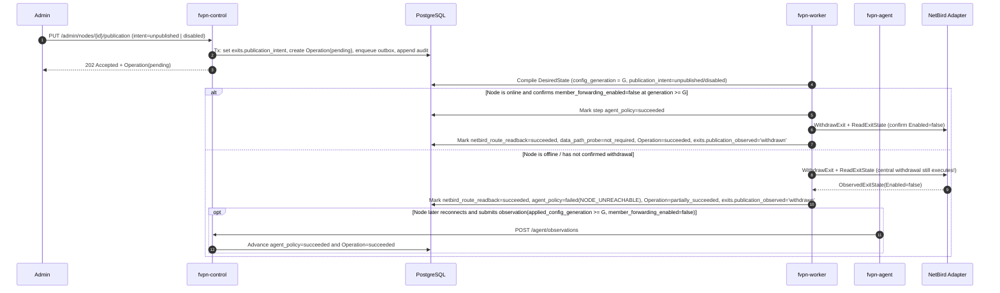

# Node Registry, Desired State, Serving Leases, and Exits

This document describes the central node management subsystem implemented in:

- `internal/nodes` — Node aggregate views (`ListNodes`, `GetNode`, `ListMemberExits`), state transition tables (`CanTransitionLifecycle`, `CanTransitionProvisioning`, `CheckPublishable`), versioned updates (`UpdateNode`), revocation (`RevokeNode`), tombstoned retirement (`RetireNode`), observation ingestion (`SubmitObservation`), and staleness sweeps (`SweepStaleNodes`).
- `internal/desiredstate` — Per-node desired-state compiler (`Compile`, `CompileTx`, `ReSign`, `GetDesiredState`, `RecompileBatch`), member rate policy delegation (`fup.BuildNodeMemberRatePolicy`), and outbox burst coalescing.
- `internal/exits` — Exit publication commands (`SetPublication`, `SetPublicationTx`), multi-step operation execution (`ExecuteOperation`), NetBird adapter integration with `external_bindings` idempotency, and NetBird read-back reconciliation (`ReconcileNetBird`).
- `internal/leases` — Serving lease calculation (`ComputeMemberLeaseEnd`, `Renew`), Ed25519 envelope signing (`lease` purpose), and replay-safe persistence (`serving_leases`, `serving_lease_members`).
- `internal/nodes/httpwire` — Admin fleet configuration (`GET`/`PUT /api/v1/admin/fleet-config`, D-065) and the HTTP adapters described in [WIRING.md](WIRING.md).

### Admin fleet configuration (D-065, §14.5, §16.3)

`GET /api/v1/admin/fleet-config` returns `max_offline_lease_seconds`, the read-only
`default_max_offline_lease_seconds` (86400), `resource_version`, `updated_at`, and
the strong ETag `"<resource_version>"`. `PUT` accepts the new maximum and a required
`reason`, using that ETag in `If-Match` and a UUID `Idempotency-Key`; it returns 200
after the local write and one `fleet_config.update` audit event commit together.
The event is visible through `GET /api/v1/admin/audit-events`, with before/after
maximums, the admin actor and reason, and null `operation_id`. Same-key replay
returns the original response and ETag, even after subsequent writes.

The value applies only to leases issued or renewed after the write. Already
issued leases and their replays keep their original value, expiry and signature.
60 seconds is a lab floor; 86400 seconds is the §16.3 ceiling. The portal must
warn below 900 seconds. Operators and harnesses use this API rather than writing
`fleet_config` directly. The command increments `resource_version` under the
singleton row lock shared with release updates, and never changes the fleet's
release generation or support policy. Missing `If-Match` returns 428; a stale
ETag returns 412 with `current_resource_version`; a reused key with different
content returns 409; the shared request validator rejects values outside
60..86400 with 422.

---

## 1. Node State Model (§5.1, §15.3, §18.1)

Every node maintains strictly separate **desired** and **observed** fields. A `202 Accepted` command or observation receipt never claims an external or node-side effect has completed until read-back evidence is recorded.

| Dimension | Values | Storage / Authority | Notes |
|---|---|---|---|
| `lifecycle_state` | `enrolling`, `registered`, `revoked`, `retired` | `nodes.lifecycle_state` | `retired` is a terminal tombstone (`DELETE` on `nodes` is forbidden by DB trigger). |
| `provisioning_state` | `pending`, `applying`, `ready`, `failed` | `nodes.provisioning_state` | Local node configuration readiness. |
| `publication_intent` | `unpublished`, `published`, `disabled` | `exits.publication_intent` | Authoritative copy lives **only** on `exits` (§15.3) and is joined into node views. |
| `publication_observed` | `absent`, `applying`, `active`, `withdrawn`, `error` | `exits.publication_observed` | Updated only after NetBird read-back and node observation evidence. |
| `control_status` | `online`, `stale`, `offline` | `nodes.control_status` | Derived from central `last_seen_at` (`received_at`). Default thresholds: heartbeat `30s`, stale `90s`, offline `180s`. |
| `safety_status` | `unknown`, `passed`, `failed`, `expired` | `nodes.safety_status` | Fail-closed: requires `internet_only=passed`, `meter_path=passed`, and `netbird.backend=kernel`. |
| `data_health` | `unknown`, `healthy`, `degraded`, `failed` | `nodes.data_health` | Data-plane probe health. |
| `config_generation` | `desired` vs `applied` (`decstr.U64`) | `nodes.desired_config_generation`, `nodes.applied_config_generation` | Monotonic per `(node_id, incarnation_id)`. |
| `releases` | `desired_release_id`, `current_release_id`, `last_good_release_id` | `nodes.*_release_id` | Desired release is separate from observed running release. |

### Allowed Lifecycle Transitions (`internal/nodes/transitions.go`)

- `enrolling -> registered | revoked | retired`
- `registered -> revoked | retired`
- `revoked -> registered | retired`
- `retired -> (none, terminal tombstone)`

### Composite Serving Condition (`ServingReadiness.IsServing`, §5.1)

A node is eligible to serve member traffic if and only if all of the following hold simultaneously:

1. `lifecycle_state == registered`
2. `provisioning_state == ready`
3. `publication_intent == published`
4. `control_status == online`
5. `safety_status == passed`
6. `data_health in (healthy, degraded)`
7. `applied_config_generation >= desired_config_generation` (and `> 0`)
8. `current_release_id` is in the active `serving_release_ids` set (not revoked and meeting `minimum_serving_version`).

Health recovery, heartbeat recovery, or software updates **never** automatically flip `publication_intent = disabled` back to `published` (`EXIT03`, §5.1).

---

## 2. Publish and Unpublish Sequence Diagrams (§5.2, AT08, AT13)

### 2.0 Publication Transaction Seam (`exits.Service.SetPublicationTx`)

All three publication intents (`published`, `unpublished`, `disabled`) share a single transactional implementation:

```go
func (s *Service) SetPublicationTx(ctx context.Context, tx pgx.Tx, p SetPublicationParams) (api.Operation, string, error)
```

- **Wrapper vs. Caller Transaction**: `exits.Service.SetPublication` opens a transaction (`db.InTx`), handles idempotency lookup/save when `IdempotencyKey` is non-empty, and delegates to `SetPublicationTx`. HTTP command handlers (`PUT /api/v1/admin/nodes/{node_id}/publication`) that manage their own transaction and idempotency record call `SetPublicationTx` directly so the idempotency row, `nodes`/`exits` state mutation, `operations` row, `outbox_events` row, and `audit_events` row commit atomically.
- **Lock Order and Concurrency**: Inside `SetPublicationTx`, rows are locked in strict `nodes -> exits` order (`SELECT true FROM nodes n WHERE n.id = $1 FOR UPDATE OF n` followed by `SELECT ... FROM nodes n JOIN exits e ON e.node_id = n.id WHERE n.id = $1 FOR UPDATE OF n, e`). `If-Match` is verified against `nodes.resource_version` under the lock (`428 PRECONDITION_REQUIRED` when missing, `412 RESOURCE_VERSION_CONFLICT` on mismatch).
- **Single-Pass Mutation**: For `published`, `nodes.CheckPublishable` requires lifecycle `registered` and provisioning `ready`, rejects safety `failed`/`expired` and data health `failed`, and checks any supplied serving-release allowlist. Command acceptance does not require online status or a new-generation ACK; execution requires those through `RequireOnlineAndACKForRun`. Unknown health/safety and degraded health are not rejected by the command gate itself. See [baseline readiness versus peer binding](WIRING.md#worker-jobs-and-read-back). On an accepted intent change, `SetPublicationTx` writes `exits.publication_intent` (setting `exits.publication_observed = 'applying'` when publishing from non-`active`), bumps `nodes.resource_version` and `exits.resource_version` by `+1`, advances `nodes.desired_config_generation` by `+1` exactly once, inserts the pending `api.Operation` (`node.publish`, `node.unpublish`, or `node.disable` with steps `agent_policy`, `netbird_route_readback`, `data_path_probe`), enqueues `node.publication_changed` (`desiredstate.EventNodePublicationChanged`) in `outbox_events`, and appends an `exit:<uuid>` audit event via `audit.NewEvent` + `audit.AppendEvent`.

### 2.1 Publish (`PUT /admin/nodes/{id}/publication` with `publication_intent=published`)

```mermaid
sequenceDiagram
    autonumber
    participant Admin
    participant Control as fvpn-control (exits.SetPublication / SetPublicationTx)
    participant DB as PostgreSQL
    participant Worker as fvpn-worker (exits.ExecuteOperation)
    participant Agent as fvpn-agent
    participant NB as NetBird Adapter

    Admin->>Control: PUT /admin/nodes/{id}/publication (If-Match, Idempotency-Key, intent=published)
    Control->>DB: Tx (SetPublicationTx): FOR UPDATE OF n then n, e; verify If-Match & CheckPublishable; bump nodes/exits resource_version & desired_config_generation (+1); set exits.publication_intent='published'; create Operation(pending: agent_policy, netbird_route_readback, data_path_probe); enqueue outbox; append audit
    Control-->>Admin: 202 Accepted + Operation(pending) + ETag

    Worker->>DB: Claim outbox & Compile new DesiredState (config_generation = G)
    alt Branch A (D-074): Node has not ACKed generation G or data-path gate is unconfirmed while retries remain
        Worker->>DB: Keep gated step (agent_policy or data_path_probe) pending with error_code=NODE_NOT_SERVICEABLE, message=member_forwarding_unconfirmed, reason=<cause>; keep Operation=running (error=null) and exits.publication_observed unchanged (or 'withdrawn' under r11 empty-exception)
        Note over Worker,DB: Exhaustion at attempt == worker_attempts (default 10, ~255.5s..511s backoff window) marks the gated step and Operation failed and sets exits.publication_observed='error' (unless confirmed 'withdrawn').
    else Branch B: Node ACKs generation G with safety_status=passed & forwarding=true
        Agent->>Control: POST /agent/observations (applied_config_generation >= G, safety_status=passed)
        Worker->>DB: Mark step agent_policy=succeeded (with observation evidence ref)
        Worker->>DB: Lookup external_bindings(resource_type='exit', resource_id=exit_id)
        Worker->>NB: PublishExit(ExistingRef from external_bindings)
        alt NetBird API error or read-back mismatch
            Worker->>DB: Record external_bindings(sync_state='error'), mark step netbird_route_readback=failed, Operation=failed, exits.publication_observed='error'
            Note over Worker,NB: Retry reuses external_bindings.external_id — never creates a duplicate route!
        else NetBird PublishExit + ReadExitState succeed
            NB-->>Worker: ObservedExitState(Exists=true, Enabled=true, GroupIDs match)
            Worker->>DB: Upsert external_bindings(sync_state='synced'), mark netbird_route_readback=succeeded, data_path_probe=succeeded, Operation=succeeded, exits.publication_observed='active'
        end
    end
```

### 2.2 Unpublish / Disable (`publication_intent=unpublished | disabled`, §5.2 step 4, AT13)

Unpublish and disable withdraw member forwarding on the node first (via a new desired-state generation), then withdraw the NetBird route. If the node is offline or unresponsive, the NetBird route and peer permissions are **still withdrawn centrally**, and the operation records `partially_succeeded` so operators see the unconfirmed node step (`§18.3`).



---

## 3. Desired-State Format and Compiler Rules (§11.2, §14.7)

- **Signing**: Canonicalized with RFC 8785 (`pkg/canonjson`) and signed with Ed25519 using purpose `desired-state` (`pkg/envelope`). The signed payload embeds the full policy content (`device_bindings`, `member_rate_policies`, `dns`, `node_capacity`, `policy_refs`), never just a URL (§14.7).
- **Effective Rate Math (§11.2 step 3)**:
  $$\text{effective\_rate} = \min(\text{plan\_rate}, \text{fair\_use\_tier\_rate}, \text{node\_member\_rate\_cap})$$
- **Immediate Revocation & Suspension Clamping**:
  - Revoked devices (`status <> 'authorized'` or `revoked_at IS NOT NULL`) are omitted immediately from `device_bindings`.
  - Suspended members (`admin_suspended = true`) have `valid_until` clamped to `<= issued_at` so the node cuts off forwarding immediately.
  - Only members entitled to at least one group in the exit's `member_group_ids` are included when `publication_intent == published`. When `publication_intent` is `unpublished` or `disabled`, `device_bindings` and `member_rate_policies` are empty `[]`.
- **ETag and `ReSign` (§14.7)**:
  - ETag is `"ds-<config_generation>-<envelope_sha256_prefix>"`.
  - Calling `ReSign` refreshes `issued_at`, `expires_at`, and `signatures` without changing `config_generation`, producing a new ETag so `GET /agent/desired-state` serves the refreshed envelope instead of `304 Not Modified`.
- **Outbox Coalescing (`RecompileBatch`)**:
  - Bursts of `member.entitlement_changed`, `device.authorized`, `device.revoked`, `member.suspended`, `policy.activated`, `node.publication_changed`, `release.target_changed`, and `node.updated` events in a worker batch are deduplicated by affected `node_id` so each affected node compiles at most once per batch.

### Full `DesiredStateEnvelope` Example (§14.7)

```json
{
  "signed": {
    "schema_version": 1,
    "node_id": "01900000-0000-7000-8000-000000000101",
    "node_incarnation_id": "01900000-0000-7000-8000-000000000201",
    "config_generation": "4",
    "binding_revision": "12",
    "issued_at": "2026-10-29T14:00:00Z",
    "expires_at": "2026-10-30T14:00:00Z",
    "publication_intent": "published",
    "desired_release_id": "01900000-0000-7000-8000-000000000301",
    "supported_release_policy_id": "01900000-0000-7000-8000-000000000302",
    "serving_release_ids": [
      "01900000-0000-7000-8000-000000000301"
    ],
    "policy_refs": {
      "authorization_generation": "7",
      "dns_generation": "5",
      "fup_generation": "3"
    },
    "safety_profile": "internet-only-v1",
    "lease_renewal_endpoint": "/api/v1/agent/lease-renewals",
    "dns": {
      "resolver_ipv4": ["100.64.0.53"],
      "resolver_ipv6": ["2001:db8::53"]
    },
    "node_capacity": {
      "down_bps": 1000000000,
      "up_bps": 1000000000,
      "member_down_bps_cap": 40000000,
      "member_up_bps_cap": 20000000
    },
    "accounting_period": {
      "period_id": "2026-10",
      "period_start": "2026-10-01T00:00:00Z",
      "period_end": "2026-11-01T00:00:00Z"
    },
    "device_bindings": [
      {
        "member_id": "01900000-0000-7000-8000-000000000401",
        "device_id": "01900000-0000-7000-8000-000000000501",
        "peer_id": "nb-peer-dev1",
        "allowed_ipv4": ["100.64.0.10/32"],
        "allowed_ipv6": [],
        "binding_revision": "12",
        "valid_from": "2026-10-29T13:00:00Z",
        "valid_until": "2026-11-05T14:00:00Z"
      }
    ],
    "member_rate_policies": [
      {
        "member_id": "01900000-0000-7000-8000-000000000401",
        "generation": "3",
        "period_id": "2026-10",
        "mode": "enforce",
        "reason": "fair_use_tier",
        "tier_index": 1,
        "down_bps": 40000000,
        "up_bps": 20000000,
        "priority": 2,
        "valid_from": "2026-10-28T14:00:00Z",
        "valid_until": "2026-11-05T14:00:00Z"
      }
    ],
    "update": null
  },
  "signatures": [
    {
      "key_id": "ds-key-2026-10",
      "algorithm": "ed25519",
      "signature_b64": "TEST_ONLY_BASE64_SIGNATURE_64_BYTES_PADDED=="
    }
  ]
}
```

---

## 4. Serving Lease Math and Worked Examples (§16.3, AT29)

When a node calls `POST /agent/lease-renewals`, the lease service computes:

$$\text{node\_lease\_end} = \text{signed\_server\_time} + \text{max\_offline\_lease}$$

$$\text{member\_lease\_end} = \min(\text{signed\_server\_time} + \text{max\_offline\_lease},\ \text{effective\_service\_end},\ \text{node\_lease\_end})$$

where the recommended default `max_offline_lease` is `86400` seconds (24 hours, configured on `fleet_config.max_offline_lease_seconds`).

### Worked Example 1: `effective_service_end` is sooner than 24h

- `signed_server_time` (`issued_at`): `2026-10-29T12:00:00Z`
- `max_offline_lease`: `24h` (`86400s`) $\implies \text{node\_lease\_end} = \text{2026-10-30T12:00:00Z}$
- Member A's `effective_service_end`: `2026-10-29T14:00:00Z` (2 hours remaining on subscription)
- Result:
  $$\text{member\_lease\_end} = \min(\text{2026-10-30T12:00:00Z},\ \text{2026-10-29T14:00:00Z},\ \text{2026-10-30T12:00:00Z}) = \text{2026-10-29T14:00:00Z}$$
  The lease never extends Member A's service past `14:00:00Z`.

### Worked Example 2: `effective_service_end` is later than 24h

- `signed_server_time` (`issued_at`): `2026-10-29T12:00:00Z`
- `max_offline_lease`: `24h` (`86400s`) $\implies \text{node\_lease\_end} = \text{2026-10-30T12:00:00Z}$
- Member B's `effective_service_end`: `2026-11-08T12:00:00Z` (10 days remaining)
- Result:
  $$\text{member\_lease\_end} = \min(\text{2026-10-30T12:00:00Z},\ \text{2026-11-08T12:00:00Z},\ \text{2026-10-30T12:00:00Z}) = \text{2026-10-30T12:00:00Z}$$
  If the node loses control-plane connectivity, it may continue forwarding for Member B until at most `2026-10-30T12:00:00Z`, after which it fails closed.

### Lease Invariants

1. **Replay idempotency**: Replaying the same `(node_id, incarnation_id, renewal_request_id)` returns the exact stored `ServingLeaseEnvelope` with the original `issued_at` and `expires_at`—never restarting the TTL (§15.3, §16.3).
2. **Entitlement immutability**: Lease renewal reads `entitlements` under `FOR SHARE` (enforced by trigger `serving_lease_members_deadline`) and never writes to `entitlements`.
3. **Unpublished / disabled nodes**: Receive a valid signed lease with `members: []` (zero member grants).

---

## 5. Observation Ingestion Rules (§5.1, §14.4, §14.5, §15.3)

1. **Strict mTLS Identity Binding**: `report.node_id` and `report.node_incarnation_id` must match the authenticated mTLS certificate identity and `nodes.current_incarnation_id`. Revoked or retired nodes receive `403 IDENTITY_REVOKED`; superseded incarnations receive `403 INCARNATION_MISMATCH`.
2. **Deduplication by `(node_id, incarnation_id, report_id)`**:
   - The payload is canonicalized via RFC 8785 (`pkg/canonjson`) and hashed with SHA-256.
   - Same `report_id` + identical hash $\implies$ `202 Accepted` with the original `received_at`.
   - Same `report_id` + different hash $\implies$ `409 ACK_CONFLICT`.
3. **Separate `received_at` and `observed_at` + Monotonicity**:
   - Central `received_at` is stored separately from the node's `observed_at`.
   - An out-of-order observation with `observed_at < nodes.last_observed_at` is recorded in `node_observations` and updates `last_seen_at`, but **never** overwrites newer observed state (`applied_config_generation`, `safety_status`, `data_health`, `current_release_id`) on `nodes`.
4. **Fail-Closed Safety Evaluation**:
   - If `netbird.backend != "kernel"` (for example `"userspace"`), or if `internet_only` or `meter_path` checks are missing or failed, `safety_status` is forced to `failed`.
5. **Concrete Evidence Required for Operation Steps**:
   - A `202 Accepted` observation does not by itself complete an operation step.
   - For `node.publish` and `node.update`, step `agent_policy` advances to `succeeded` only when `applied_config_generation >= desired_generation` and `safety_status == passed`.
   - For `node.unpublish`, `node.disable`, `node.revoke`, and `node.retire`, step `agent_policy` advances to `succeeded` only when `applied_config_generation >= desired_generation` and `member_forwarding_enabled == false`.

---

## 6. Desired state and lease decisions, follow-up 2

1. **Null `desired_release_id` when no release target is set (§13.2, §14.7)**:
   - `DBPolicyReader.ReadPolicySnapshot` checks `fleet_config.desired_release_id` and `nodes.desired_release_id`. When neither sets a release target, `DesiredReleaseID` remains `nil` (`"desired_release_id": null` in the signed envelope).
   - No query inside a compile transaction ever discards a SQL error and continues; the first SQL error aborts and returns immediately.
2. **Fair-use state (`fup_member_states`) and missing plan rates (§11.2, §11.5)**:
   - `DBEntitlementReader.ListEntitledMembersForGroups` reads `fup_member_states` for the current accounting period alongside the referenced `policy_revisions` payload.
   - When `fup_member_states.mode == 'shadow'`, or when the fair-use policy revision has `mode == 'shadow'` or `as_of < effective_at`, the compiled member rate policy stamps `mode = "shadow"`, `tier_index = 0`, `reason = "normal"`, and a **null tier rate** so `effective_rate = min(plan_rate, node_member_rate_cap)` (shadow `would_apply_*` rates are never enforced).
   - When `mode == 'enforce'` and `as_of >= effective_at`, the compiler stamps `mode = "enforce"` and uses the stored `enforced_down_bps`, `enforced_up_bps`, `enforced_tier_index`, `enforced_priority`, `enforced_reason`, and `generation` from `fup_member_states` to compute `effective_rate = min(plan_rate, fair_use_tier_rate, node_member_rate_cap)`.
   - Production paths have no default plan rate (`DefaultPlanRateBps` is removed). If a member's plan revision omits a positive `down_bps` or `up_bps`, that member is omitted from both `member_rate_policies` and `device_bindings`, recorded in `CompiledDesiredState.OmittedMembers` (`reason = "plan_missing_rate"`), and logged via `slog.WarnContext`.
3. **DNS profile generation and resolver configuration seam for `w3-dns-publish` (§8.1, §12.2, §12.4)**:
   - `DBPolicyReader.ReadPolicySnapshot` matches the contract policy type `dns_profile` (`api.PolicyTypeDnsProfile`) and stamps `policy_refs.dns_generation` from the active `dns_profile` revision's generation (`greatest(policy_definitions.generation, policy_revisions.revision)`).
   - Designated resolver addresses (`dns.resolver_ipv4`, `dns.resolver_ipv6`) are deployment configuration—never read from `dns_profile` revision payloads and with no production default (`TestOnlyDefaultDNSResolverIPv4` exists solely for `FakePolicyReader` in unit tests).
   - **Seam for `w3-dns-publish`**: `desiredstate.NewCompiler` accepts `desiredstate.WithDNSResolvers(ipv4, ipv6 []string)` supplied by central control configuration at construction. When `w3-dns-publish` introduces a published resolver document, it can either supply those addresses via `WithDNSResolvers` or populate `PolicySnapshot.DNSResolverIPv4` / `DNSResolverIPv6` in `DBPolicyReader.ReadPolicySnapshot` (which `CompileTx` preserves whenever `WithDNSResolvers` is not overriding them).
4. **Lease signing concurrency and member grant consistency (§15.3, §16.3)**:
   - `leases.Service.Renew` locks eligible `members` and `entitlements` rows (`FOR SHARE OF m, e` in deterministic `m.id ASC` order) and holds those locks until transaction commit.
   - If the locked eligible member set differs after `Signer.Sign` (for example, if a member was suspended concurrently while signing), `Renew` discards the first signature, rebuilds the `ServingLease` document from the locked eligible set, and signs again.
   - `serving_leases.member_grant_refs` always equals the final signed `Members` list, and all `serving_lease_members` rows are inserted in the same transaction; any member-row insert failure aborts the entire lease renewal.
5. **Signed lease `config_generation` authority (§14.4, §16.3)**:
   - `ServingLease.ConfigGeneration` and `serving_leases.policy_generation` are always stamped from `nodes.desired_config_generation`. The agent's request `applied_config_generation` is an observation input only and never overwrites the signed lease generation.
6. **`Compiler.ReSign` lifecycle and revocation guard (§14.7)**:
   - `Compiler.ReSign` reads `nodes.lifecycle_state`, `nodes.current_incarnation_id`, and `node_incarnations.revoked_at` under `FOR UPDATE OF n` in the same transaction and refuses `revoked` or `retired` nodes (or revoked incarnations) with `403 IDENTITY_REVOKED`.
7. **QoS class IDs (§11.4)**:
   - Traffic-control class IDs remain node-local per §11.4 and are not embedded in central desired-state envelopes.

---

## 7. Desired state and lease decisions, follow-up 3

1. **D-030 Serving Readers (`internal/entitlement`, `internal/nodes`, `internal/desiredstate`, `internal/leases`)**:
   - Member exit visibility (`nodes.Service.ListMemberExits`), desired-state member compilation (`desiredstate.DBEntitlementReader.ListEntitledMembersForGroups`), and serving lease renewal (`leases.Service.Renew` / `RenewTx`) derive member eligibility exclusively from `entitlement.ServingExitGroups` and `entitlement.ListServingMembersForGroups` (and its lock variant `entitlement.ListServingMembersForGroupsForShare`) instead of `assignments`.
   - Exit groups are the active plan revision's `exit_group_ids` $\cup$ `members.member_group_ids` projected onto `entitlements.projection->'exit_group_ids'`; a member is serving iff `members.status = 'active'`, `NOT members.admin_suspended`, `NOT entitlements.admin_suspended`, `entitlements.state NOT IN ('pending_payment','suspended','expired','closed')`, and `entitlements.valid_from <= asOf < entitlements.effective_service_end`.
   - `entitlement.ListServingMembersForGroupsForShare` reuses the single `servingQuery` predicate constant with `FOR SHARE OF m, e` appended, preventing any predicate drift between initial read and post-sign verification.
2. **DNS Generation from `dns_publication_heads` (§12.4, §12.5)**:
   - `DBPolicyReader.ReadPolicySnapshot` reads `PolicySnapshot.DNSGeneration` and `dns_profile` `PolicyRefs` from the active published head in `dns_publication_heads` (`status = 'active'`), not from `policy_definitions` or `policy_revisions`.
   - When no active published head exists in `dns_publication_heads`, `DNSGeneration` is `0` (`"dns_generation": "0"` in the compiled desired state).
3. **Caller-Transaction Lease Renewal (`leases.Service.RenewTx`)**:
   - `leases.Service.RenewTx(ctx, tx, authNodeID, authIncarnationID, req)` executes the full lease renewal workflow (node `FOR UPDATE` lock, replay check, initial D-030 read, signing, `FOR SHARE OF m, e` re-read with signature rebuild if eligibility changed, `serving_leases` + `serving_lease_members` + `audit_events` persistence) inside the caller's `pgx.Tx`.
   - `leases.Service.Renew` delegates directly to `RenewTx` wrapped in `db.InTx`.
4. **Entitlement Grant Operation Node Enforcement ACK and Lookup (Members request 3)**:
   - `nodes.ListMemberOperations` and `nodes.GetMemberOperation` resolve member operations across `resource_type = 'member'`, `resource_type = 'entitlement_grant'` (through `entitlement_grants.member_id`), and `resource_type = 'member_device'` (through `member_devices.member_id`).
   - When `nodes.Service.SubmitObservation` receives a ready, safety-passing observation (`applied_config_generation >= desired_config_generation` and `safety_status == passed`), `advanceNodeOperationsOnObservation` transitions the `"nodes"` step on matching `member`, `entitlement_grant` (excluding future grants where `valid_from > now`), and `member_device` operations via `entitlement.TransitionOperation` with persisted `audit_event:<uuid>` evidence.
5. **D-029 Audit and Operation Conformance**:
   - All audit rows written by `nodes`, `desiredstate`, `leases`, and `exits` use `resource = node:<uuid>` or `exit:<uuid>`, UUID actors (`actor_type` in `admin|member|node|system`), and results `succeeded|failed|denied`.
   - Operation kinds are validated against the generated `api.OperationKind` enum.
   - Verified via `audit.Store.List` returning all rows with `store.AnomalyCount() == 0`.

---

## 8. Publication transaction seam and member rate algorithm, follow-up 4

1. **Caller-Transaction Publication Seam (`exits.Service.SetPublicationTx`)**:
   - `exits.Service.SetPublicationTx(ctx, tx, p)` provides the single implementation for `published`, `unpublished`, and `disabled` publication changes inside a caller-managed transaction (`pgx.Tx`), returning `(api.Operation, newETag, error)`.
   - `exits.Service.SetPublication` opens a transaction (`db.InTx`), checks/records idempotency when `p.IdempotencyKey != ""`, and calls `SetPublicationTx`.
   - Row locks follow the canonical `nodes -> exits` order (`FOR UPDATE OF n`, then `FOR UPDATE OF n, e`). `If-Match` is verified under the lock, `nodes.resource_version` and `exits.resource_version` each increment by `+1`, `nodes.desired_config_generation` increments by `+1` once per accepted change, the pending operation (`node.publish` with `agent_policy`, `netbird_route_readback`, `data_path_probe`; `node.unpublish`; `node.disable`) is inserted, `node.publication_changed` is enqueued to `outbox_events`, and the `exit:<uuid>` audit event is recorded via `audit.NewEvent` + `audit.AppendEvent`.
2. **Single Member Rate Algorithm (`fup.BuildNodeMemberRatePolicy` in `desiredstate.Compiler`)**:
   - `desiredstate.Compiler.CompileTx` delegates `api.MemberRatePolicy` construction to `fup.BuildNodeMemberRatePolicy(eval, planRate, nodeCapacityRatePair(nodeCap))` and removes the duplicate `ComputeEffectiveRateBps` function.
   - `DBEntitlementReader.ListEntitledMembersForGroups` loads persisted `fup_member_states` (and referenced `policy_revisions`) for the current accounting period into `EntitledMember`:
     - In `enforce` mode (`as_of >= effective_at` and tier `> 0`), `eval` carries `EnforcedTierIndex`, `EnforcedDownBps`, `EnforcedUpBps`, `EnforcedPriority`, `EnforcedReason`, and `Reason = "fair_use_tier"`, so `fup.BuildNodeMemberRatePolicy` computes $\min(\text{plan\_rate}, \text{fair\_use\_tier\_rate}, \text{node\_member\_rate\_cap})$ and emits `WouldApplyTierIndex`, `WouldApplyDownBps`, `WouldApplyUpBps`, and `WouldApplyPriority`.
     - In `shadow` mode (or normal tier `0`), `eval` carries `EnforcedTierIndex = 0`, `Reason = "normal"`, and any shadow `WouldApply*` fields while effective `DownBps`/`UpBps` remain $\min(\text{plan\_rate}, \text{node\_member\_rate\_cap})$.
   - `nodeCapacityRatePair(nodeCap)` combines `nodeCap.DownBps`/`UpBps` with optional `nodeCap.MemberDownBpsCap`/`MemberUpBpsCap` so both total node bandwidth and per-member node caps bound the member rate policy.

---

## 9. Operation Completion Under Pending Isolation Errors & Readiness/Lease Contract, Follow-up 18

### 9.1 Revoke Operation Completion Under Pending `ISOLATION_POLICY_INVALID` Apply Errors (r13 M-3)

1. **Problem & Invariant (§5.2, §8.1, §14.5)**:
   - When a node applies a new policy generation that removes a member or device binding, the node installs and verifies the serving nftables/tc ruleset first and then flushes established conntrack flows (`conntrack -D`) for the revoked overlay addresses.
   - While bounded `conntrack -D` retries are in progress on the node, the agent reports `member_forwarding_enabled = true`, `safety_status = "passed"`, `provisioning_state = "ready"`, all checks `passed`, and an apply error `ISOLATION_POLICY_INVALID` (`stage = "apply"`, `"conntrack delete pending; serving ruleset verified"`).
   - Central **never** completes the `"nodes"` step of a revoke operation (`member.device_revoke`, `member.grant_revoke`, `member.suspend`, or `member.update` on close/suspend) while the node's latest accepted observation for the target generation carries a pending `ISOLATION_POLICY_INVALID` apply error.

2. **Node State, Operation Read Model, and Audit While Pending**:
   - `evaluateObservationEvidence` (`internal/nodes/observations.go`) degrades `nodes.data_health` from `healthy` to `degraded` whenever `ISOLATION_POLICY_INVALID` is present in `report.Errors`, and `publicationForwardingFailure` (`internal/nodes/publication_evidence.go`) returns `"isolation_unconfirmed"`.
   - `advanceNodeOperationsOnObservation` keeps the operation's `"nodes"` step in `status = "pending"` and records:
     - `steps.nodes.error_code = "ISOLATION_POLICY_INVALID"`
     - `steps.nodes.error_message = "member_forwarding_unconfirmed"` (in the `operations.IsBoundedFailureCause` allowlist so both `operations.Store.Get` for admins and `nodes.GetOperation` / `nodes.GetMemberOperation` / `nodes.ListMemberOperations` surface it, while `operations.Store.Get` for members surfaces `ErrorCode = "ISOLATION_POLICY_INVALID"` with the redacted step failure prompt)
     - `steps.nodes.reason = "conntrack_delete_pending"`
     - `observed_refs.nodes_isolation_pending = "report:<report_id>:gen:<gen>:error:ISOLATION_POLICY_INVALID"`
   - `SubmitObservation` records `"isolation_error_code": "ISOLATION_POLICY_INVALID"` and `"isolation_error_reason": "conntrack_delete_pending"` on the `node.observation_applied` audit event and appends a correlated `node.revoke_isolation_pending` (`result = "failed"`, `operation_id = <op_id>`) audit event on the affected resource.

3. **Completion Rules (Follow-up 18 & Follow-up 20, D-070)**:
   - `hasIsolationApplyError` (`internal/nodes/publication_evidence.go`) keys strictly on `code == "ISOLATION_POLICY_INVALID"` and `stage == "apply"`.
   - **Pending-under-the-bound report (`agent.Decide` with `RevocationPending = true, ConntrackBlocked = false`, D-070)**: the agent reports `errors: [{"code": "ISOLATION_POLICY_INVALID", "stage": "apply", "message": "conntrack delete pending; serving ruleset verified"}]`, `member_forwarding_enabled = true`, `safety_status = "passed"`, and every check `passed`. `isPendingIsolationApplyError` matches this shape and holds the `"nodes"` step in `status = "pending"` (`error_code = "ISOLATION_POLICY_INVALID"`, `error_message = "member_forwarding_unconfirmed"`, `reason = "conntrack_delete_pending"`). The step is **never** completed while the node forwards with a pending conntrack delete.
   - **Real fail-closed report (`agent.Decide` with `ConntrackBlocked = true`, D-070)**: after 12 consecutive `conntrack -D` failures (`"Conntrack delete exceeded the retry bound."`) or when `conntrack` is missing (`"Conntrack is not installed."`), the agent reports `member_forwarding_enabled = false`, `safety_status = "failed"`, `forwarding_block_reasons` containing `"safety_check_failed"`, check `internet_only` **`failed`** with `error_code = "ISOLATION_POLICY_INVALID"` (detail `"Conntrack delete exceeded the retry bound."` or `"Conntrack is not installed."`), and `{code: "ISOLATION_POLICY_INVALID", stage: "apply"}` still present in `errors` (which central `SubmitObservation` projects to `nodes.provisioning_state = "applying"`, `nodes.safety_status = "failed"`, `nodes.data_health = "degraded"`, `nodes.member_forwarding_observed = false`).
   - The `"nodes"` step transitions to `succeeded` (clearing `error_code`, `error_message`, `reason`, and `nodes_isolation_pending`) and appends a correlated `node.revoke_isolation_resolved` (`result = "succeeded"`) audit event only when no other registered, online node that shares an exit group with the member's plan and has a fresh observation within `DefaultStaleTimeout` (`90s` on both `last_observed_at` and `last_seen_at`; r14 H-1) still reports a pending `{code: "ISOLATION_POLICY_INVALID", stage: "apply"}` error while forwarding, and either:
     1. **Next clean observation (`resolution = "conntrack_delete_succeeded"`)**: the node submits an observation for `applied_config_generation >= desired_config_generation` with `safety_status = "passed"`, `provisioning_state = "ready"`, and no `ISOLATION_POLICY_INVALID` apply error; or
     2. **Node fails closed (`resolution = "node_failed_closed"`, D-070)**: `isFailClosedIsolationApplyError` matches the agent's real fail-closed shape (`member_forwarding_enabled = false`, `safety_status = "failed"`, `forwarding_block_reasons` contains `"safety_check_failed"`, check `internet_only` failed with `ISOLATION_POLICY_INVALID`, and the `ISOLATION_POLICY_INVALID` apply error in `errors`). The revocation's effect holds because nothing is forwarded on the node, while the node failure is surfaced by `safety_status = "failed"` and `forwarding_block_reasons = ["safety_check_failed"]`.

### 9.2 Readiness, Serving Lease Contract, and D-067 60s Provisional Expiry Backstop (Members F4-01 / AT09, Isolation Finding 1, Follow-up 20)

1. **Readiness Gate and D-067 60s Expiry Backstop on `RenewTx` (`internal/leases/leases.go`)**:
   - `RenewTx` includes member lease grants iff `lifecycle_state == "registered" && publication_intent == "published" && provisioning_state == "ready" && len(groupIDs) > 0`.
   - When `includeMembers` is false on a registered, published exit because `provisioning_state != "ready"`, `RenewTx` issues the grant-less lease (`members: []`) on `config_generation == desired_config_generation` with `expires_at = issued_at + min(max_offline_seconds, 60s)` (`leases.ProvisionalGrantlessLeaseSeconds = 60`, D-067 central backstop), while keeping `max_offline_seconds` copied from `fleet_config.max_offline_lease_seconds`. Ready nodes (`provisioning_state == "ready"`) are **never** shortened and always keep their full configured `max_offline_lease_seconds` window (D-065).
   - Once `SubmitObservation` accepts a ready observation (`provisioning_state = "ready"`, `safety_status = "passed"`) on that generation, the next `RenewTx` issues a lease on the **same** `config_generation` populated with the active member grants and the full configured `max_offline_lease_seconds` window (`TestLeases_ReadinessGateAndSameGenerationGrantRecovery`).
   - **Post-restart readiness flip code path (AT09, AT10–AT13)**:
     - On `fvpn-agent` restart (`node/agent/engine.go:Start`/`Boot`), in the first `(*agent.Engine).Step` (`node/agent/engine.go:572-608`):
       1. `(*Engine).syncDesired` (`node/agent/sync.go:23-81`) verifies the desired state envelope (`e.desiredOK = true`).
       2. `(*Engine).syncLease` (`node/agent/sync.go:83-145`) calls `POST /api/v1/agent/lease-renewals` (`leases.Service.RenewTx`, `internal/leases/leases.go:349-535`). If `nodes.provisioning_state` in PostgreSQL is already `'ready'` (preserved across restarts and concurrent generation advances), `RenewTx` immediately returns member grants on the first step. If `nodes.provisioning_state` is `'applying'` (for example after a prior fail-closed observation), `RenewTx` returns a 60s grant-less lease (`members: []`), and `(*Engine).noteProvisionalSchedule` (`node/agent/sync.go:222-234`) schedules the next renewal after one heartbeat (`10s`, doubling up to `60s`).
       3. Still in the first `Step`, `(*Engine).evaluate` (`node/agent/engine.go:610-635`) runs `(*Engine).refreshProbe` (`e.lastProbe.Ran = true`) and `agent.Decide` (`node/agent/decide.go:110-310`), which sets `d.Applied = uint64(in.Desired.ConfigGeneration)`, `d.Provisioning = api.ProvisioningStateReady` (`provisioningOf` at `decide.go:495-506`), and `d.Safety = api.SafetyStatusPassed` (`safetyOf` at `decide.go:454-486`) as soon as baseline checks (`internet_only`, `meter_path`, `tunnel_probe`, `dns_policy`, `policy_signature`, `release_supported`, `storage`) pass—even while `d.Serve == false` with `awaiting_member_grants`.
       4. `(*Engine).enforce` (`node/agent/engine.go:741-796`) installs the baseline ruleset and calls `(*Engine).ackApplied(ctx, d.Applied)` (`engine.go:794`).
       5. `(*Engine).observe` + `(*Engine).flush` (`node/agent/observe.go:19-44, 217-249`) immediately send the first observation (`e.lastObs.IsZero()` is true on the first step after restart) to `POST /api/v1/agent/observations`.
       6. Central `(*nodes.Service).SubmitObservation` (`internal/nodes/observations.go:237-295`) verifies `effectiveSafety == api.SafetyStatusPassed` and `applied_config_generation >= desired_config_generation` (`acknowledged == true`), flipping `nodes.provisioning_state = 'ready'` and `nodes.safety_status = 'passed'` **on that first accepted observation**.
       7. On the next lease renewal (`10s` later via `provisionalWait(1)` on the current agent, or within `~30s` via the 60s `expires_at` central backstop), `RenewTx` sees `provisioning_state == 'ready'` and issues the populated member grants.

2. **Preserving `provisioning_state = "ready"` Across Concurrent Generation Bumps (Bounded One-Shot Grace, r14 M-2 & D-075)**:
   - Initial baseline readiness for a node incarnation requires `applied_config_generation >= desired_config_generation` and `safety_status = "passed"`.
   - Once the current incarnation has achieved `nodes.provisioning_state = "ready"`, at most **one** in-flight observation for an already-applied generation (`applied_config_generation >= nodes.applied_config_generation > 0`) that still passes safety (`safety_status = "passed"`) preserves `nodes.provisioning_state = "ready"` when central concurrently advances `desired_config_generation` (`TestReadiness_PreservedAcrossConcurrentDesiredGenerationAdvance`). A **second** consecutive report that still attests an applied generation below `desired_config_generation` downgrades `nodes.provisioning_state` to `"applying"` while recording `safety_status` as reported (`TestReviewR14_RepeatedStalePassedReportKeepsReady`).
   - **Domain column (`node_incarnations.stale_generation_grace_at`, migration `00187`, D-075)**: The one-shot grace mark is stored on `node_incarnations.stale_generation_grace_at` (set to `observed_at` in the same transaction that grants the grace, cleared to `NULL` when the incarnation applies a generation `>= desired_config_generation` or is downgraded to `"applying"`/`"failed"`, and read via `i.stale_generation_grace_at IS NULL` so control-plane decisions never read `audit_events`, while `"stale_generation_grace": true` remains on the `node.observation_applied` audit payload as informational metadata).
   - Generation lag continues to be enforced by `applied_config_generation < desired_config_generation` in `CheckPublishable` and `PublicationDataPathFailure` (`"stale_generation"`), while avoiding artificial grant-less lease windows when the agent renews its lease for a newly compiled generation before sending that generation's observation.

3. **Separation of Baseline Readiness (`provisioning_state` / `safety_status`) from Serving Checks**:
   - Per §5.1 and §8.1, `safety_status` and `provisioning_state` reflect the isolation and policy baseline (`internet_only`, `meter_path`, `tunnel_probe`, policy/release/DNS/storage baseline), whereas active member traffic forwarding is reflected by `member_forwarding_observed` and `PublicationDataPathFailure` (`"check_failed"` / `"serving_checks_unconfirmed"`).
   - Serving checks (`lease`, `qos`, `source_binding`) intentionally do not flip `provisioning_state` to `"applying"` or `safety_status` to `"failed"`: because `RenewTx` requires `provisioning_state == "ready"` to issue member grants, downgrading `provisioning_state` on `lease: LEASE_EXPIRED` would deadlock recovery from a grant-less lease.

---

## 10. Node Incarnation History, Enrollment `token_sha256`, and `awaiting_member_grants`, Follow-up 19

### 10.1 `GET /api/v1/admin/nodes/{node_id}/incarnations` (`listNodeIncarnations`, ENR-03)

1. **Single-Query Read Model (`internal/nodes/incarnations.go`, `internal/nodes/httpwire/handlers.go`)**:
   - `(*Service).ListNodeIncarnations` executes a single read-only query over `nodes` joined via `LEFT JOIN LATERAL` to `node_incarnations`, `node_enrollments` (`e.incarnation_id = i.id AND e.node_id = i.node_id`), and the per-incarnation usage ledger tables from migration `00130_usage_ledger.sql` (`usage_checkpoints`, `usage_events`, `usage_samples`).
   - Returns HTTP 404 (`RESOURCE_NOT_FOUND`) only when no `nodes` row exists for `{node_id}`; a known node with no bound incarnations returns HTTP 200 with `items: []` and `next_cursor: null`.
   - Ordered newest first (`created_at DESC, id DESC`), cursor-paginated (`limit` default 50, max 100; cursor `<= 512` chars), protected by admin RBAC.

2. **Identity, Lifecycle State, and `retire_reason` Derivation**:
   - `bound_public_key_sha256`: lowercase 64-character hex encoding of `node_incarnations.public_key_fingerprint`.
   - `bound_at`: `coalesce(node_enrollments.consumed_at, node_incarnations.created_at)`.
   - `current`: `nodes.current_incarnation_id = node_incarnations.id`.
   - `state`: `"active"` when `node_incarnations.revoked_at IS NULL`, else `"retired"`.
   - `retired_at`: `node_incarnations.revoked_at` (`null` while active).
   - `retire_reason`: `null` while active; when retired (`revoked_at IS NOT NULL`):
     - `"reinstall"` if a later `node_incarnations` row exists for the same `node_id`;
     - else `"revocation"` if `nodes.lifecycle_state` is `'revoked'` or `'retired'`;
     - else `"supersession"`.

3. **Per-Incarnation Retained Usage (`NodeIncarnationUsage`)**:
   - Reads only `usage_checkpoints` (`node_id`, `incarnation_id`, `updated_at`), `usage_events` (`id`, `node_id`, `incarnation_id`), and `usage_samples` (`event_id`, `upload_bytes`, `download_bytes`). Never reads `usage_event_rejections`, `usage_event_conflicts`, `usage_rollups`, or `usage_rollup_details`.
   - `upload_bytes` and `download_bytes` are the sums of accepted `usage_samples` (`NUMERIC(20,0)`) formatted as decimal strings and parsed via `decstr.Parse` (`decstr.U64`). Any sum exceeding $2^{64}-1$ fails closed with `decstr.ErrOverflow` (HTTP 500 `INTERNAL_ERROR`), never returning a truncated total.
   - `through` is `usage_checkpoints.updated_at` (`null` when no checkpoint row exists; when a checkpoint row exists with zero samples, bytes are `"0"` and `through` is set).
   - Usage is keyed by `(node_id, incarnation_id)` and never moves between incarnations across guarded reinstalls.

### 10.2 `token_sha256` on Enrollment Responses and Audit Events (ENR-02)

- `internal/enrollment` populates `api.Enrollment.TokenSha256` (`*string`, 64 lowercase hex characters of `node_enrollments.token_hash`) on `createEnrollment` (both initial creation and idempotent replay), `getEnrollment`, and `revokeEnrollment`, and `internal/nodes/httpwire` passes the domain `api.Enrollment` through unchanged while never exposing the plaintext token after initial creation.
- `enrollment.created` audit events record `changes.after.token_sha256` without redaction (via the `_sha256` suffix exemption in `internal/audit`).

### 10.3 `awaiting_member_grants` in the Nodes Read Model (D-067, D-071, Revision 10–12)

- `ForwardingBlockReasonAwaitingMemberGrants` (`"awaiting_member_grants"`) means the node holds a valid node lease with zero member grants while `device_bindings` are desired in its compiled policy. Under D-071 (contract revision 11–12, `ObservationReport.awaiting-member-grants.json`), the agent reports check `internet_only` as `passed` (`error_code: null`), serving checks `lease`, `qos`, and `source_binding` as `failed` with `error_code: "AWAITING_MEMBER_GRANTS"`, and one `errors` entry `{code: "AWAITING_MEMBER_GRANTS", stage: "lease", message: "Serving lease has no member grants yet."}`.
- **Validation & Read Model Projection**:
  - `SubmitObservation` validates every element of `report.ForwardingBlockReasons` against `api.ForwardingBlockReason.Valid()`, rejecting unknown block reasons with `422 VALIDATION_FAILED`.
  - When `member_forwarding_enabled == false` and `forwarding_block_reasons` contains `"awaiting_member_grants"` (with `internet_only == "passed"` and `meter_path` absent, `"not_run"`, or `"passed"`), `evaluateObservationEvidence` preserves `safety_status = "passed"` and `data_health = "healthy"` (or `"degraded"` if degraded by another check)—the node is healthy and provisional, not `"expired"` or `"failed"`.
  - In `GET /api/v1/admin/nodes/{node_id}` (`NodeDetail`) and `GET /api/v1/admin/nodes` (`NodeSummary`), the node shows `provisioning_state: "ready"`, `safety_status: "passed"`, `data_health: "healthy"`, and `member_forwarding_observed: false`, while `NodeDetail.recent_errors` projects the `AWAITING_MEMBER_GRANTS` entry and `node_observations.report_payload` retains `"forwarding_block_reasons": ["awaiting_member_grants"]`.
  - **Publication & Operations (`check_failed` Precedence Order, D-067 / D-071)**: `exits.publication_intent` and `exits.publication_observed` remain unchanged. In `publicationForwardingFailure` (`internal/nodes/publication_evidence.go`), the loop over `report.Checks` runs before the `!report.MemberForwardingEnabled` (`"forwarding_disabled"`) branch, so a provisional node whose grant-less lease checks (`lease`, `qos`, `source_binding`) report `status = "failed"` with `error_code = "AWAITING_MEMBER_GRANTS"` is classified as `"check_failed"` (rather than `"forwarding_disabled"`). This order is the intended D-067 / D-071 semantics for the provisional state: `node.publish` completes `agent_policy` once the desired generation is acknowledged with passed safety while keeping `data_path_probe` held in the waiting gate until member grants arrive, serving checks pass, and member forwarding is armed. Member/entitlement/device operations waiting on their `"nodes"` step advance to `succeeded` once the node acknowledges the target generation with `safety_status = "passed"` and `provisioning_state = "ready"`.

---

## 11. Cloned-Identity Conflict Detection, Roaming vs. Interleaving, and Mapping Freeze (D-072, §6.2, Follow-up 21)

1. **Production Ingress Callers (`internal/httpapi/middleware.go`, `internal/nodes/httpwire/handlers.go`, `internal/nodes/httpwire/state.go`)**:
   - On authenticated `agent-mtls` requests, `httpapi.New` stores the verified leaf certificate (`httpapi.ClientCertificate(ctx)`) and coarsened compatibility domain (`httpapi.ClientCompatibilityDomain(ctx)`) in request-local metadata.
   - `Handlers.RenewServingLease` (`POST /api/v1/agent/lease-renewals`) and `Handlers.SubmitObservation` (`POST /api/v1/agent/observations`) call `Enrollment.ObserveEndpointTx` inside their per-request transaction before any automatic identity-mapping mutation.
   - `GET /api/v1/agent/desired-state` and other GET routes perform no endpoint observation write.

2. **Compatibility Domain Coarsening and Limitation**:
   - Derived via `requestRateKey` (`X-Forwarded-For` honoured only when `RemoteAddr` belongs to configured `trusted_proxies`, otherwise `RemoteAddr`), coarsened to **IPv4 `/24`** and **IPv6 `/48`**, and hashed with SHA-256 into `node_identity_endpoints.endpoint_hash`.
   - Raw addresses and CIDRs are never stored or logged.
   - **Limitation**: Two clones operating behind the same IPv4 `/24` or IPv6 `/48` compatibility domain are not detected by this check.

3. **Roaming vs. Interleaving (`DefaultIdentityActiveWindow = 120s`)**:
   - `DefaultIdentityActiveWindow` is `120s`: larger than the 60s D-067 provisional lease renewal cap and the 30s heartbeat interval so an active or renewing node always refreshes inside the window, and shorter than a finite-member serving lease.
   - **Roaming (`X → Y`)**: When `Y` is first observed while `X` was seen inside `activeWindow`, `X` remains mapped in `node_identity_endpoints`, `Y` is persisted as the roaming candidate on `node_identity_endpoints` (`candidate_hash`, `candidate_first_seen_at`, `candidate_last_seen_at`, locked with `SELECT … FOR UPDATE` inside the request transaction per migration `00187` / D-073 so multi-replica `fvpn-control` instances and process restarts evaluate roaming and interleaving identically), and `Y` is promoted to `node_identity_endpoints` only once `X` has been quiet for a full `activeWindow`.
   - **Interleaving Conflict**: When `X` is observed again while `Y` is still inside `activeWindow` (`X → Y → X`), when `Y` and `X` are both seen within one window twice, or when a third domain `Z` is observed while `X` and `Y` are inside the window, `ObserveEndpointTx` inserts one `node_identity_conflicts` row, sets `mapping_frozen = true`, and appends one `node.identity.conflict` audit event on `node:<node_id>` with `changes.after` containing only `incarnation_id`, `conflict_count`, and `observed_at` (later requests while frozen emit no second audit event). The HTTP request still returns its normal 2xx response (`200` for lease renewal, `202` for observation).

4. **Terminal Freeze Effect and Reconciliation (`revokeNode` + Re-Enroll)**:
   - While `mapping_frozen = true`, every automatic external identity mapping path (`node.peer.observe`, `node.peer.discover`, `node.provision.requested`, `netbird.Client.EnsureNodePeer`, `netbird.Client.DiscoverNodePeer`, and `PublicationAdapter.PublishExit`) skips mutation (no last-write-wins), and `SubmitObservationTx` forces the D-055 terminal state (`provisioning_state = 'failed'`, `safety_status = 'failed'`, `member_forwarding_observed = false`). This is intended because a cloned private key is a compromise.
   - Operators reconcile a frozen node via `revokeNode` followed by re-enrollment (`createEnrollment` + `enrollNode`), which creates a new incarnation with no `node_identity_endpoints` row (unfrozen) while keeping the historical `node_identity_conflicts` rows attached to the retired incarnation.

5. **`NodeDetail.identity_conflict` Projection and Operator Note (D-072, Revision 11, Follow-up 22)**:
   - `GET /api/v1/admin/nodes/{node_id}` (`getNode`) projects `identity_conflict` in the single node-detail query via a `LEFT JOIN` to `node_identity_endpoints` (`ie.incarnation_id = n.current_incarnation_id`) and a `LEFT JOIN LATERAL` aggregation over `node_identity_conflicts` (`ic.incarnation_id = n.current_incarnation_id`):
     - `null` when the node has no `current_incarnation_id` or no `node_identity_endpoints` row yet for the current incarnation;
     - otherwise `{mapping_frozen, conflict_count, last_conflict_at}` with `mapping_frozen` from `node_identity_endpoints.mapping_frozen`, `conflict_count` counting only conflict rows for `current_incarnation_id`, and `last_conflict_at` set to `max(observed_at)` in UTC (or `null` when `conflict_count == 0`).
   - Endpoint hashes, client IP addresses, and compatibility domains never leave the server; the serialized `identity_conflict` object carries only `mapping_frozen`, `conflict_count`, and `last_conflict_at`. `listNodes` (`NodeSummary`), `drift`, and `recent_errors` are unchanged.
   - Recording the first endpoint row or recording a conflict / freezing `mapping_frozen` increments `nodes.resource_version`, rotating the `GetNode` `ETag`; `GET /api/v1/admin/nodes/{node_id}` honours `If-None-Match` and returns `304 Not Modified` while the ETag is unchanged.
   - **Operator note**: Operators inspect `NodeDetail.identity_conflict` (`mapping_frozen: true`, `conflict_count`, `last_conflict_at`) alongside `node.identity.conflict` audit events to see when a node incarnation's identity mapping has been frozen due to concurrent activity from incompatible endpoint domains; there is no automatic unfreeze and no unfreeze API—reconciliation is always `revokeNode` followed by re-enrolling the replacement node (`createEnrollment` + `enrollNode`), which starts a new incarnation with `{mapping_frozen: false, conflict_count: 0, last_conflict_at: null}` once observed.

---

## 12. Gated `node.publish` Waiting State vs. Exhaustion Failure (D-074, Follow-up 23)

1. **Pending Gate Step (`NODE_NOT_SERVICEABLE`) While Retries Remain**:
   - When `node.publish` runs before the node has applied the latest compiled generation or before the node's observation confirms an armed member data path, the gate is a **waiting state**, not a failure:
     - On `agent_policy` (`reason` in `stale_generation`, `readiness_unconfirmed`) or `data_path_probe` (`reason` in `stale_generation`, `forwarding_disabled`, `tunnel_not_passed`, `isolation_unconfirmed`, `readiness_unconfirmed`, `check_failed`, `serving_checks_unconfirmed`, `lease_unconfirmed`), `exits.Service.failGatedPublish` calls `pendingPublishStepOutcome` to keep the gated step in `status = "pending"` with `error_code = "NODE_NOT_SERVICEABLE"`, bounded `message = "member_forwarding_unconfirmed"`, and `reason = <cause>`.
     - The `node.publish` operation remains `status = "running"` (or `"pending"` before the first worker claim) with top-level `error = null`, and `exits.publication_observed` is **never** set to `"error"` by a waiting gate (`publication_observed` remains unchanged, or is set to `"withdrawn"` when the r11 empty-exception route withdrawal is confirmed).
2. **How the Waiting Gate Clears**:
   - When the node submits a subsequent `ObservationReport` acknowledging `applied_config_generation >= max(op.desired_generation, nodes.desired_config_generation)` with passing baseline/serving evidence, `advanceNodeOperationsOnObservation` (`internal/nodes/observations.go`) transitions `agent_policy` and `data_path_probe` to `succeeded` (clearing `error_code`, `error_message`, and `reason`).
   - If `netbird_route_readback` has already succeeded, the observation completes the operation immediately (`status = "succeeded"`, `exits.publication_observed = "active"`). Otherwise `advanceNodeOperationsOnObservation` wakes the pending `node.publication_changed` outbox event (`available_at = clock_timestamp()`) so the worker immediately executes `netbird_route_readback` and completes the operation.
3. **Retry and Exhaustion Budget**:
   - Controlled by `worker_attempts` (default `10`, range `1..100`), `worker_backoff_seconds` (default `1s`), and `worker_backoff_max_seconds` (default `300s`). Each retry doubles the backoff cap (`1, 2, 4, 8, 16, 32, 64, 128, 256` seconds across 9 retries = `511s` unjittered ceiling) with uniform jitter in `[delay/2, delay]`, giving a total waiting window of `~255.5s..511s` (~4.3 to 8.5 minutes) before attempt 10 unless woken early by an observation.
   - If the gate is still unsatisfied on the final attempt (`event.Attempt >= worker_attempts`), `exits.Service.ExhaustGatedPublish` marks the gated step `status = "failed"`, marks the operation `status = "failed"` with `error.code = "NODE_NOT_SERVICEABLE"`, and sets `exits.publication_observed = "error"` (unless confirmed `"withdrawn"` under the r11 empty-exception path).
   - Non-gate failures (`DEPENDENCY_UNAVAILABLE` NetBird adapter errors, `STATE_CONFLICT`) still mark the step `failed` and set `exits.publication_observed = "error"` immediately on the first failed attempt.
4. **Operator Note**:
   - On a `node.publish` operation, a `pending` `agent_policy` or `data_path_probe` step carrying `error_code = "NODE_NOT_SERVICEABLE"` and `message = "member_forwarding_unconfirmed"` means the operation is waiting (`status = "running"`, `error = null`, `publication_observed` unchanged or `"withdrawn"` under the empty-attachment exception) for the node to apply the target generation and report passing serving checks; it clears automatically on the next qualifying observation + worker pass, and transitions the step and operation to `failed` (`publication_observed = "error"`) only if the worker retry budget (`worker_attempts` = 10 attempts, ~4.3–8.5 minutes of jittered exponential backoff from `1s` to `300s`) is exhausted, after which operators re-issue `PUT /api/v1/admin/nodes/{node_id}/publication` once the node is healthy.

---

## 13. `NodeDetail.usage_outbox` Projection and Migration `00189` (SECOPS-19, D-075, D-077 §2, Follow-up 25)

1. **Domain Columns on `node_incarnations` (`db/migrations/00189_node_incarnation_usage_outbox.sql`, D-075)**:
   - Migration `00189_node_incarnation_usage_outbox.sql` adds `usage_outbox JSONB NULL` (`CHECK (usage_outbox IS NULL OR jsonb_typeof(usage_outbox) = 'object')`), `usage_outbox_observed_at TIMESTAMPTZ NULL`, and `CONSTRAINT node_incarnations_usage_outbox_check CHECK ((usage_outbox IS NULL) = (usage_outbox_observed_at IS NULL))` on `node_incarnations` (with a reversible `-- +goose Down` that drops the constraint and both columns).
   - **Why `usage_outbox JSONB NULL` + `usage_outbox_observed_at TIMESTAMPTZ NULL` on `node_incarnations` rather than 9 individual typed columns**:
     - Putting the projection on `node_incarnations` scopes it per incarnation so a guarded re-enrollment (`nodes.current_incarnation_id` advancing to a new incarnation row) automatically resets `NodeDetail.usage_outbox` to `null` while retaining the retired incarnation's final snapshot on its row, and `getNodeWithQuerier` (`internal/nodes/nodes.go`) already performs `LEFT JOIN node_incarnations inc ON inc.id = n.current_incarnation_id` so reading `inc.usage_outbox` and `inc.usage_outbox_observed_at` requires zero extra joins or queries (`audit_events` and `node_observations.report_payload` are never read on `GET /api/v1/admin/nodes/{node_id}`, D-075).
     - No SQL query filters, aggregates, or joins on individual fields of `usage_outbox`, and per SECOPS-19 / D-077 §2 the projection is informational only and never participates in control-plane decisions; storing the validated `UsageOutboxStatus` object in `usage_outbox JSONB` alongside `usage_outbox_observed_at TIMESTAMPTZ` matches `nodes.latest_checks`, `nodes.recent_errors`, `nodes.drift`, and `nodes.capacity` while preserving exact `decstr.U64` decimal strings (`last_durable_event_seq`, `central_acked_through`, `blocked_seq`, `unacked_payload_bytes`, `acked_archive_bytes`).

2. **Transactional Write on Observation Acceptance (`SubmitObservation` / `SubmitObservationTx`, `internal/nodes/observations.go`)**:
   - Inside the same transaction that accepts a non-stale observation report (`isNewerOrEqual`), `SubmitObservation` writes `node_incarnations.usage_outbox = $2::jsonb` and `node_incarnations.usage_outbox_observed_at = $3` (`receivedAt`, i.e., `node_observations.received_at` of that report) **only when the report's `usage` block is present** (`hasUsageOutbox(report.Usage)` is true).
   - When the agent's local SQLite store is unavailable and the agent reports the zero `UsageOutboxStatus` shape (`ledger_epoch: null`, `meter_epoch_id: null`, `blocked_seq: null`, `oldest_unacked_at: null`, and zero counts `"0"` / `0`), the `usage` block is present and is persisted and projected as those zeros with `observed_at = received_at`, never `null`.
   - When a report has no `usage` block (`hasUsageOutbox(report.Usage) == false`), `SubmitObservation` leaves `node_incarnations.usage_outbox` and `node_incarnations.usage_outbox_observed_at` unchanged.

3. **Read Model and Strong ETag (`GetNode` / `GetNodeTx` / `GetNodeWithDNSEvidence`, `internal/nodes/nodes.go`)**:
   - `GET /api/v1/admin/nodes/{node_id}` (`NodeDetail`) always emits `usage_outbox` (`nullable.Nullable[api.NodeUsageOutbox]`): `null` when the current incarnation has not yet had a report with a `usage` block accepted, or the `NodeUsageOutbox` object (`UsageOutboxStatus` fields plus `observed_at` equal to `usage_outbox_observed_at` in UTC) when present. The field is never absent on revision-12+ servers. `GET /api/v1/admin/nodes` (`NodeList`) returns `NodeSummary` items and does not embed `NodeDetail`.
   - `usage_outbox` participates in the strong ETag (`"<resource_version>"`) by the exact same rule as the other observation-derived `NodeDetail` fields (`checks`, `recent_errors`, `safety_status`, `member_forwarding_observed`, `data_health`, `dns_policy_evidence`): `SubmitObservationTx` increments `nodes.resource_version` when an observation is accepted, and `GetNode` serves `ETag: "<resource_version>"` and honours `If-None-Match` (`304 Not Modified`).

4. **Informational-Only Invariant (SECOPS-19)**:
   - `NodeDetail.usage_outbox` is strictly informational for operators monitoring whether a node's local usage outbox is backing up (`unacked_event_count`, `unacked_payload_bytes`, `oldest_unacked_at`, `blocked_seq`). It **never** affects `safety_status`, `provisioning_state`, `data_health`, `member_forwarding_observed`, lease renewal, or exit publication.


