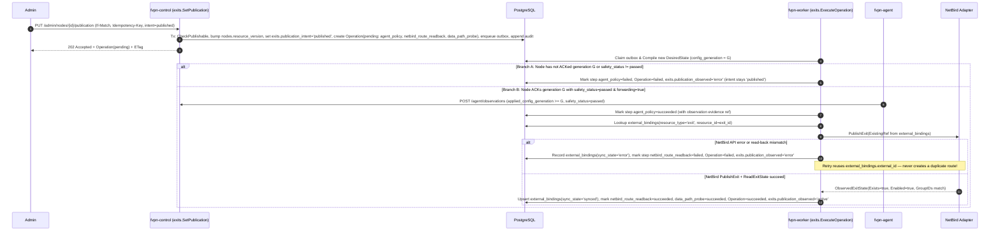
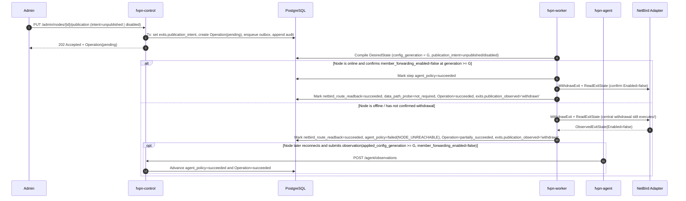

# Node Registry, Desired State, Serving Leases, and Exits

This document describes the central node management subsystem implemented in:

- `internal/nodes` — Node aggregate views (`ListNodes`, `GetNode`, `ListMemberExits`), state transition tables (`CanTransitionLifecycle`, `CanTransitionProvisioning`, `CheckPublishable`), versioned updates (`UpdateNode`), revocation (`RevokeNode`), tombstoned retirement (`RetireNode`), observation ingestion (`SubmitObservation`), and staleness sweeps (`SweepStaleNodes`).
- `internal/desiredstate` — Per-node desired-state compiler (`Compile`, `ReSign`, `GetDesiredState`, `RecompileBatch`), effective rate computation (`ComputeEffectiveRateBps`), and outbox burst coalescing.
- `internal/exits` — Exit publication commands (`SetPublication`), multi-step operation execution (`ExecuteOperation`), NetBird adapter integration with `external_bindings` idempotency, and NetBird read-back reconciliation (`ReconcileNetBird`).
- `internal/leases` — Serving lease calculation (`ComputeMemberLeaseEnd`, `Renew`), Ed25519 envelope signing (`lease` purpose), and replay-safe persistence (`serving_leases`, `serving_lease_members`).

---

## 1. Node State Model (§5.1, §15.3, §18.1)

Every node maintains strictly separate **desired** and **observed** fields. A `202 Accepted` command or observation receipt never claims an external or node-side effect has completed until read-back evidence is recorded.

| Dimension | Values | Storage / Authority | Notes |
|---|---|---|---|
| `lifecycle_state` | `enrolling`, `registered`, `revoked`, `retired` | `nodes.lifecycle_state` | `retired` is a terminal tombstone (`DELETE` on `nodes` is forbidden by DB trigger). |
| `provisioning_state` | `pending`, `applying`, `ready`, `failed` | `nodes.provisioning_state` | Local node configuration readiness. |
| `publication_intent` | `unpublished`, `published`, `disabled` | `exits.publication_intent` | Authoritative copy lives **only** on `exits` (§15.3) and is joined into node views. |
| `publication_observed` | `absent`, `applying`, `active`, `withdrawn`, `error` | `exits.publication_observed` | Updated only after NetBird read-back and node observation evidence. |
| `control_status` | `online`, `stale`, `offline` | `nodes.control_status` | Derived from central `last_seen_at` (`received_at`). Default thresholds: heartbeat `30s`, stale `90s`, offline `180s`. |
| `safety_status` | `unknown`, `passed`, `failed`, `expired` | `nodes.safety_status` | Fail-closed: requires `internet_only=passed`, `meter_path=passed`, and `netbird.backend=kernel`. |
| `data_health` | `unknown`, `healthy`, `degraded`, `failed` | `nodes.data_health` | Data-plane probe health. |
| `config_generation` | `desired` vs `applied` (`decstr.U64`) | `nodes.desired_config_generation`, `nodes.applied_config_generation` | Monotonic per `(node_id, incarnation_id)`. |
| `releases` | `desired_release_id`, `current_release_id`, `last_good_release_id` | `nodes.*_release_id` | Desired release is separate from observed running release. |

### Allowed Lifecycle Transitions (`internal/nodes/transitions.go`)

- `enrolling -> registered | revoked | retired`
- `registered -> revoked | retired`
- `revoked -> registered | retired`
- `retired -> (none, terminal tombstone)`

### Composite Serving Condition (`ServingReadiness.IsServing`, §5.1)

A node is eligible to serve member traffic if and only if all of the following hold simultaneously:

1. `lifecycle_state == registered`
2. `provisioning_state == ready`
3. `publication_intent == published`
4. `control_status == online`
5. `safety_status == passed`
6. `data_health in (healthy, degraded)`
7. `applied_config_generation >= desired_config_generation` (and `> 0`)
8. `current_release_id` is in the active `serving_release_ids` set (not revoked and meeting `minimum_serving_version`).

Health recovery, heartbeat recovery, or software updates **never** automatically flip `publication_intent = disabled` back to `published` (`EXIT03`, §5.1).

---

## 2. Publish and Unpublish Sequence Diagrams (§5.2, AT08, AT13)

### 2.1 Publish (`PUT /admin/nodes/{id}/publication` with `publication_intent=published`)



### 2.2 Unpublish / Disable (`publication_intent=unpublished | disabled`, §5.2 step 4, AT13)

Unpublish and disable withdraw member forwarding on the node first (via a new desired-state generation), then withdraw the NetBird route. If the node is offline or unresponsive, the NetBird route and peer permissions are **still withdrawn centrally**, and the operation records `partially_succeeded` so operators see the unconfirmed node step (`§18.3`).



---

## 3. Desired-State Format and Compiler Rules (§11.2, §14.7)

- **Signing**: Canonicalized with RFC 8785 (`pkg/canonjson`) and signed with Ed25519 using purpose `desired-state` (`pkg/envelope`). The signed payload embeds the full policy content (`device_bindings`, `member_rate_policies`, `dns`, `node_capacity`, `policy_refs`), never just a URL (§14.7).
- **Effective Rate Math (§11.2 step 3)**:
  $$\text{effective\_rate} = \min(\text{plan\_rate}, \text{fair\_use\_tier\_rate}, \text{node\_member\_rate\_cap})$$
- **Immediate Revocation & Suspension Clamping**:
  - Revoked devices (`status <> 'authorized'` or `revoked_at IS NOT NULL`) are omitted immediately from `device_bindings`.
  - Suspended members (`admin_suspended = true`) have `valid_until` clamped to `<= issued_at` so the node cuts off forwarding immediately.
  - Only members entitled to at least one group in the exit's `member_group_ids` are included when `publication_intent == published`. When `publication_intent` is `unpublished` or `disabled`, `device_bindings` and `member_rate_policies` are empty `[]`.
- **ETag and `ReSign` (§14.7)**:
  - ETag is `"ds-<config_generation>-<envelope_sha256_prefix>"`.
  - Calling `ReSign` refreshes `issued_at`, `expires_at`, and `signatures` without changing `config_generation`, producing a new ETag so `GET /agent/desired-state` serves the refreshed envelope instead of `304 Not Modified`.
- **Outbox Coalescing (`RecompileBatch`)**:
  - Bursts of `member.entitlement_changed`, `device.authorized`, `device.revoked`, `member.suspended`, `policy.activated`, `node.publication_changed`, `release.target_changed`, and `node.updated` events in a worker batch are deduplicated by affected `node_id` so each affected node compiles at most once per batch.

### Full `DesiredStateEnvelope` Example (§14.7)

```json
{
  "signed": {
    "schema_version": 1,
    "node_id": "01900000-0000-7000-8000-000000000101",
    "node_incarnation_id": "01900000-0000-7000-8000-000000000201",
    "config_generation": "4",
    "binding_revision": "12",
    "issued_at": "2026-10-29T14:00:00Z",
    "expires_at": "2026-10-30T14:00:00Z",
    "publication_intent": "published",
    "desired_release_id": "01900000-0000-7000-8000-000000000301",
    "supported_release_policy_id": "01900000-0000-7000-8000-000000000302",
    "serving_release_ids": [
      "01900000-0000-7000-8000-000000000301"
    ],
    "policy_refs": {
      "authorization_generation": "7",
      "dns_generation": "5",
      "fup_generation": "3"
    },
    "safety_profile": "internet-only-v1",
    "lease_renewal_endpoint": "/api/v1/agent/lease-renewals",
    "dns": {
      "resolver_ipv4": ["100.64.0.53"],
      "resolver_ipv6": ["2001:db8::53"]
    },
    "node_capacity": {
      "down_bps": 1000000000,
      "up_bps": 1000000000,
      "member_down_bps_cap": 40000000,
      "member_up_bps_cap": 20000000
    },
    "accounting_period": {
      "period_id": "2026-10",
      "period_start": "2026-10-01T00:00:00Z",
      "period_end": "2026-11-01T00:00:00Z"
    },
    "device_bindings": [
      {
        "member_id": "01900000-0000-7000-8000-000000000401",
        "device_id": "01900000-0000-7000-8000-000000000501",
        "peer_id": "nb-peer-dev1",
        "allowed_ipv4": ["100.64.0.10/32"],
        "allowed_ipv6": [],
        "binding_revision": "12",
        "valid_from": "2026-10-29T13:00:00Z",
        "valid_until": "2026-11-05T14:00:00Z"
      }
    ],
    "member_rate_policies": [
      {
        "member_id": "01900000-0000-7000-8000-000000000401",
        "generation": "3",
        "period_id": "2026-10",
        "mode": "enforce",
        "reason": "fair_use_tier",
        "tier_index": 1,
        "down_bps": 40000000,
        "up_bps": 20000000,
        "priority": 2,
        "valid_from": "2026-10-28T14:00:00Z",
        "valid_until": "2026-11-05T14:00:00Z"
      }
    ],
    "update": null
  },
  "signatures": [
    {
      "key_id": "ds-key-2026-10",
      "algorithm": "ed25519",
      "signature_b64": "TEST_ONLY_BASE64_SIGNATURE_64_BYTES_PADDED=="
    }
  ]
}
```

---

## 4. Serving Lease Math and Worked Examples (§16.3, AT29)

When a node calls `POST /agent/lease-renewals`, the lease service computes:

$$\text{node\_lease\_end} = \text{signed\_server\_time} + \text{max\_offline\_lease}$$

$$\text{member\_lease\_end} = \min(\text{signed\_server\_time} + \text{max\_offline\_lease},\ \text{effective\_service\_end},\ \text{node\_lease\_end})$$

where the recommended default `max_offline_lease` is `86400` seconds (24 hours, configured on `fleet_config.max_offline_lease_seconds`).

### Worked Example 1: `effective_service_end` is sooner than 24h

- `signed_server_time` (`issued_at`): `2026-10-29T12:00:00Z`
- `max_offline_lease`: `24h` (`86400s`) $\implies \text{node\_lease\_end} = \text{2026-10-30T12:00:00Z}$
- Member A's `effective_service_end`: `2026-10-29T14:00:00Z` (2 hours remaining on subscription)
- Result:
  $$\text{member\_lease\_end} = \min(\text{2026-10-30T12:00:00Z},\ \text{2026-10-29T14:00:00Z},\ \text{2026-10-30T12:00:00Z}) = \text{2026-10-29T14:00:00Z}$$
  The lease never extends Member A's service past `14:00:00Z`.

### Worked Example 2: `effective_service_end` is later than 24h

- `signed_server_time` (`issued_at`): `2026-10-29T12:00:00Z`
- `max_offline_lease`: `24h` (`86400s`) $\implies \text{node\_lease\_end} = \text{2026-10-30T12:00:00Z}$
- Member B's `effective_service_end`: `2026-11-08T12:00:00Z` (10 days remaining)
- Result:
  $$\text{member\_lease\_end} = \min(\text{2026-10-30T12:00:00Z},\ \text{2026-11-08T12:00:00Z},\ \text{2026-10-30T12:00:00Z}) = \text{2026-10-30T12:00:00Z}$$
  If the node loses control-plane connectivity, it may continue forwarding for Member B until at most `2026-10-30T12:00:00Z`, after which it fails closed.

### Lease Invariants

1. **Replay idempotency**: Replaying the same `(node_id, incarnation_id, renewal_request_id)` returns the exact stored `ServingLeaseEnvelope` with the original `issued_at` and `expires_at`—never restarting the TTL (§15.3, §16.3).
2. **Entitlement immutability**: Lease renewal reads `entitlements` under `FOR SHARE` (enforced by trigger `serving_lease_members_deadline`) and never writes to `entitlements`.
3. **Unpublished / disabled nodes**: Receive a valid signed lease with `members: []` (zero member grants).

---

## 5. Observation Ingestion Rules (§5.1, §14.4, §14.5, §15.3)

1. **Strict mTLS Identity Binding**: `report.node_id` and `report.node_incarnation_id` must match the authenticated mTLS certificate identity and `nodes.current_incarnation_id`. Revoked or retired nodes receive `403 IDENTITY_REVOKED`; superseded incarnations receive `403 INCARNATION_MISMATCH`.
2. **Deduplication by `(node_id, incarnation_id, report_id)`**:
   - The payload is canonicalized via RFC 8785 (`pkg/canonjson`) and hashed with SHA-256.
   - Same `report_id` + identical hash $\implies$ `202 Accepted` with the original `received_at`.
   - Same `report_id` + different hash $\implies$ `409 ACK_CONFLICT`.
3. **Separate `received_at` and `observed_at` + Monotonicity**:
   - Central `received_at` is stored separately from the node's `observed_at`.
   - An out-of-order observation with `observed_at < nodes.last_observed_at` is recorded in `node_observations` and updates `last_seen_at`, but **never** overwrites newer observed state (`applied_config_generation`, `safety_status`, `data_health`, `current_release_id`) on `nodes`.
4. **Fail-Closed Safety Evaluation**:
   - If `netbird.backend != "kernel"` (for example `"userspace"`), or if `internet_only` or `meter_path` checks are missing or failed, `safety_status` is forced to `failed`.
5. **Concrete Evidence Required for Operation Steps**:
   - A `202 Accepted` observation does not by itself complete an operation step.
   - For `node.publish` and `node.update`, step `agent_policy` advances to `succeeded` only when `applied_config_generation >= desired_generation` and `safety_status == passed`.
   - For `node.unpublish`, `node.disable`, `node.revoke`, and `node.retire`, step `agent_policy` advances to `succeeded` only when `applied_config_generation >= desired_generation` and `member_forwarding_enabled == false`.

---

## 6. Desired state and lease decisions, follow-up 2

1. **Null `desired_release_id` when no release target is set (§13.2, §14.7)**:
   - `DBPolicyReader.ReadPolicySnapshot` checks `fleet_config.desired_release_id` and `nodes.desired_release_id`. When neither sets a release target, `DesiredReleaseID` remains `nil` (`"desired_release_id": null` in the signed envelope).
   - No query inside a compile transaction ever discards a SQL error and continues; the first SQL error aborts and returns immediately.
2. **Fair-use state (`fup_member_states`) and missing plan rates (§11.2, §11.5)**:
   - `DBEntitlementReader.ListEntitledMembersForGroups` reads `fup_member_states` for the current accounting period alongside the referenced `policy_revisions` payload.
   - When `fup_member_states.mode == 'shadow'`, or when the fair-use policy revision has `mode == 'shadow'` or `as_of < effective_at`, the compiled member rate policy stamps `mode = "shadow"`, `tier_index = 0`, `reason = "normal"`, and a **null tier rate** so `effective_rate = min(plan_rate, node_member_rate_cap)` (shadow `would_apply_*` rates are never enforced).
   - When `mode == 'enforce'` and `as_of >= effective_at`, the compiler stamps `mode = "enforce"` and uses the stored `enforced_down_bps`, `enforced_up_bps`, `enforced_tier_index`, `enforced_priority`, `enforced_reason`, and `generation` from `fup_member_states` to compute `effective_rate = min(plan_rate, fair_use_tier_rate, node_member_rate_cap)`.
   - Production paths have no default plan rate (`DefaultPlanRateBps` is removed). If a member's plan revision omits a positive `down_bps` or `up_bps`, that member is omitted from both `member_rate_policies` and `device_bindings`, recorded in `CompiledDesiredState.OmittedMembers` (`reason = "plan_missing_rate"`), and logged via `slog.WarnContext`.
3. **DNS profile generation and resolver configuration seam for `w3-dns-publish` (§8.1, §12.2, §12.4)**:
   - `DBPolicyReader.ReadPolicySnapshot` matches the contract policy type `dns_profile` (`api.PolicyTypeDnsProfile`) and stamps `policy_refs.dns_generation` from the active `dns_profile` revision's generation (`greatest(policy_definitions.generation, policy_revisions.revision)`).
   - Designated resolver addresses (`dns.resolver_ipv4`, `dns.resolver_ipv6`) are deployment configuration—never read from `dns_profile` revision payloads and with no production default (`TestOnlyDefaultDNSResolverIPv4` exists solely for `FakePolicyReader` in unit tests).
   - **Seam for `w3-dns-publish`**: `desiredstate.NewCompiler` accepts `desiredstate.WithDNSResolvers(ipv4, ipv6 []string)` supplied by central control configuration at construction. When `w3-dns-publish` introduces a published resolver document, it can either supply those addresses via `WithDNSResolvers` or populate `PolicySnapshot.DNSResolverIPv4` / `DNSResolverIPv6` in `DBPolicyReader.ReadPolicySnapshot` (which `CompileTx` preserves whenever `WithDNSResolvers` is not overriding them).
4. **Lease signing concurrency and member grant consistency (§15.3, §16.3)**:
   - `leases.Service.Renew` locks eligible `members` and `entitlements` rows (`FOR SHARE OF m, e` in deterministic `m.id ASC` order) and holds those locks until transaction commit.
   - If the locked eligible member set differs after `Signer.Sign` (for example, if a member was suspended concurrently while signing), `Renew` discards the first signature, rebuilds the `ServingLease` document from the locked eligible set, and signs again.
   - `serving_leases.member_grant_refs` always equals the final signed `Members` list, and all `serving_lease_members` rows are inserted in the same transaction; any member-row insert failure aborts the entire lease renewal.
5. **Signed lease `config_generation` authority (§14.4, §16.3)**:
   - `ServingLease.ConfigGeneration` and `serving_leases.policy_generation` are always stamped from `nodes.desired_config_generation`. The agent's request `applied_config_generation` is an observation input only and never overwrites the signed lease generation.
6. **`Compiler.ReSign` lifecycle and revocation guard (§14.7)**:
   - `Compiler.ReSign` reads `nodes.lifecycle_state`, `nodes.current_incarnation_id`, and `node_incarnations.revoked_at` under `FOR UPDATE OF n` in the same transaction and refuses `revoked` or `retired` nodes (or revoked incarnations) with `403 IDENTITY_REVOKED`.
7. **QoS class IDs (§11.4)**:
   - Traffic-control class IDs remain node-local per §11.4 and are not embedded in central desired-state envelopes.
