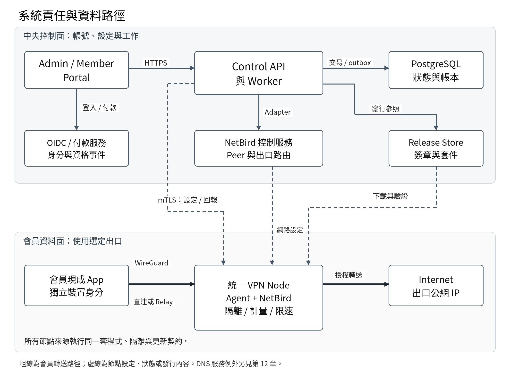

# 會員制 VPN 平台產品與工程規格

_Project Spec_

版本 1.0   2026 年 10 月 28 日

適用對象  專案負責人  工程團隊  測試人員

本規格定義初期約 20 名會員的多地區付費 VPN。預裝盒子、自家 OCI 或任何已協調的 Ubuntu 主機，全部是相同 Node，使用同一套註冊、分類、上架、政策與更新契約。有效啟用碼代表允許加入，設備自動檢查後由管理員上架。

基準架構為自架 NetBird Community 與既有 App，加上自家控制服務、Node Agent 及 Updater。所有出口固定執行 Internet-only 隔離，中央管理會員資格、裝置、用量、調速、DNS 與網站封鎖，以及一次更新全部節點。

本文件供工程團隊建立程式、API、資料庫與測試。章節中的自家 API、資料表、SLO 及參數是本專案設計；第三方原生功能以參考資料標示。真正的資料路徑、App 行為與軟體版本仍以驗收結果定案。

## 規格標示

必須：本版的交付條件。建議預設：可直接作為開發起點，正式營運前由專案負責人確認。待決策：尚需選定的商業或產品參數。待實測：文件與設計尚不能替代實際版本、裝置與網路的驗證。

# 章節導覽

1 範圍與規格優先順序

2 名詞與識別模型

3 架構與部署基準

4 功能需求清單

5 節點狀態與服務資格

6 統一節點註冊與安裝

7 NetBird 與原生 App 整合

8 網路與 Internet-only 隔離

9 會員資格與訂閱

10 流量計量與跨節點帳本

11 公平使用政策與會員調速

12 DNS、網站封鎖與安全瀏覽

13 全部節點程式更新與發行契約

14 API 契約與交易語意

15 資料模型、索引與一致性

16 安全、資料保護與非功能規格

17 故障、復原與對帳

18 管理後台與會員操作規格

19 驗收規格與可重現證據

20 開發結構、部署與舊會員移轉

21 參數登錄、未決項目與需求追蹤

22 參考資料與版本依據

# 1 範圍與規格優先順序

本版的確定需求為：三種來源統一管理、所有節點不能暴露內網、會員使用現成 App、中央月用量監控及漸進調速、網域與安全瀏覽防護，以及一個操作更新全部節點。加入者協調與日常維運由團隊自行處理。平台不增加合作方帳號、來源等級、物流、分潤或維護排程。

本規格優先於先前概念示意中省略的細節。例如，正式更新邏輯將「目標版本」與「最低允許服務版本」分開；發布新目標不應立即停掉所有仍安全可用的舊版本。未決商業參數以待決策標記，不影響可用測試設定推進工程。

本文件的「禁止內網」指會員經本服務的 VPN 路徑，不能存取出口宿主、內部網路、管理服務及其他會員。會員自己手機或電腦原本所在的 Wi-Fi／LAN，屬其本機網路行為；若要連本機 LAN 都受強制管理，需要額外終端控制，並非本版伺服器隔離的保證。

## 1.1 交付與限制

- 第一版提供手動出口選擇，不承諾自動選全球最快節點、跨國無縫切換或指定串流服務解鎖。

- Safe Browsing 為產品功能描述；第一版實作 DNS／網域威脅防護，不使用 TLS 中間人解密。

- 月用量跨會員全部裝置及出口彙總；速率先以同一會員在同一出口的全部裝置合計限制。

- 節點程式更新涵蓋本產品套件及固定依賴；一般 OS 修補、遠端 shell、場地及聯絡協調不做成平台功能。

- 第一版建議固定一個 Ubuntu LTS 與兩種架構；支援矩陣擴大時需增加對應測試。

# 2 名詞與識別模型

| 名詞 | 定義 |
|---|---|
| Member | 付款或取得授權的會員帳號，以 member_id 為穩定識別。 |
| MemberDevice | 會員的一台已登錄裝置，對應 NetBird peer；不等同一次連線。 |
| Subscription | 付款供應商的訂閱狀態、服務期間及參照資料。 |
| Entitlement | 自家控制器計算的有效 VPN 使用資格，含期限、方案、停權及版本。 |
| Node | 一台受統一納管的 VPN 出口主機；來源不影響功能或權限。 |
| Node incarnation | 同一 Node 的一次安裝身分；重灌或換身分時產生新值。 |
| Exit | 會員可選的出口項目；第一版一個 exit_id 對應一個 Node。 |
| Publication | 管理員上架意圖，以及路由及節點實際套用結果。 |
| Policy generation | 單調遞增設定版本；舊版本不能覆蓋新版本。 |
| Release | 不可變的產品發行版本，含兩架構套件、元件版本、manifest 與簽章。 |
| Update batch | 一次更新操作及按下當時的目標節點快照。 |
| Usage event | 具唯一序號、觀測區間、身分映射及方向的用量紀錄。 |
| Accounting period | 公平使用的計量期間；建議 UTC 自然月，與扣款週期分開。 |
| Desired 與 Observed | 中央要求的狀態，與經回報或讀回確認的實際狀態。 |

所有內部關聯使用不可變 ID，不以 email、IP、MAC、hostname 或地區名稱作主鍵。OIDC 使用 issuer 加 subject 對應 Member；IP 對應須含有效期間與 binding_revision，避免重用 IP 時將舊流量算到新會員。

OIDC 的 subject 需連同其 client／sector 範圍理解；同一 issuer 的不同 OAuth clients 可能取得不同 pairwise subject。M1 必須選定可穩定對應的 public subject、供應商支援的共同 sector，或經驗證的跨 client 身分映射，另保存 NetBird user ID 到 member_id 的關聯。不可用 email 相同就自動合併帳號。[S36]

# 3 架構與部署基準



*圖 1  控制面與會員資料面的責任分離。箭頭表示主要關係；雙向回應、DNS 與付款 webhook 的詳細契約依各章定義。*

| 元件 | 責任 | 最小部署方式 |
|---|---|---|
| Admin 與 Member Portal | 節點與會員介面、訂閱入口、政策與更新結果 | 同一前端程式，按角色授權 |
| Control API | 認證、授權、資源操作、期望狀態、事件接收 | 一個模組化後端服務 |
| Worker | NetBird 同步、付款對帳、用量彙總、政策編譯 | 同 codebase 的獨立程序 |
| PostgreSQL | 自家 authoritative state、inbox／outbox、帳本 | 單一主資料庫及備份 |
| OIDC 身分服務 | 會員及管理員登入，穩定身分識別 | 選定共用 IdP，分開 OAuth client |
| NetBird 控制服務 | peer、路由、群組、signal 與連線協調 | 自架固定版本 CE |
| Relay | 不能直連時搬運加密隧道 | 亞洲及美國候選部署，依實測決定 |
| DNS resolver | 受控解析、網域政策、授權存取 | 建議兩台使用相同政策的解析器 |
| Node Agent | 註冊、設定、授權、計量、健康及狀態回報 | systemd 背景服務 |
| Node Updater | 驗證套件、版本切換、健康檢查及恢復 | 獨立於被替換 Agent 的程序 |
| Release Store | 不可變套件與簽章 manifest | 物件儲存或既有 release 儲存 |

建議後端及 Agent 使用 Go、前端使用 TypeScript 與 React、資料庫使用 PostgreSQL；這是為降低語言與封裝差異的工程起點，可依既有團隊技能調整。API 與 worker 共用 domain modules，不預先拆微服務。節點的 durable outbox 可採 SQLite WAL。

控制面不承載一般會員的上網資料。會員到出口優先直接建立 WireGuard 隧道，必要時走自架 Relay；中央 API 負責身分及設定。跨 tenancy 不需要為此建立完整企業內網互通。[S09]

## 3.1 節點內部組成

安裝器建立獨立的 VPN 轉送環境，讓 NetBird 自行管理的規則與外層 Internet-only enforcement 分開。Agent 控制必要的 namespace、veth、nftables、tc 與服務設定，但不將一般會員送入宿主管理平面。NetBird 官方指出普通 host firewall 與 Block LAN 選項不足以覆蓋所有上游內網，因此此組合必須由 POC 證明。[S06][S28]

中央服務、付款憑證、簽發私鑰及全域 NetBird 管理 token 不放在出口機器。節點只保存自己的裝置憑證、執行所需的匿名 member／device 對應、有效政策、計量 outbox 及已核准發行資訊。

## 3.2 第一版建議支援矩陣

| 項目 | 基準 | 驗證要求 |
|---|---|---|
| 節點 OS | Ubuntu 24.04 LTS 候選 | 固定 kernel、依賴及 patch baseline；M1 確認 |
| CPU 架構 | amd64、arm64 | 兩者同一協定與 release，套件分架構 |
| 網路 | 有線 DHCP 或既有可用 Ubuntu 網路 | 可解析 DNS、正確時間、可連必要控制端點 |
| 節點用途 | 專用 VPN 節點 | 共用其他業務服務的主機須先確認不受路由與規則影響 |
| 會員 App | NetBird 官方 Windows、macOS、iOS、Android | 記錄精確版本並完成真機驗收 |
| 控制服務 | 固定版本 NetBird CE、API、worker、DB | 不得以 latest 作正式版本識別 |

# 4 功能需求清單

| 需求 ID | 等級 | 要求 |
|---|---|---|
| NODE01 | 必須 | 所有 Node 使用同一資料模型、安裝協定與管理操作。 |
| NODE02 | 必須 | 列表顯示名稱、地區、在線與資料健康、發布狀態、目前版本與更新結果。 |
| NODE03 | 必須 | 管理員可命名、分類、設定可用會員群組、上架、停用、撤銷及移除。 |
| NODE04 | 必須 | 來源、擁有人備註不參與權限或不同審核流程。 |
| ENR01 | 必須 | 每台使用單次啟用碼；有效碼代表加入已授權。 |
| ENR02 | 必須 | 並行使用、不同公鑰重放與已撤銷碼須拒絕；正常重試可恢復原結果。 |
| ENR03 | 必須 | 預裝及 installer 都產生獨立裝置金鑰、incarnation 與 NetBird 身分。 |
| ENR04 | 必須 | 註冊成功只納管，不自動發布會員出口。 |
| PKG01 | 必須 | 兩架構套件可安裝、重跑、檢查、升級與移除，不任意清除全機防火牆。 |
| EXIT01 | 必須 | 上架同步到 NetBird 路由與節點授權；介面顯示已套用或處理中。 |
| EXIT02 | 必須 | 多個獨立出口使用手動選擇，不因名稱排序被誤當最快出口。 |
| EXIT03 | 必須 | 停用及重新連線不改變管理員的停用意圖。 |
| ISO01 | 必須 | 禁止宿主與上游內網、管理服務、metadata、未授權 overlay 及跨會員存取。 |
| ISO02 | 必須 | 隔離固定開啟，失效不能繼續提供付費轉送。 |
| ISO03 | 必須 | 支援所選 IPv6 模式，不能有未驗證的旁路。 |
| ISO04 | 必須 | 指定 DNS 只開精確服務例外，不放行整個內部網段。 |
| ID01 | 必須 | Member 以 OIDC issuer／subject 識別，角色由中央授權。 |
| MEM01 | 必須 | 會員管理自己的裝置、訂閱狀態、出口權限及用量摘要。 |
| MEM02 | 必須 | 裝置數限制依已授權裝置計算，並發註冊不能超額。 |
| MEM03 | 必須 | 每個 device 可個別撤銷；會員停權作用到其全部 device。 |
| ENT01 | 必須 | 登入成功不代表可使用 VPN；有效 entitlement 才能轉送。 |
| ENT02 | 必須 | 到期與撤權涵蓋既有 TCP／UDP 流，不能只阻止新連線。 |
| BILL01 | 必須 | 付款事件簽章驗證、持久化、去重、亂序與對帳。 |
| BILL02 | 必須 | 期末取消、退款、欠費、寬限及人工授權有明確規則。 |
| BILL03 | 必須 | 成功回跳頁不得直接作為付款成功證據。 |
| MTR01 | 必須 | 按已定義的內層 IP bytes 計量，上下行各一次。 |
| MTR02 | 必須 | 同會員所有裝置與所有節點用量合併。 |
| MTR03 | 必須 | 事件序號、payload hash、持久 outbox 與連續 ACK 保證重送不翻倍。 |
| MTR04 | 必須 | 重啟、counter reset、跨月、遲到及缺口有明確語意。 |
| MTR05 | 必須 | 會員用量與供應商帳單用量分開。 |
| FUP01 | 必須 | 公平使用政策可版本化，支援 shadow mode。 |
| FUP02 | 必須 | 每出口同會員全部裝置合計限速，分別處理上下行。 |
| FUP03 | 必須 | 會員可見目前速度狀態、原因與恢復時間。 |
| FUP04 | 必須 | 各節點可設定總容量上限，與會員級距分開。 |
| DNS01 | 必須 | 預設惡意網域防護、自訂封鎖與允許清單。 |
| DNS02 | 必須 | 規則按 DNS label、IDNA、子網域與記錄類型正確處理。 |
| DNS03 | 必須 | DNS 管理面不對會員開放，resolver 不成為公開遞迴服務。 |
| DNS04 | 必須 | 明確揭露 DNS／HTTPS／Private DNS／DoH 能力界線。 |
| SEC01 | 必須 | API 權限、mTLS、秘密保護、稽核、更新簽章與資料最小化。 |
| SEC02 | 必須 | 一般 log 與 metrics 不記錄完整瀏覽或 DNS 歷史。 |
| UPD01 | 必須 | 一個操作指定全部未撤銷／未退役節點的目標 release。 |
| UPD02 | 必須 | 離線補更新、架構套件、簽章驗證、失敗結果及重試。 |
| UPD03 | 必須 | 更新不得重設會員用量、節點身分或 publication intent。 |
| UPD04 | 必須 | 目標版本與最低允許服務版本分開。 |
| UPD05 | 必須 | 失敗回復受驗證版本；實際成功回報後才標成功。 |
| API01 | 必須 | 冪等 key、resource version、非同步 operation 與明確錯誤碼。 |
| DATA01 | 必須 | 自家狀態可靠持久化，備份還原後可重新對帳。 |
| APP01 | 必須 | 支援平台以實際版本驗收首次登入、出口選擇、停權及故障。 |
| NFR01 | 必須 | 效能與時效按參數登錄及受控測試驗收。 |
| SCOPE01 | 必須 | 不新增合作方流程、來源分級或維運協調介面。 |

本表定義 50 項功能與工程要求。後續章節提供其資料、介面與失敗語意；不得只以同名按鈕存在判定需求已完成。

# 5 節點狀態與服務資格

| 欄位 | 狀態或內容 | 意義 |
|---|---|---|
| lifecycle_state | enrolling registered revoked retired | 裝置身分是否有效 |
| provisioning_state | pending applying ready failed | 本機配置是否完成 |
| publication_intent | unpublished published disabled | 管理員期望的發布狀態 |
| publication_observed | absent applying active withdrawn error | NetBird 與節點的實際套用狀態 |
| control_status | online stale offline | Agent 與控制面連線觀測 |
| data_health | unknown healthy degraded failed | 實際資料路徑探測結果 |
| safety_status | unknown passed failed expired | 隔離與有效政策是否符合基線 |
| config_generation | desired 與 applied | 設定要求與成功套用版本 |
| release_id | current desired last_good | 實際、目標及可恢復版本 |
| update_state | queued waiting_online downloading verifying applying checking succeeded failed rolled_back superseded | 一個更新工作的執行進度 |

同一 Node 可同時為 publication_intent=disabled 與 control_status=online。健康或程式更新不得自行把 disabled 改成 published。健康短暫下降也不改寫管理員意圖；平台依既有意圖與實際可用條件協調路由。

## 5.1 服務條件

```text
serving_allowed =
  identity_valid
  AND publication_intent == "published"
  AND provisioning_ready
  AND safety_policy_valid
  AND member_entitlement_valid
  AND current_release_is_supported
  AND NOT disruptive_update_phase
```

上述為資料面判斷的概念條件，不以心跳單一訊號代替。current_release 與 desired_release 不同時，只要目前版本仍受支援且政策有效，可以在下載與驗證期間繼續服務。必要切換／重啟階段才暫停；回復 last_good 後需重新檢查。

## 5.2 上架與下架交易

1. 上架 API 驗證角色、資源版本及節點 ready 狀態，將 publication intent、operation 與 audit 寫入同一 DB transaction。

2. Worker 確認節點隔離及政策 ACK，配置必要 NetBird group／route，讀回結果。

3. 中央確認實際轉送與已發布設定後，將 operation 標成完成。任何一步失敗，保留 intent 與明確失敗結果以便重試。

4. 停用優先移除節點允許的會員轉送，再撤下 NetBird 路由／群組。節點不回應時仍從可信控制面撤路由與 peer 權限，並顯示尚未確認的部分。

撤銷為身分失效，與暫停服務不同。撤銷需撤出口、peer、Agent 憑證及未使用啟用碼；只撤 setup key 無法斷開已註冊 peer。[S01] 永久移除採 tombstone 保留用量與稽核的關聯，不把歷史帳本 cascade delete。

# 6 統一節點註冊與安裝

## 6.1 管理員與設備流程

1. 管理員建立 Node enrollment，可預填名稱、地區、會員群組及備註。中央產生單台使用的高熵 token，資料庫只保存雜湊。

2. 同一 token 可寫入單台預裝盒子的私有設定，或由 Ubuntu 安裝器安全讀取。通用 master image 不含可重複使用的 token 或私鑰。

3. 首次啟動產生 Agent 私鑰、CSR、incarnation_id 與 enrollment_request_id，透過 HTTPS 提交。

4. 中央原子綁定 token 與公鑰指紋。相同請求可重試，不同公鑰使用同 token 必須失敗。

5. 簽發只限本 Node 的 mTLS 憑證。中央產生一次性 NetBird setup key，設備註冊進無會員出口權限的 staging group。

6. Agent 回報 peer ID，中央從 NetBird API 交叉確認。配置隔離、計量、DNS、服務政策並回報 applied generation。

7. 自動檢查通過，節點進入 registered／ready／unpublished。管理員分類後上架，流程中沒有另一次人工入網核准。

NetBird 的機器 setup key 用於無人值守伺服器；會員手機與筆電應使用使用者登入，以維持使用者及裝置對應。固定出口不使用 ephemeral peer。[S01][S02]

## 6.2 註冊冪等與失敗恢復

- 同一 token 第一次成功綁定後，只允許相同 enrollment_request_id、公鑰及 CSR 證明持有者重取原結果；不可只憑已消耗 token 讀回憑證。

- 簽發後但回應遺失時，重試回傳同一 Node incarnation，不重新建立第二個 peer。必要時重發憑證，但保持受控的 certificate serial 歷史。

- NetBird 註冊在中央與外部 API 間不能做分散式單一交易；需記錄 provisioning job、setup key ID 與已知 peer，重試前先讀回。

- 若發現相同裝置身分在不相容端點同時活動，記錄衝突並停止自動更新身分映射；不得用最後一次寫入任意覆蓋。

- 撤銷後的憑證不得因 heartbeat 或重新安裝自動恢復；重新加入需要新的受授權 enrollment。

## 6.3 安裝器契約

安裝器必須識別 OS／架構、檢查 kernel 與所需工具、建立專用目錄與 systemd services、驗證發行套件、初始化網路隔離，最後才啟用會員轉送。安裝器重跑應為冪等，保留既有身分與 outbox，除非明確執行重新註冊程序。

不得以 flush ruleset 清除宿主全部規則；只管理專用 namespace、table、chain、interface 及 systemd unit。安裝前記錄必須修改的參數，失敗時恢復本產品所改範圍。使用既有網路設定，不任意改寫宿主預設路由或全機 DNS。

預裝映像需清除已產生的 NetBird 私鑰與狀態、Agent 憑證、SSH host keys 及需重新生成的 machine-id。每台出貨時的啟用資料單獨寫入。NetBird 官方要求 base image 中 PrivateKey 留空，由首次啟動生成。[S02]

## 6.4 憑證與啟用有效期

| 憑證 | 取得與保存 | 邊界 |
|---|---|---|
| 自家啟用碼 | 每台隨機高熵值；中央只存雜湊；單次使用、可撤銷與到期 | 預裝出貨期限與短效安裝碼分開設定；不寫入共同映像。 |
| Agent mTLS | 設備本機私鑰加 CSR；憑證綁 Node 及 incarnation | 只取本機設定與回報，支援提前輪替；撤銷舊身分不自動恢復。 |
| NetBird setup key | 註冊當下建立 one-off、usage_limit=1、ephemeral=false | 透過已認證通道取得；註冊後不保留明文，不作會員登入憑證。 |
| WireGuard 私鑰 | 每台設備生成並保存在本機專用路徑 | 不在管理員電腦為所有會員生成或共用，不上傳中央。 |
| 中央管理與發行秘密 | 由控制服務或發行環境保管 | 不下發管理 token、CA 私鑰或 release signing 私鑰至節點。 |

目前 NetBird Setup Keys API 的 expires_in 最短為 86,400 秒；本產品自己設定的短效啟用碼期限是獨立機制。不要把自家 15 分鐘安裝碼誤寫成 NetBird 原生短效 setup key。出貨啟用碼可依協調時間設定較長期限，NetBird key 到設備真正加入時才產生。[S35]

# 7 NetBird 與原生 App 整合

## 7.1 版本與權限基準

初始 NetBird account 的 All-to-All Default policy 必須在任何會員加入前移除。NetBird policy 為 ALLOW 型，新增窄規則不能覆蓋仍存在的廣泛允許。只建立會員到出口的必要權限、指定 DNS 服務例外及管理員維運通道。[S07]

本案不依賴 CE 不提供的 Peer Approval、SCIM 或控制面 active-active 功能。有效啟用碼可直接註冊，但出口尚未發布。會員 peer 也需完成自家 entitlement 與裝置檢查後才授予 paid group，不能用廣泛 user auto-group 讓所有新裝置先取得出口。[S03][S34]

## 7.2 路由發布 adapter

所有 NetBird 呼叫集中在 adapter，介面至少有 EnsureNodePeer、EnsureMemberDevice、PublishExit、WithdrawExit、ApplyDeviceAuthorization、DeletePeer、ReadObservedState。自家 DB 保存外部 ID，不直接修改 NetBird 資料庫。

每個獨立出口使用穩定 exit_id，對應一台 Node 與一組路由。多個手動可選出口預設 Auto Apply 關閉。未來若需要同國多 peer 的 Exit Pool，應另建明確 pool 模型，不把多個獨立出口混成自動最快選擇。[S06]

目前官方將 Routes API 標為 deprecated，但 routing 文件仍將 exit node 指向 Routes。固定已測版本後封裝 API，保留替換 adapter 的位置。建立 route 時 peer 與 peer_groups 互斥，不可直接照抄同時包含兩者的示例。[S04][S05]

## 7.3 會員首次使用

1. 會員登入入口，確認方案與有效資格，取得其平台的官方 App 安裝指引。

2. 第一次將 App 指向本服務的 self-hosted management URL，使用相同 OIDC 身分登入。

3. 中央將新 peer 對應 MemberDevice，原子檢查裝置名額，然後授予該 device 的出口與 DNS 權限。

4. 會員在 App 選擇已授權出口；入口顯示目前資格、可用出口及裝置狀態。

5. 若超過裝置數，入口提供撤銷舊裝置方式。不能假定未客製 App 會呈現自家超額訊息。

原生 App 是必要相容性驗收，需逐平台記錄 management URL 設定、SSO、出口名稱更新、手動切換、已選出口被撤下及睡眠／換網路後行為。沒有實測證據的能力不得標為已支援。

NetBird 官方說明沒有完整 always-on／kill-switch mode，因此不能把伺服器端隔離等同於隧道斷線時會員裝置絕不使用原本 ISP。此限制需在會員使用指引說明；自有 kill switch App 不在本版。[S06]

# 8 網路與 Internet-only 隔離

## 8.1 明確的允許與拒絕

| 流量 | 規則 |
|---|---|
| 會員到 Internet | 有效裝置與 entitlement 才可轉送，套用速率與用量計量。 |
| 會員到其他會員 | 拒絕，包括同帳號不同裝置，除非未來另立需求。 |
| 會員到節點或宿主服務 | 拒絕 SSH、Agent API、管理 UI、DB、容器 API 及其他本機埠。 |
| 會員到內部位址 | 拒絕宿主 LAN、上游內網、雲端私網、metadata、loopback、link-local、未授權 overlay。 |
| 會員到指定 DNS | 僅允許指定 resolver IP 與必要 TCP／UDP 53；其他埠仍拒絕。 |
| 節點控制與更新 | 獨立控制流，僅使用節點身分連必要服務，不計入會員用量。 |
| 系統健康探測 | 專用受認證 probe、精確公網測試目的地與服務；不放行會員、不改發布意圖，詳第 13 章。 |
| 宿主原有 DHCP 及管理 | 與會員資料路徑分開處理，不因禁止會員內網而全部封鎖。 |

禁止目的地集合至少包含 IPv4 特殊用途與 RFC1918、CGNAT／overlay 範圍、link-local 及 metadata，IPv6 ULA、link-local、loopback 與不允許用途。還須加入宿主直連及可達的內部網段，包括使用公網 prefix 的內網。DNS allowlist 不得解除此 IP 層防線。

## 8.2 Enforcement 設計

採獨立轉送 namespace 或同等隔離域，讓 NetBird 自行插入的 allow 規則不能支配最外層防線。具體 chain priority、hook、namespace 邊界、SNAT 與分類位置要由 POC 封包證據確認。僅安裝容器、只設定 UFW、或只開 Block LAN access 均不能直接算通過。[S06][S28]

來源身分必須與允許的 peer／overlay IP 對應。拒絕未知來源及冒用其他會員的位址。任何 revoked 或過期會員檢查需先於可能廣泛放行 established／related 的規則，必要時精確清理相關 conntrack；不可因既有連線而持續放行。

所有規則採原子更新。新版本先驗證再切換，過程不得出現 allow-all 視窗。路由模式、自家規則 generation 或基線檢查失敗時，保持控制通道，停止會員轉送並上報具體原因。相同規則適用所有來源節點。

## 8.3 IPv6 與 NAT

第一版須明定單一支援模式：建議先以 IPv4 服務，加上經實測的會員 IPv6 阻擋；若使用 NetBird IPv6 overlay，則同步建立完整 IPv6 隔離、計量與限速，不能只放行 ::/0。所選模式在每個會員平台驗收。

節點一般以對外連線進行註冊、協商與中繼；可直連時直接傳送，否則走 Relay。是否使用 Relay 是每對 peer 的結果，不能只用一台節點的永久標籤表示。實際出口 IP 由最後出口決定；中繼 bytes 另計成本。[S08][S09]

MTU 不採未測試的全域固定值。記錄 underlay、IPv4／IPv6、直連／Relay 的基準，測試大型封包、QUIC、TCP MSS 與 PMTU。host LAN 或 control subnet 與 overlay 衝突時，安裝器須辨識並回報，不能靜默覆寫路由。

# 9 會員資格與訂閱

## 9.1 身分與角色

角色只有 Admin、Member 及 Node machine identity。Admin 管理節點、會員、政策及更新；Member 只讀取與修改自己的允許資料；Node 只能回報自己並取得本機必要設定。需要細分管理員權限時，可將 billing、policy、release 權限拆成 scopes，但不引入合作方角色。

Portal 與 NetBird 建議共用外部 OIDC issuer，使用不同 client 與 audience。NetBird 也提供內建本機帳密身分，外部 IdP 並非其必需條件；但不能假定該內建身分可直接作自家入口的完整 OAuth issuer。本案選定共用 IdP 後驗證連接方式。[S32] 以 issuer／subject 對應身分，不以 email 作永久鍵。Admin 必須啟用 MFA；高影響操作保留操作者、請求 ID 與前後差異。

## 9.2 資格計算與優先順序

```text
effective_access =
  member_not_closed
  AND NOT admin_suspended
  AND device_authorized
  AND now >= valid_from
  AND now < forwarding_valid_until
  AND requested_exit_in_plan
forwarding_valid_until = min(
  effective_service_end,
  policy_lease_expiry
)
```

effective_service_end 由已付服務期間、有效的人工 grant 及明定的有限 grace 規則計算；paid_through 保留實際已付期限，不因寬限改寫。節點的轉送 deadline 才取服務截止與租約的較早者。人工停權優先於付款成功。付費狀態、期末取消旗標、已付期間與 grant 分開保存；trial 或補償必須有截止時間與理由。裝置限制按已授權裝置計算，不宣稱精確的 WireGuard 同時登入數。

| 狀態或事件 | 服務行為 | 資料處理 |
|---|---|---|
| pending_payment | 可登入入口，不可用出口 | 等待可信付款確認 |
| active | 依方案使用 | 服務截止與節點轉送 deadline 分別保存 |
| cancel_at_period_end | 已付費期間內仍有效 | 到期後停止，不立即清空已付款權利 |
| past_due 或 grace | 依明定寬限政策 | 寬限期限單獨記錄，不永久延長 |
| expired | 停止該會員所有裝置轉送 | 撤群組及節點允許集合 |
| suspended | 立即按撤權目標停止 | 後續付款不能自行解除人工停權 |
| full refund | 依退款政策處理剩餘資格 | 以原交易及服務期間計算，不任意扣 30 天 |
| partial refund | 按產品明定規則 | 預設不自動推導時數，保留對帳事件 |
| closed | 關閉帳號與裝置資格 | 依保存政策處理歷史資料 |

## 9.3 付款事件處理

1. 保留 raw body 並驗證供應商簽章；無效請求不改變資格。

2. 以 provider 加 event_id 唯一鍵寫 durable inbox，成功後才回 2xx。

3. Worker 讀取供應商目前的 subscription／invoice 狀態，計算已付費服務期間。

4. 同一 transaction 更新訂閱快照、entitlement revision、audit 及政策 outbox。

5. 同步會員 peer 群組與各出口允許集合，並記錄實際套用結果。

6. 定期 reconciliation 修補 webhook 遺失；顯示最後對帳時間及異常。

Webhook 可能重送或亂序，不能以到達次序累加 30 天，不能把秒精度 created 當嚴格事件順序。相同已付款 invoice 重送不重複延長；晚到的失敗事件不得覆蓋較新的有效服務期間。Stripe 可作第一個 adapter 範例，但供應商選擇仍為產品決策。[S18][S19]

## 9.4 裝置授權與撤銷

新 peer 先進無出口權限狀態，中央確認 user 對應、device 狀態與名額後才授權。名額檢查與新增授權在 transaction／row lock 下執行，兩台同時爭取最後一個名額時只允許一台。撤銷裝置需更新所有節點的映射及 NetBird 權限，不能只在入口刪除名稱。

會員到期時不等待使用者再次登入。節點依已簽署政策的 valid_until 自行停止；控制面在線時主動撤權。若節點無法收到即時撤權，最長容忍依政策租約限制，該取捨必須寫入服務行為及驗收。

# 10 流量計量與跨節點帳本

本章對應 MTR01 至 MTR05。正式會員用量由出口的自家計量器產生，再由中央合併；不能把 App 畫面的流量、NetBird 事件、WireGuard peer bytes 及 OCI 帳單數字混成同一個指標。以下頻率、容量與保存時間皆為建議預設，正式採用前須經壓測及參數登錄確認；HTTP 狀態碼、資料型別與去重語意則是本版介面契約。

## 10.1 正式計量契約

計量版本命名為 forward_admission_v1：在指定的出口資料路徑中，封包已解開隧道、可辨識會員，並通過本產品在該計量 hook 前的授權與 Internet-only 檢查後，累加內層 IP 封包長度。上行與下行各有一個正式計量位置，每個方向的每個封包最多計一次。

這代表「允許進入轉送路徑的 IP bytes」，不代表成功送達應用程式的 bytes。IP 與傳輸層 header、TCP 重傳、ACK 及符合規則的 UDP 封包均依實際經過 hook 的長度計入。計量後才發生的 qdisc drop、出口介面錯誤或下游網路丟包，仍可能已計入；不得把此數值標成 delivered_bytes、成功下載檔案大小或零損失有效負載。

| 欄位／流量 | 定義 | 計量行為 |
|---|---|---|
| upload_bytes | 以會員視角，會員到 Internet | 在會員身分可辨識的上行 admission hook 計一次。 |
| download_bytes | 以會員視角，Internet 到會員 | 在回程還原目的會員後的下行 admission hook 計一次。 |
| total_bytes | upload_bytes 加 download_bytes | 中央以整數加總，不另從 WAN counters 再補一次。 |
| IP 與傳輸層 header | 內層 IPv4／IPv6 與 TCP／UDP 等 header | 包含；實際取值與分段／聚合的影響在 PoC 固定。 |
| 外層隧道流量 | WireGuard／Relay 封裝、握手及 keepalive | 不計入會員 forward_admission_v1 用量。 |
| 系統流量 | Agent、更新、作業系統及已識別的探測 | 不計入；使用獨立來源身分或不進會員 accounting path。 |
| 拒絕流量 | 在正式 accounting hook 前已被拒絕 | 不計入；若在 hook 後才丟棄，不冒稱已從用量扣除。 |
| 指定 DNS 服務 | 會員到本服務 resolver 的必要解析 | 建議從 Internet forwarding 用量排除，可另做純計數。 |

資料庫與 API 必須保存 metering_version。未來若改成更接近實際送出的計量位置，不可靜默改變同名數值語意；需新版本、比對報告、明確切換時間及相容的歷史報表。會員介面應稱「已記錄的 VPN 用量」，並顯示更新時間。

## 10.2 封包歸屬與計量位置

NetBird 的 Linux kernel routing 文件描述隧道解密、forward chain、masquerade 與回程狀態追蹤。SNAT 後可能無法只靠來源 IP 辨識會員，因此計量與分類位置必須先確認，不可單憑主機對外網卡上的 IP 判斷。[S05]

1. 上行：由 NetBird peer 對應的內層來源位址辨識 MemberDevice，查詢當時有效的 binding_revision，確認會員資格及固定隔離規則。

2. 在選定的 admission hook 更新該 device 的 upload counter；後續依已建立的會員分類套用 QoS，再依實際拓樸做 SNAT 與對外轉送。

3. 下行：利用 reverse NAT 後的內層目的位址，或經驗證的連線分類資料，取得同一個 MemberDevice。

4. 在選定的回程 admission hook 更新 download counter，套用會員下行 class，再送入隧道。

5. 中央只加總這兩個正式 counter 來源；其他 counter 用於診斷或成本，標示不同 metric namespace。

PoC 交付物必須記錄每方向的 namespace、介面、table、chain、hook priority、NAT 前後位置及分類方式，並用封包與 counter 證據證明每個方向只計一次。若在隔離層外側已失去 peer IP，必須使用事先建立且經測試的分類資訊；不能猜測 NAT 後的位址仍等同會員。

中央下發的 binding 包含 member_id、device_id、peer_id、允許的 IPv4／IPv6、binding_revision、valid_from 與 valid_until。節點遇到未知來源、重複位址或不符合綁定的來源時停止該流量。上報附帶歷史 binding_revision；中央依事件期間驗證，不以目前 IP 擁有者重新歸戶。

nftables counter 是自上次 reset 以來的累計 packets／bytes，counter 在規則中的位置會影響哪些封包被計入。因此實作採具穩定名稱的 counter 或經等價驗證的計量器；讀取、重建及清理都由 Agent 追蹤，不能把 kernel counter 本身當成持久帳本。[S23]

## 10.3 固定資料路徑與相容性門檻

本版優先驗證 Linux native forwarding。NetBird 可使用 userspace router，與是否使用 kernel WireGuard 是不同設定；native firewall 不可用時的 fallback 也會改變封包路徑。因此安裝、開機及更新後必須確認實際 backend。未經驗證的 userspace／netstack 路徑不得冒稱 nftables 與 tc 計量仍有效。[S10]

NetBird Traffic Events Logging 不能作為本案會員用量來源：官方列有授權限制，且 exit route 的流量不在其記錄範圍。本案計量需由自家 Agent 完成。[S11]

Netfilter flowtable 可讓後續封包繞過一般 forwarding hooks。V1 必須禁止受計量流量使用會繞過正式 hook 的 offload，或提供另外經驗證的計量方案。GRO／GSO／TSO、封包分段與 UDP 大封包的長度語意也須在支援組合內測試；不能未測就以不同層的 bytes 作相等斷言。[S22]

- counter hook、介面或 binding generation 不符合要求時，停止會員 forwarding，保持控制通道並回報 METER_PATH_INVALID。

- NetBird 更新後新增／重排規則，不得使正式 accounting hook 被跳過；此項為每個 release 的必要回歸。

- 新增裝置時保留既有 counter；不得因調整群組、限速或 DNS 政策，順便清空全部用量。

- 診斷可以比對 WireGuard 與 WAN metrics，但此類差異不直接修改正式 ledger。

## 10.4 單位、整數精度與期間

內部使用非負整數 bytes，不以浮點 GB 保存。Go／資料庫讀寫需做範圍與溢位檢查；PostgreSQL 可用受檢查的 BIGINT，或經團隊統一定義的整數 NUMERIC。超出支援範圍時拒絕並回報，不截斷、不取模。顯示 GB 使用十進位 1 GB = 1,000,000,000 bytes；若介面另顯示 GiB，必須明確標示。

JSON 的 bytes、累計值、seq 及可能長期增加的整數識別序號一律使用十進位字串，例如 "9876543210"，前端以 BigInt 或十進位函式處理，避免跨越 JavaScript 安全整數範圍後失真。契約只接受由數字組成的正規十進位表示：零為 "0"，非零不含多餘前導零，不接受負號、小數、指數、空白或 NaN。[S31]

建議 accounting period 採 UTC 自然月，使用半開區間 [period_start, period_end)，與金流扣款日分開。period_id 由中央產生並下發，節點不可使用宿主當地時區自行重定義月份。會員介面可用當地時區顯示「下一次恢復時間」，後端一律保存 UTC。此期間選擇為待決策；變更需從明定的新期間開始，不重寫已結束月份。

## 10.5 本機取樣、持久化與事件格式

| 參數 | 建議預設 | 行為 |
|---|---|---|
| counter sample | 每 10 秒 | 讀取累計 counter，另在月界及受控 reset 前取樣。 |
| upload interval | 每 60 秒 | 可按 payload 門檻提前送出；不必逐 sample 發網路請求。 |
| local ledger | SQLite WAL | checkpoint、事件序號與 outbox 在同一 transaction 落盤。 |
| meter epoch | UUID | 只標識 counter 世代；重建計量器時換代，不重設事件序列。 |
| event seq | 同一 Node incarnation 從 1 永久單調遞增 | 以十進位字串交換；counter reset、reboot 及升級不歸零，重送沿用原值。 |
| ACK rule | highest contiguous seq | 中央成功持久化後，回傳同一 incarnation stream 的最高連續序號。 |

建議每個採樣區間產生一個 immutable event，內含該節點所有有變動的 device records；每次上傳可批次攜帶多個 event。事件依同一 node_id、node_incarnation_id 的單一 stream 排序，event_seq 從 1 永久單調累加。meter_epoch_id 僅表示事件所屬的 counter 世代；跨世代仍沿用相同 stream，不能因 counter 換代刪除舊 outbox 或重設 event_seq。

```json
{
  "schema_version": 1,
  "node_id": "node_uuid",
  "node_incarnation_id": "installation_uuid",
  "meter_epoch_id": "epoch_uuid",
  "event_seq": "1234",
  "metering_version": "forward_admission_v1",
  "interval_start": "2026-10-28T14:00:00Z",
  "interval_end": "2026-10-28T14:00:10Z",
  "quality": "complete",
  "records": [
    {
      "member_id": "member_uuid",
      "device_id": "device_uuid",
      "binding_revision": "42",
      "period_id": "2026-10",
      "upload_bytes": "123456",
      "download_bytes": "987654"
    }
  ],
  "payload_sha256": "sha256_of_canonical_payload"
}
```

以上為本產品示例，不是 NetBird 原生 API。schema_version 是小範圍版本列舉；event_seq、revision 與 bytes 依精度契約使用字串。SHA-256 對指定 canonical JSON payload 計算，排除 payload_sha256 自身及傳輸批次包裝；canonicalization 規則與黃金測試向量隨 schema 一起發布。相同事件重送時使用已保存的相同 payload，不重新組合時間戳。

1. 取得 kernel counter 與對應 binding snapshot；以 monotonic clock 追蹤採樣間隔，同時保存可對應的 UTC 時間。

2. 對同一 meter epoch 的 counter 計算非負 delta。發現歸零、回退、遺失或 mapping 衝突時，走明確 reset／gap 流程，不用負數抵銷。

3. 在單一本機 transaction 中寫入 delta event、event_seq 與新的 counter checkpoint，成功 commit 後才能認定本次採樣已保存。

4. 依上報間隔批次送到中央，失敗時保留原事件並使用有上限的退避重試。

5. 收到且驗證 ACK 後，將對應連續範圍標為已確認並移入 replay retention；不立即永久刪除。

不得先更新 checkpoint 再另外寫 outbox，否則兩步之間的 crash 會造成無法重建的資料缺口。若 commit 成功但程序尚未收到結果就 crash，重啟後以本機已保存的 transaction 狀態恢復，不再建立相同 delta 的第二份事件。

## 10.6 中央去重、亂序與 ACK

正式唯一鍵為 node_id、node_incarnation_id、event_seq。meter_epoch_id 是 immutable event 的內容與 counter 世代，不加入去重 key；不能藉更換 meter_epoch_id 重用既有 event_seq。中央須用資料庫唯一約束保證去重，不能只靠單一 worker 記憶體。mTLS 身分限制可上報的 Node；payload 宣告的 node_id 不得覆蓋連線身分。

| 情境 | 中央處理 | 回應 |
|---|---|---|
| 新事件且格式有效 | 原子寫 ledger、期間增量與 receipt 狀態；或寫 durable ledger 後由冪等 projector 彙總 | 成功回傳持久化 receipt 與連續 ACK。 |
| 相同 key、相同 hash | 視為合法重送，不增加 bytes | 成功回傳既有確認結果。 |
| 相同 key、不同 hash | 保存衝突摘要；兩份內容都不以最後寫入覆蓋 | HTTP 409，USAGE_EVENT_CONFLICT。 |
| 格式／整數／mapping 無效 | 拒絕該事件，保留前方已確認範圍 | HTTP 422 及具體欄位錯誤。 |
| mTLS 身分不符 | 不接受任何 ledger 變更 | HTTP 403 或憑證驗證拒絕。 |
| 中央不可寫入 | 不宣告已確認，不要求節點丟棄事件 | HTTP 503，保留重試。 |

亂序示例：同一 incarnation stream 目前已連續確認至 seq 100，先收到 102 時可保存 102，但最高連續 ACK 仍是 100。收到 101 且兩者都持久化後，ACK 才前進到 102。即使 101 與 102 屬於不同 meter_epoch_id，仍依同一 stream 判斷連續性。缺口不得以「看到更大的 seq」或 counter 換代自動跳過；ACK 不按 meter epoch 分拆。

中央可在 ledger 寫入交易中更新彙總，也可先寫 ledger 後由 projector 異步處理。後者必須保存 projector checkpoint，重跑不得重複加總。ACK 代表原始事件可恢復地保存，會員頁需另顯示 aggregate_as_of，不能把尚未完成的彙總偽裝成即時。

批次傳輸需定義每個事件的接受結果。建議逐事件具備原子性，只有該事件通過才前移 receipt；遇到衝突不刪除其後合法事件。節點保留無法確認的範圍，回報 blocked_seq，避免無限嘗試後靜默跳號。

## 10.7 重啟、counter reset 與資料缺口

1. 正常程式更新或受控重啟前，暫停需要重建的轉送範圍，取得 final sample 並 commit，保存 epoch 結束紀錄。

2. 重建 counter、一般主機 reboot 或程式升級時，產生新的 meter_epoch_id 並建立已確認的 counter 基準；counter 重建後的基準為零。event_seq 繼續由本機持久 stream 的下一個值累加，同一 Node 的 incarnation 不因這些操作改變。

3. 僅 Agent 程序短暫重啟且 kernel counter 仍完整時，可延續既有 meter epoch，但須先驗證 counter identity 與 checkpoint 一致；無論是否換 meter epoch，event_seq 都不可重設。

4. 硬斷電或無法判定 counter 連續性時，建立新 meter epoch，沿用持久化 stream 的下一個 event_seq，保存 gap record、最後 checkpoint 時間及原因，禁止產生負 delta。

5. 所有未確認舊事件依原 key 重送；中央重複收到只回 ACK，不再累加。

硬斷電可能遺失最後一次成功持久化後的計量資料。採樣正常時窗口接近一個採樣間隔；若 Agent 或磁碟已卡住，窗口可能更長，因此不無條件承諾最多遺失 10 秒。quality 可為 complete、gap 或 boundary_estimated；未知 bytes 不以零值假裝完整，也不以估算值悄悄增加正式會員用量。

若發現使用者資料路徑仍通，但 meter writer 無法持久化，必須停止會員 forwarding 並保留控制通道。這是計量完整性保護，不是後台另增人工維運流程。恢復需確認儲存可寫、計量器可用及政策有效；不得自行解除原本 disabled 的 publication intent。

## 10.8 離線 outbox 與中央復原重播

| 儲存區 | 建議預設 | 容量／期限行為 |
|---|---|---|
| 未 ACK outbox | 最舊事件 72 小時，或 payload 合計 256 MB，達先者 | 達保護上限時停止新增會員 forwarding；保留未 ACK 事件並繼續重送。 |
| 已 ACK replay archive | 每事件自本機確認 ACK 起保留至少 72 小時 | 使用獨立容量預算，供中央備份還原後重播；不佔未 ACK backlog 的 256 MB 配額。 |
| 實體磁碟保護 | 獨立設定最小可用空間，數值待壓測 | 把 SQLite main／WAL／index 及 replay archive 都納入；不可只看 payload 邏輯大小。 |
| 恢復服務 | 建議 backlog 低於容量 80%，且 oldest age 回到有效範圍 | 重新確認政策及原上架意圖；避免在容量邊緣反覆啟停。 |

此處 MB 為十進位 1,000,000 bytes。未 ACK 容量按尚未確認事件的 canonical payload bytes 加總，另外觀測實際資料庫與磁碟用量，避免 SQLite 已配置但可重用頁面造成錯誤判斷。72 小時緩衝並不表示控制面失聯時仍允許服務 72 小時；服務資格仍受第 9 章的較短政策租約與安全條件限制。

已 ACK 歷史與未 ACK backlog 必須分開管理。ACK 後仍保留 replay copy，是為中央從較舊備份恢復而重新請求資料；不能因正常已 ACK 歷史剛好滿 72 小時，就誤判未 ACK outbox 已滿。容量規劃須容納承諾的 replay window、尖峰事件數與 SQLite 額外空間。

可清理已超過 replay retention 的已 ACK 紀錄，並採可恢復的 compact／vacuum 策略。保護窗口內的資料不得為繼續轉送而偷偷提前刪除；磁碟不足時先暫停資料面並上報。若團隊要縮短保存窗口，必須更新參數、復原文件及風險說明，不能仍宣稱可重播原先的 72 小時。

1. 中央恢復時使用經控制服務簽署的新 ledger_epoch，回報各 node_id、node_incarnation_id stream 實際保存的最高連續序號與缺少區間；不依 meter epoch 分拆 checkpoint。

2. 相同 ledger_epoch 的 ACK 不得倒退；只有經驗證的新 ledger_epoch 及復原請求，才允許節點採用較低 checkpoint 並從 replay archive 重送原事件與 hash。ledger_epoch 不加入原事件去重 key。

3. 中央依唯一鍵去重並重建彙總，完成前將受影響報表標示為 reconciliation_in_progress。

4. 若缺少範圍已超過節點保存窗口，回傳明確 replay_unavailable 與範圍，建立 gap；不得用月總數覆蓋原始 ledger 來掩蓋缺口。

## 10.9 月界、遲到事件與彙總

中央為每個會員、期間及 metering_version 保存 upload、download、total、last_observed_at、aggregate_as_of 與 quality flags。彙總可按 Node 及 MemberDevice 下鑽，但不能把登入位置或目前出口當成用量歸屬的唯一來源。會員刪除裝置或 Node 退役後，歷史關聯仍須可解釋。

- Agent 在 period_end 主動追加採樣，使正常情況的 interval 不跨月；上報時間晚於月份結束不改變事件歸桶。

- 跨界採樣未成功時，保留原始 interval。建議按期間重疊時長比例分攤整數 bytes，餘數歸後一段，並標示 boundary_estimated；兩段總和必須等於原值。

- 期間切割發生在 Agent 或中央只能選一個 authoritative 位置。建議中央 projector 依原始 interval 執行；Agent 可附 period hint，但不得造成二次分攤。

- 牆鐘回退或過大時差不能造成負 interval。保留 monotonic elapsed、clock quality 與最後校時資訊；異常資料暫存待對帳，不任意放入本月。

- 遲到上月事件歸上月，修正上月報表；不把上月流量加到本月，也不默默延長上月調速。

- 本月重置是新 period 的彙總從零開始，並非清除歷史 counters、raw events 或所有裝置身分。

如果產品要求精確到月界每一個 byte，需另做 kernel counter rotation／精確時間分流，列為新增 PoC，不把時間比例分攤說成精確測量。日期顯示與 reset time 需在會員入口說明，避免「每月」被誤解成付款後的任意 30 天。

## 10.10 成本度量與驗收證據

供應商成本指標使用獨立名稱，例如 provider_egress_bytes、relay_forwarded_bytes、node_update_bytes。來源可能是 OCI 帳單、網卡或 Relay metrics，其時間與 bytes 語意各自保存。這些度量協助成本預算，但不混入會員正式 ledger。[S25]

| 驗收項目 | 必要證據 |
|---|---|
| 方向與唯一計量 | 同層參考封包／counter 比對，上行、下行與合計不翻倍；SNAT 後仍正確歸戶。 |
| drop 語意 | 在 hook 前拒絕不計；在 hook 後製造 qdisc drop 時，不把已計 bytes 冒稱成功送達。 |
| 去重與亂序 | 相同事件重送、ACK 遺失、102 早於 101、相同 key 不同 hash 的結果。 |
| 重啟與 reset | Agent crash、正常更新、host reboot、counter 重建、磁碟寫入失敗。 |
| 容量與復原 | 未 ACK 上限暫停、ACK archive 不誤觸 backlog 上限、中央還原後重播。 |
| 期間與精度 | UTC 月界、遲到事件、estimated 分攤守恆、超過 2^53 的 JSON bytes 無失真。 |
| 路徑相容性 | 直連／Relay、所選 IPv6 模式、kernel backend、NetBird 更新與 offload。 |

容許誤差須以相同 metering layer 與固定測試條件訂定，待 PoC 產生數據後填入驗收表。不得拿單一檔案大小或 OCI 帳單當作與 forward_admission_v1 逐 byte 相等的基準。

# 11 公平使用政策與會員調速

本章對應 FUP01 至 FUP04。服務可不以固定 GB 套餐作主要呈現，但需讓會員理解共享品質管理、目前速度狀態及恢復時間。所有門檻、速度、寬限與觀察期間皆為待決策；先前概念討論的數字不是已核准的售價或承諾。

## 11.1 政策資料與階段

| 欄位 | 規格 |
|---|---|
| policy_id／revision | 不可變政策版本；每次修改建立新 revision，保存發布者與理由。 |
| mode | shadow 或 enforce；切換必須有 effective_at，不能把 shadow 結果當成已限速。 |
| accounting_basis | 指定 period type、metering_version 及使用 upload 加 download 的 total。 |
| tiers | 依遞增 threshold_bytes 定義 down_bps、up_bps、priority 及會員顯示名稱。 |
| minimum_rate | 建議保留基本可用速率；正式數字待決策，不將低速等同成本硬上限。 |
| override | member_id、覆寫值、valid_until、原因及操作者；有期限且可稽核。 |
| effective_period | 建議從下一完整期間套用新門檻；緊急即時調整須明確指定。 |

| 級距示意 | 判斷 | 可設定行為 |
|---|---|---|
| Tier 0 | 0 ≤ U < T1 | 正常速度上限及正常排程優先序。 |
| Tier 1 | T1 ≤ U < T2 | 可先降低壅塞優先序，或使用較低速度上限。 |
| Tier 2 | T2 ≤ U < T3 | 進一步降低上／下行上限。 |
| Tier 3 | U ≥ T3 | 維持明訂的最低可用級距，直到新期間或有效 override。 |

T1、T2、T3 與各速率是符號示例，正式配置必須驗證門檻嚴格遞增、速率非負、級距覆蓋完整、上下行欄位齊備及最低值合理。不能把少寫一個 tier 的空檔默認為無限制。正常使用量累加時，級距在同一期間只維持或向更嚴格移動；更正帳本或管理員 override 的例外要另留 audit。

## 11.2 計算、下發與恢復

1. 中央從已持久化且完成彙總的會員 period total 計算 would_apply_tier，記錄計算使用的 ledger watermark。

2. shadow 模式只保存預期級距及影響摘要；資料面維持既定正常策略。

3. enforce 模式產生新的 member policy generation，包含有效期間、tier、上／下行限制與原因。

4. 所有可提供該會員服務的節點取得相同會員政策；各自回報 applied generation。

5. 節點將該會員所有授權 device 放入同一方向的共同 class，不為每台裝置複製完整會員額度。

6. 新 accounting period 開始時，中央依新期間用量重算。離線節點不得自行清空歷史或恢復無期限資格，仍受有效政策與租約限制。

門檻越界不是即時逐封包的全球事件。取樣、上報、彙總、政策同步各有延遲；正常環境下的完整收斂目標應列入 NFR 參數並實測。會員頁顯示計量更新時間與正在套用的狀態，不在節點尚未 ACK 時宣稱全部已生效。

建議初期先執行 shadow mode，以實際會員分布決定門檻。觀察長度與何時啟用 enforce 由團隊決定；觀察與正式執行使用同一份計算邏輯，避免上線後才發現不同計量單位。

## 11.3 同會員、多裝置與多出口

V1 的速率保證範圍固定為 member_id 加 node_id。假設某會員在單一出口的下行上限是 R，兩台裝置同時下載時合計受 R 約束；不可讓每台各拿 R。會員跨全部出口的月用量仍加總，但若同時使用兩個出口，各出口可以各提供自己的 R；這不是瞬時全球總速率 R。

```text
monthly_usage(member, period) =
  sum(accepted_usage_events for all devices and nodes)
rate_scope = (member_id, node_id, direction)
effective_rate = min(
  plan_rate,
  fair_use_tier_rate,
  node_member_rate_cap
)
```

node_capacity 是整台節點的總上／下行上限，與每會員 class 的 ceil 不同。總容量不足時，所有會員的實際速度可能低於個別上限；不得把每個 class 的上限當成保證頻寬。若未來要求跨出口瞬時上限，需新增分散式速率額度或活躍出口限制，另立規格及失聯語意。

## 11.4 HTB、fq_codel 與分類

建議在每個受控方向建立節點容量 parent，再以會員為單位建立 HTB class，會員的全部裝置歸同一 class。每個會員 class 下配置 fq_codel 管理其內部 flows。HTB 提供 egress shaping；fq_codel 是 flow 維度的排程，單獨掛在整台節點不代表會員間已公平。[S24][S30]

| 方向 | 分類與執行要求 |
|---|---|
| 會員上行 | 在 SNAT 前辨識來源 member；在實際可控制的對外 egress 或專用 veth 執行。若已 SNAT，使用經驗證的分類資訊，不猜來源。 |
| 會員下行 | 在 reverse NAT 後依目的 member 分類，於進入會員隧道的 egress 執行，避免同裝置多 flow 分到多份額度。 |
| 單網卡主機 | 同一 NIC 同時承載加密隧道與對外流量；必須避免把外層回程再套一次會員 class，或把 Agent 流量算成會員。 |
| IPv6 | 若本版支援 IPv6 forwarding，使用相同 member class 與容量策略；不能另走無上限路徑。 |
| 未識別流量 | 會員未知來源由授權層拒絕；管理與控制流使用明確分類，不以無限制 default class 接住錯誤映射。 |

NetBird 使用 fwmark 參與路由，並提供 NB_FWMARK_BASE 調整衝突範圍。自家 QoS 必須明訂所用欄位、bit mask 或其他 classifier，保留 NetBird 已使用的語意；不可整個覆寫 skb mark／conntrack mark。namespace、veth、SNAT 及封裝是否保留所需分類，須以指定版本實測。[S10]

HTB 的 rate、ceil、burst、quantum 與 priority 由編譯器從政策產生。若定義保證 rate，所有 child rate 的總和不得超過 parent 可承諾容量。PoC 需確認大量平行 flows、UDP、QUIC 與小封包下的公平性及延遲；不能只用單條 TCP speed test 判定完成。

套用新速率時，盡量更新既有 class，不為每次級距改變重新建立全部網路或 counters。編譯後的 class ID 對應有穩定映射與碰撞檢查；原子交換成員集合，避免裝置暫時落到錯誤會員 class。

## 11.5 失敗與成本界線

- 政策下載失敗時，沿用仍有效的最後政策；不因錯誤而變成 unlimited。到 lease 到期時依共同服務規則停止。

- QoS 套用失敗或 class 映射不一致時，回報具體原因，不把 generation 標為 applied；不能靠 UI 顯示的目標速率判定成功。

- 用量補報只更新所屬期間；上月事件不默默重啟本月調速。有效期外的舊 tier revision 不得覆蓋新期間策略。

- soft throttling 不提供雲端費用硬上限。節點總量、Relay 流量及供應商預算另行監測，不把低速會員視為零成本。

純計算示例：5 Mbps 持續 30 天，單方向約為 1.62 TB 十進位流量，尚未包含封裝。此例只說明速率與月用量的關係，不代表已選定最低速率或正式政策。

## 11.6 會員與管理員可見內容

會員入口顯示本期間已記錄用量、目前速度級距、調整原因、下一次恢復時間及最後更新時間。可用「正常速度」「公平使用調整中」等易懂文字，搭配明確可得的速率上限；不能顯示一個實測不出的固定下載保證。

管理員可編輯政策草稿、驗證、發布、查看節點 applied generation，並設定有期限的會員 override。這是服務政策功能，不增加合作方審核或維運排程。正式會員說明需交代大量使用會調整速度；公開行銷是否列出精確門檻仍為商業決策，但不能與實際策略互相矛盾。

| 驗收 | 通過條件 |
|---|---|
| 同會員兩裝置 | 同一出口、同方向合計受一個會員 class 限制。 |
| 兩個出口 | 月量合併；結果按 per-exit rate_scope 解讀，不錯稱全球瞬時上限。 |
| 級距邊界 | 恰等於 threshold 時進入定義的新 tier；無空檔或單位錯誤。 |
| shadow | 計算結果可見，但實際 class 未降速；切換 enforce 後才執行。 |
| 政策重送與回退 | 相同 revision 不重複操作；舊 revision 不覆蓋新策略。 |
| 容量及多 flows | parent 總容量有效，多 flow 不形成每 flow 一份會員額度。 |

## 11.7 QoS 測試窗口與容忍值

以下為可執行的建議驗收起點，須在 PoC 後由專案負責人凍結為正式參數；不是對公網會員速度的承諾。測試使用固定 release、MTU、backend 與可重複的網路條件。參考計量取實際 shaper dequeue 或經驗證的對端內層 IP bytes，不以本章 admission counters 代替已排程輸出的速率。

| 項目 | 建議驗收值／前提 |
|---|---|
| 線路與資源前提 | 先量測不限速基準；相關方向可持續容量至少為待測上限 R 的 1.5 倍。測試時 CPU／softirq 不飽和，其他 parent／WAN／Relay 不構成更低瓶頸。 |
| 負載與窗口 | 持續 offered load 至少為 R 的 1.2 倍；先暖機 30 秒，再取連續 120 秒穩態窗口，至少重複 3 次。 |
| 速率上界 | 每個穩態窗口的會員合計 egress 速率不得超過 R 的 110%；短時間 token burst 另記錄，不以單秒峰值直接判定平均上限失敗。 |
| 可達下界 | 符合容量及持續負載前提時，穩態輸出至少達 R 的 85%。未達需分類為 shaping、CPU、路徑或測試流量原因，不任意放寬上界。 |
| 多裝置與方向 | 同會員至少兩台裝置合計套用同一 R；分別測 upload、download 與雙向同時傳輸，兩方向各自符合上／下界。 |
| 會員間競爭 | 等權重、等級距的兩個會員爭用容量 C，一個多 flows、一個單 flow；建議各取得 C 的 35% 至 65%，合計至少 85% C 且不超過 110% C。 |
| 其他路徑 | 對直連及 Relay 分別取得基準。Relay 本身不足時標示瓶頸，不以該結果假稱 shaper 能提供原本不存在的容量。 |

每次測試保存設定 R／C、實際線路基準、方向、device 數、flow 數、協定、CPU／drop 指標與三次窗口結果。至少涵蓋長 TCP、UDP、QUIC 及小封包情境。若某協定或低速級距無法符合預設容忍值，必須在支援矩陣與門檻決策中明列；不能僅以「誤差合理」結案。

# 12 DNS、網站封鎖與安全瀏覽

本章對應 DNS01 至 DNS04 及 SEC02。第一版提供網域級惡意／釣魚防護、自訂封鎖及允許清單，保留廣告與家庭 profile 擴充。所有節點來源使用相同服務契約；內網隔離不因 DNS profile 或 allowlist 放寬。

## 12.1 能力範圍

| 功能 | 第一版定義 |
|---|---|
| 惡意／釣魚網域 | 依已授權資料來源與本機規則，對 DNS 名稱作比對並阻擋解析。 |
| 管理員封鎖 | 新增完整網域及是否涵蓋子網域，按 profile 或全服務發布。 |
| 允許清單 | 處理誤擋；依明確優先序生效，不覆蓋固定網路隔離。 |
| HTTPS URL path | 不可藉 DNS 判斷某個 /path、query 或同站頁面；不宣稱支援。 |
| 內容與檔案掃描 | 不進行 TLS 中間人解密，不能宣稱掃描所有 HTTPS 下載內容。 |
| 不可規避過濾 | 未受管會員裝置可使用 DoH 等途徑；不承諾所有 DNS／VPN 旁路都能阻止。 |
| 封鎖頁 | 預設以選定 DNS response 阻擋；不對任意 HTTPS 網站偽造憑證或透明注入頁。 |

安全瀏覽是服務功能名稱，不等同採用 Google Safe Browsing API。產品文字應說明其網域防護範圍及可能誤擋／漏擋，避免把 DNS 黑名單包裝成完整內容安全閘道。

## 12.2 Resolver 拓樸與存取

建議第一版部署兩台專用 resolver，套用相同的 profile 與規則版本，透過 NetBird nameserver 設定發布給已授權會員。兩台是韌性起點，不保證原生 App 固定依主從順序使用；並行查詢、fallback 與切換行為須在各平台驗收。[S13]

- resolver 僅對授權的會員／裝置開放必要 TCP／UDP 53，並使用精確 IP 與服務埠例外；不放行整個 overlay、resolver 宿主或管理網段。

- resolver 管理 UI、API、SSH 與其他服務只供受授權管理路徑使用。公網不得成為無認證 open recursive DNS。

- 保留來源裝置可辨識性，或使用明確的 authenticated identity mapping，才能套用會員 profile；若 SNAT 讓全部查詢看起來同一來源，必須先修正再宣稱 per-member profile。

- 兩台 resolver 都只能使用已設定的安全上游及相同政策。故障時切到另一台受控 resolver，不悄悄改用任意公共 DNS 來繞過防護。

- 不得假設會員改選出口後 DNS 就位於相同國家。第一版允許 DNS 與 exit 分開，並驗收解析可用性及明確的路徑。

- 若未來改為每出口本機 resolver，必須先證明選定出口與 DNS 路徑如何綁定；不以多台不同地區 nameserver 清單自動等同此能力。

NetBird 配置只負責把 DNS 設定發布到客戶端，域名防護由自家 resolver policy adapter 執行。建議使用 AdGuard Home 作第一個 filtering backend；前端以自家 profile／rule 模型為準，避免把廠商全部管理 API 直接暴露給會員。

## 12.3 名單來源與商業使用

| 來源欄位 | 要求 |
|---|---|
| source_id／version | 穩定識別來源及已下載內容 hash，保存最近成功版本。 |
| 授權與用途 | 記錄允許的商業使用、分發方式及必要歸屬說明；未確認前不放入正式 profile。 |
| 更新來源 | 固定可信 HTTPS 來源，驗證格式、大小及完整性；不接受未限制的任意抓取網址。 |
| 更新節奏 | 依來源建議與本產品容量決定，數值待決策；失敗時保留最後良好版本。 |
| 適用分類 | 惡意、釣魚、廣告、家庭等，避免將廣告偏好與安全基線混為一談。 |
| 品質 | 規則數、變更量、解析錯誤、最後更新時間及 smoke test 結果。 |

Google Safe Browsing API 官方限制非商業用途；付費 VPN 若需 Google URL 威脅資料，應評估 Web Risk。Web Risk 提供 URL 查詢／hash 更新模式，但不讓 DNS gateway 看見原本看不到的 HTTPS path，且官方有資料不得再分發等使用條件。第一版優先使用商業用途授權明確的網域名單，Google adapter 保留為待決策選項。[S16][S17]

AdGuard Home 的功能開關不代表本產品已取得任何外部 reputation feed 的商用或再散布權。外部查詢是否送出 URL／網域、保存多久及如何計費，必須在 adapter 選定時填入資料流與供應商條件，不靠產品名稱推定。

## 12.4 規則正規化與優先序

```json
{
  "rule_id": "rule_uuid",
  "profile_id": "standard",
  "domain": "example.com",
  "include_subdomains": true,
  "action": "block",
  "reason": "admin_rule",
  "revision": "12"
}
```

domain 欄位只接受名稱，不接受 scheme、port、path、query、fragment 或使用者資訊。先做 Unicode／IDNA 檢查與正規化、轉小寫、移除末尾 DNS root dot，再保存 canonical ASCII 形式；UI 可同時呈現原輸入供辨識。非法 label、混入控制字元、空值或不允許的萬用字元必須拒絕。

include_subdomains=true 表示 apex 與以完整 label 邊界結尾的所有子網域；false 只匹配 exact name。example.com 不得誤擋 notexample.com。V1 建議使用明確布林欄位，不讓不同 backend 的 wildcard 語意決定產品規格。

| 優先序 | 層級 | 語意 |
|---|---|---|
| 最高 | 固定網路隔離與會員授權 | DNS allowlist 不能讓會員碰內網、metadata、管理服務或未授權資源。 |
| 1 | 管理員強制封鎖 | 全域或 profile 的 explicit deny；會員偏好不可覆蓋。 |
| 2 | 管理員明確允許 | 可覆蓋一般威脅／分類名單的誤擋，但不能覆蓋強制 deny。 |
| 3 | 啟用的安全與分類名單 | 依 profile 啟用的惡意／釣魚、廣告或家庭清單比對。 |
| 4 | 一般解析 | 沒有命中且服務資格有效時送往指定 upstream。 |

同一層的同名規則衝突在草稿驗證時拒絕，不採未定義的最後寫入贏。若某來源未來被標為不可覆蓋的安全封鎖，需在資料模型新增明確層級及 UI 說明，不能藏在 backend 規則排序。第一版會員不自行編輯 allowlist；可依方案選已提供的 profile。

規則編譯器需以同一套測試向量驗證 exact、subdomain、IDNA、尾端 dot 及相似名稱，並測 A、AAAA、CNAME chain、HTTPS／SVCB record。只有 backend 實測支援的 response filtering 行為才能標成已完成；不得僅擋 A record 卻留下等效的 AAAA 路徑。

## 12.5 發布、快取與誤擋處理

1. 管理員編輯草稿；中央驗證名稱、衝突、來源授權、規則數及 profile 關聯。

2. 編譯 immutable policy bundle，產生 hash、revision、有效時間與已知測試結果。

3. 兩台 resolver 取得 bundle，先做語法檢查與 smoke test，再原子切換至新版本。

4. 只有成功載入且檢查通過的 resolver 回報 applied revision；失敗者保留 last_good 並回報原因。

5. 中央按實際結果顯示全部生效、部分生效或失敗；不能因 API 已接受就宣稱所有會員已套用。

建議預設 block response 使用 NXDOMAIN，blocked TTL 以可調短值作起點，正式值待決策。修改 allowlist 或解除封鎖後，resolver 自身相關快取可清除，但會員 OS、瀏覽器及應用快取仍可能延後生效；會員入口應提供合理的重新解析指引，不能承諾所有既有連線立即改變。

DNS 封鎖主要影響後續名稱解析。已建立的 HTTPS 連線、應用已快取的目的 IP 或直接 IP 連線，不會只因新增 DNS rule 就必然中斷；這與第 9 章會員停權須阻斷既有 forwarding 的要求不同。IP 層額外封鎖若列入產品，需處理共享 CDN 與誤擋，另有明確規則類型。

名單更新失敗時保留已知良好名單，不因暫時取不到來源就整份清空。兩台 resolver 同時不可用時，依明定的服務政策回應錯誤或停止解析；不得靜默退回無過濾解析器。此取捨需在可用性測試及會員說明中一致。

## 12.6 Private DNS、DoH 與終端限制

NetBird 官方說明 Android Private DNS 會繞過 VPN DNS 配置。因此 Android 首次使用指引必須檢查此設定；如果產品要求使用本服務的 DNS 防護，指引需讓會員關閉衝突設定並驗證解析路徑。[S29]

一般外部 TCP／UDP 53、DoT／DoQ 及已知 encrypted DNS endpoints 可按選定政策限制，但 DoH 可使用一般 HTTPS 443，且可能與正常網站共用基礎設施。只靠未受管會員裝置與現成 VPN App，不能保證辨識和阻止所有 DoH、自訂解析、其他 tunnel 或直接 IP 存取。

| 情境 | 規格行為 |
|---|---|
| 正常系統 DNS | 依 NetBird nameserver 設定使用受控 resolver，驗證 IPv4／IPv6 與所支援平台。 |
| 手動外部 DNS 53 | 是否拒絕或受控導向為待決策；若實作需測 TCP、UDP、IPv6、DNSSEC 及錯誤回應。 |
| Android Private DNS | 使用指引揭露衝突；驗收關閉後正常，開啟時行為符合限制說明。 |
| 瀏覽器／應用 DoH | 不宣稱完整不可繞過；若封已知端點，保存範圍、誤擋及例外決策。 |
| HTTPS 內容／URL | 不解密內容、不讀完整 path；有需求時另立受管終端或明確 proxy 方案。 |
| 會員本機 LAN | 不屬於伺服器出口隔離可完全控制的路徑，與第 1 章邊界一致。 |

DNS 防護可用性不應只測 dig 指定 resolver 成功；還要測會員平台正常應用使用的系統解析路徑。Android、iOS、Windows 與 macOS 的結果分別記錄，不能用一台 Linux 的成功推論全部 App。

## 12.7 最小化日誌與資料

若承諾不保存完整 DNS 或瀏覽歷史，AdGuard Home 的 query log 與 statistics 都必須納入設定檢查。只關 query log 不代表其他 domain／client 統計已停止。本版建議 querylog.enabled=false、querylog.file_enabled=false、statistics.enabled=false，並在固定版本實際檢查磁碟、API、metrics 與備份內容。[S15]

- 一般 Agent、resolver、反向代理及錯誤 log 不記錄完整查詢名稱、URL、目的 IP 清單或封包內容；必要錯誤訊息做欄位白名單與遮罩。

- DNS 正常運作所需短期快取，與持久查詢歷史分開定義。是否跨重啟持久化快取須明列，不能把它隱含在「無日誌」承諾之外。

- 如要提供封鎖次數，只收不含 qname／URL 的純聚合數值。若 backend 無法在不保存名稱的情況取得數字，先不提供該統計。

- 正式用量 ledger 只需要匿名 member／device／node ID、方向、bytes、期間與品質；不需要每筆連線目的地。

- 管理員變更封鎖或允許規則本身需要 audit，但它是設定歷史，不是會員瀏覽歷史；兩者使用不同資料表及權限。

- 任何診斷收集不得默默變成常態封包或查詢紀錄；若未來加入，另行定義啟用、期間、存取與刪除契約。

## 12.8 DNS 與安全防護驗收

| 案例 | 必須確認 |
|---|---|
| 規則比對 | apex、子網域、相似名稱、IDNA、大小寫、尾端 dot 與非法 URL 輸入。 |
| 優先序 | 強制 block 大於 admin allow；allow 可解除一般名單誤擋；任何 allow 不解除內網隔離。 |
| 記錄類型 | A、AAAA、CNAME、HTTPS／SVCB 依選定 backend 的已驗證能力處理。 |
| 兩個 resolver | 相同會員 profile 與 applied revision；單台故障不轉向未授權公共 DNS。 |
| 存取控制 | 公網不可無認證遞迴；會員只可達 DNS 服務埠，不能到管理 UI 或同主機其他服務。 |
| 設定發布 | 草稿不影響線上、失敗保留 last_good、部分成功不顯示全部完成。 |
| 終端差異 | 系統 resolver 與實際瀏覽器路徑；Private DNS／DoH 的結果與揭露一致。 |
| 資料最小化 | 檔案、DB、API、metrics、錯誤 log 及備份中沒有非必要完整查詢歷史。 |
| 防護邊界 | 測試 DNS rebinding 指向內網仍被 IP 層阻擋；不把既有 HTTPS session 延續誤判為可解密內容。 |

# 13 全部節點程式更新與發行契約

本章定義 UPD01 至 UPD05 的可實作契約。管理員選一個已核准 Release，按一次「全部更新」，中央就對全部符合範圍的 Node 建立目標版本；節點自行下載、驗證、切換、檢查及回報。設備來源不參與更新判斷，流程不要求逐台 SSH、人工分批核准或維護工單。

更新範圍是本產品的 Node Agent、Updater、隔離／計量／調速模組及發行清單內固定版本的依賴。中央 Control API、資料庫與 NetBird Management 的部署另由工程交付程序處理；不混入「全部節點更新」。一般 OS 升級、kernel 重開機、任意遠端命令及聯絡協調不屬本功能。NetBird 目前原生 Automatic Updates 不支援 Linux，因此 Ubuntu 節點的此功能由本產品實作。[S12]

## 13.1 一次更新全部的範圍與資料交易

1. 管理員提交 release_id 與 scope=all_nodes；API 驗證 release 權限、Release 是否已核准、簽章清單是否完整，以及呼叫者的 Idempotency-Key。不得只依前端目前勾選或顯示的資料列決定全部範圍。

2. 在同一資料庫交易中，建立 UpdateBatch，查詢當下所有 lifecycle_state 不為 revoked／retired 的已存在 Node，將不可變的 node_id 與當時 incarnation_id 複製為 UpdateTarget 快照。離線、尚未上架、已停用及仍在註冊中的 Node 均列入；未完成註冊者等到可認證連線後執行。

3. 為每個目標配置 job_id、單調遞增 update_generation、desired_release_id 與初始狀態；同時將 fleet_default_release_id 更新為本次 Release，並寫入通知 outbox 及稽核。整個交易失敗時不留下只有一半節點有目標版本的結果。

4. API 回傳 202 Accepted、batch_id 與目標數量。這只表示工作已可靠受理，不代表下載、安裝或全部更新成功。Worker 及節點以已持久化的工作繼續處理。

5. 新加入的 Node 取得最新 fleet_default_release_id，但不插入已建立 batch 的目標快照；其首次版本同步以獨立工作記錄，避免歷史批次的分母隨時間變動。

若已建立 Node 記錄但尚未完成註冊，incarnation_at_snapshot 可為 null；首次成功認證註冊後，以交易將 execution_incarnation_id 綁定一次，之後不得移交給其他 incarnation。若此時已有更新 generation，原目標依 superseded 契約保留歷史，新身分只領取最新授權工作。歷史快照仍保持原值，不能為了追上現況而改寫。

同一 Idempotency-Key 與相同正規化 request body 重送，回傳原 batch_id；同 key 配不同內容回 409 IDEMPOTENCY_CONFLICT。未被中央保存的單次通知不構成更新契約，Agent 每次同步 desired state 時都能重新取得尚未完成的目標。

發布新目標後，原本 publication_intent=disabled 的 Node 仍為 disabled；更新完成、重啟或重新連線均不得上架它。若批次執行期間 Node 被撤銷或退役，該目標轉為 cancelled_revoked 或 cancelled_retired，保留原快照及已知結果，並停止授權新的下載／套用。已進入本機切換的交易只允許完成必要的安全收尾，會員轉送保持停止。

## 13.2 目標版本、允許服務版本與更新狀態

| 欄位／狀態 | 契約 |
|---|---|
| desired_release_id | 中央目前要求的 Release；變更此值只建立更新意圖，不等同停止舊版本服務。 |
| current_release_id | 目前確實啟用的套件版本；只有可靠的本機檢查及回報能更新中央 observed 值。 |
| last_good_release_id | 最近通過完整本機檢查且可恢復的 Release；不是未經檢查的下載完成版本。 |
| minimum_serving_version | 中央安全及相容政策的獨立最低服務門檻。依指定元件或已核准 Release allowlist 判斷，不依版本字串的字母順序比較。 |
| queued／waiting_online | 工作已建立；當前套件仍可依既有授權、政策及安全檢查服務。離線不代表已更新。 |
| downloading／verifying | 下載與靜態驗證在旁路暫存區進行；不得先刪除 current Release。 |
| applying／checking | 進入會破壞資料路徑的交易窗口；禁止會員轉送，保持必要控制及恢復能力。 |
| succeeded | 實際版本及要求的健康證據均符合本次目標，中央已接受該工作的完成回報。 |
| failed／rolled_back | 本次目標未達成；rolled_back 表示已恢復另一個已驗證版本，不能計入目標版本成功數。 |
| superseded | 尚未套用的舊目標被更新的 generation 取代；保留歷史，不偽裝成失敗或成功。 |

serving_allowed 不加入 current_release_id == desired_release_id 這個條件。舊版只要仍滿足最低服務門檻、會員資格、有效政策與隔離檢查，就可在下載及驗證時繼續提供服務。切換窗口、失效政策、隔離失敗或低於最低安全版本時才停止。這個正式契約取代早期示意畫面對版本一致性的簡化處理。

普通「全部更新」不隱含提高 minimum_serving_version。若確有緊急安全版本門檻變更，必須是有明確 scope、理由與 audit 的中央政策變更；其結果可能使尚未更新的節點停止服務，UI 必須顯示真正原因。

## 13.3 不可變 Release 與簽章 manifest

同一 release_id 的 manifest、套件內容與 SHA-256 一經發布不得覆寫。修正任何可執行內容或相容條件時建立新 release_id。人類可讀的 version 用於顯示，安全判斷使用 release_id、內容雜湊、已核准版本集合與 update_generation；不得以 latest 標籤作安裝依據。

| manifest 區塊 | 必須包含及驗證的內容 |
|---|---|
| 識別與來源 | manifest_schema_version、release_id、product_version、release_sequence、created_at、對應 source commit 及 build ID。release_sequence 不取代授權的 update_generation。 |
| 元件版本 | Agent、Updater、NetBird、隔離／計量元件的精確版本；與控制 API 及政策 schema 的相容範圍。 |
| 平台 artifact | 每個支援的 OS／版本／架構各一筆。至少有已選 Ubuntu baseline 的 amd64 與 arm64，列出 URL、下載 bytes、SHA-256、封裝種類與安裝後大小估算。 |
| 資料相容 | 允許的本機狀態 schema 來源版本、目標版本、migration ID、rollback 是否可讀，以及支援的計量事件 schema。 |
| 回復條件 | 允許的 rollback Release、需要的磁碟預留、是否需要重啟資料服務、健康檢查 profile。 |
| 發布證據 | SBOM、授權 notices、必要對應來源的 URL 或 artifact hash；簽章 key_id 與演算法。 |

建議採帶 signed 物件與 signatures 陣列的 envelope，對 signed 物件依明定的 canonical JSON 編碼後簽章；不得對重新格式化後不確定的 JSON 字串自行猜測驗證方式。正式實作需選定並固定 canonicalization 規範與測試向量。下例採 Ed25519 作候選，簽章私鑰留在建置／發布端，節點只保存信任的驗章公鑰。

套件可由 Release Store、物件儲存或受控鏡像下載，但 transport location 不能取代簽章。Agent 只接受已信任 key_id 的簽章、當前受授權工作指定的 manifest hash、符合 OS／架構及相容條件的 artifact。HTTP 成功、檔名正確或 TLS 正常都不構成套件內容已通過驗證。

建置時保留 component license inventory。NetBird 主 repo 的 client 與 server 元件授權不同，dashboard 另有授權；寄送套件或修改相關元件時，需隨已固定版本保存 notices 及必要來源取得資料。[S20][S21] 下例的版本、checksum、簽章與 example.invalid 網址均為結構範例，沒有可部署的真實套件或有效簽章；netbird 版本欄亦不是已選定或已驗證版本，正式值必須在 M1 依支援矩陣固定。

```json
{
  "signed": {
    "manifest_schema_version": 1,
    "release_id": "rel_demo_20261028_001",
    "product_version": "1.1.0",
    "release_sequence": "42",
    "created_at": "2026-10-28T14:00:00Z",
    "source_commit": "1111111111111111111111111111111111111111",
    "build_id": "build_demo_42",
    "components": {
      "node_agent": "1.1.0",
      "node_updater": "1.1.0",
      "netbird": "0.76.2",
      "enforcement": "1.1.0"
    },
    "compatibility": {
      "control_api_major": 1,
      "policy_schema_versions": [
        1
      ],
      "usage_event_schema_versions": [
        1
      ],
      "minimum_updater_version": "1.0.0",
      "state_schema_from": [
        1
      ],
      "state_schema_to": 1,
      "migration_id": null,
      "requires_service_restart": true
    },
    "artifacts": [
      {
        "os_id": "ubuntu",
        "os_versions": [
          "24.04"
        ],
        "architecture": "amd64",
        "format": "tar.zst",
        "url": "https://releases.example.invalid/r42/amd64.tar.zst",
        "size_bytes": "83886080",
        "installed_size_bytes": "209715200",
        "sha256": "2222222222222222222222222222222222222222222222222222222222222222"
      },
      {
        "os_id": "ubuntu",
        "os_versions": [
          "24.04"
        ],
        "architecture": "arm64",
        "format": "tar.zst",
        "url": "https://releases.example.invalid/r42/arm64.tar.zst",
        "size_bytes": "78643200",
        "installed_size_bytes": "199229440",
        "sha256": "3333333333333333333333333333333333333333333333333333333333333333"
      }
    ],
    "rollback": {
      "allowed_release_ids": [
        "rel_demo_20261001_001"
      ],
      "state_readable_by_previous": true,
      "health_profile": "vpn-node-standard-v1"
    },
    "evidence": {
      "sbom_url": "https://releases.example.invalid/r42/sbom.json",
      "sbom_sha256": "4444444444444444444444444444444444444444444444444444444444444444",
      "notices_url": "https://releases.example.invalid/r42/NOTICE.txt",
      "source_url": "https://releases.example.invalid/r42/source.tar.zst"
    }
  },
  "signatures": [
    {
      "key_id": "release-signing-demo-2026",
      "algorithm": "ed25519",
      "signature_b64": "AAAAAAAAAAAAAAAAAAAAAAAAAAAAAAAAAAAAAAAAAAAAAAAAAAAAAAAAAAAAAAAAAAAAAAAAAAAAAAAAAAAAAA=="
    }
  ]
}
```

## 13.4 驗章信任、版本相容與下載政策

- 初始 installer 內含受信任 release 公鑰或其固定 trust root。不得從與未知套件同一個未受信任回應直接加入新公鑰；key rotation 必須由既有信任鏈授權，並保存 key_id、有效範圍與撤銷資料。

- 更新簽章金鑰、Agent mTLS 金鑰及 WireGuard 金鑰用途分開。節點憑證遭撤銷時不能再取得新的受授權工作；仍保存的舊 signed manifest 也不能自行授權安裝。

- desired state 帶 manifest hash、update_generation、node incarnation 及有效期限。Agent 持久保存已接受的 generation，拒絕過期或較舊授權造成的靜默降版；明確 rollback 由獨立受授權工作或本章的交易恢復條件允許。

- M1 固定支援矩陣後，OS、kernel 所需能力、架構、控制 API major、policy schema、usage schema 與 state schema 均須驗證。缺任一架構包不可將 Release 標為可供 all_nodes 使用。

- 下載使用暫存檔，可在相同內容 hash 與受驗證的 range／ETag 條件下續傳；伺服器內容或長度改變時重下並重驗整檔，不能只驗證最後一段。

- 暫時性連線錯誤使用有上限的 exponential backoff 與 jitter。重試上限、最大等待及下載逾時為集中設定，正式值依測試決定；雜湊或簽章不符等永久錯誤不做無限自動重試。

- 下載完成前只清理本產品已確認無使用中的暫存檔；保留 current、last_good、尚未 ACK 的資料與必要恢復空間。不為騰出空間而刪除會員計量 outbox 或裝置私鑰。

## 13.5 Updater 隔離、目錄與本機交易

| 位置／機制 | 規則 |
|---|---|
| /opt/vpn-node/releases/{release_id} | 不可變版本目錄。新套件解壓到不同位置，不能直接覆寫目前正在使用的程式檔。 |
| /opt/vpn-node/current | 指向已啟用版本的指標。候選與正式指標在同一 filesystem 以原子 rename／同等機制切換。 |
| /var/lib/vpn-node/identity | Node／incarnation、mTLS、WireGuard 與必要秘密；使用最小檔案權限。任何一般更新包都不得覆寫或重新生成。 |
| /var/lib/vpn-node/state | 政策版本、授權、binding、計量進度及 durable outbox。與可替換程式目錄分離。 |
| /var/lib/vpn-node/update-journal | 工作 ID、generation、階段、current／candidate／last_good、hash、資料 schema 與恢復決策；每個不可逆步驟前後持久化。 |
| exclusive flock | Agent、手動 installer 與 Updater 使用同一個本機互斥鎖；只有一個程序可修改版本指標、state schema 或本產品服務。鎖競爭回報 busy，不並行安裝。 |

上述路徑是建議標準，實作可配置，但程式、秘密與持久狀態必須分離。壓縮包解開前驗證清單；拒絕絕對路徑、.. 路徑逃逸、指向目標目錄外的 link、未預期的權限或會覆寫 persistent state 的項目。不得把 manifest 變成任意 shell 指令執行接口。

Updater 先寫並同步候選檔案與 journal，再切換 current 指標並同步其父目錄；使用中的資料庫須完成 transaction／WAL 的耐久化要求。單純 rename 不等同斷電後一定留存，檔案、目錄及資料庫的 flush／fsync 順序須在選定 filesystem 實測。跨 filesystem 複製不可宣稱具有同一原子切換契約。

Updater 執行程序不依賴正在被替換的 Agent；啟動恢復單元在會員資料服務之前執行。若 journal 顯示 applying／checking 尚未提交，開機時維持資料面封鎖，按 journal 恢復或完成驗證後才決定是否開放。Updater 自身更新需由仍在執行的可信 supervisor／bootstrap 完成，不能先卸掉唯一恢復程式。

## 13.6 每台 Node 的執行順序

1. 以 mTLS 取得本 Node 的 desired state，驗證 incarnation、generation、工作有效性及 Release 是否仍核准；保存工作領取結果。

2. 檢查同版本是否已成功啟用。已達成時仍確認基本相容與安全狀態，回報 already_current；不得重置資料或反覆重啟。

3. 下載並驗證 signed manifest，選擇對應架構 artifact，完成空間、版本、schema 與回復相容性預檢。

4. 在 current 以外的位置下載、解壓、驗證套件；記錄 hash 與候選目錄。此階段原有安全版本可繼續轉送。

5. 取得 exclusive update lock，重新讀取最新 publication intent、撤銷狀態、政策有效期、minimum serving 條件及 generation。套用前發現已被較新工作取代則停止此候選並回報 superseded。

6. 寫入並同步 journal 的 prepared 階段，記錄 last_good 與即將使用的資料 schema。

7. 啟用外層會員轉送封鎖，阻止更新窗口有未檢查的流量通過；控制、更新下載與必要復原通訊保持可用。這不代表變更 publication intent。

8. 在封鎖生效後完成舊 counter 的 final sample，將最後增量、counter epoch 關閉標記、事件序號及未 ACK outbox 可靠持久化。失敗即不進入破壞性切換。

9. 停止需要替換的服務。依 manifest 執行已驗證、具 journal 的 state migration；一般更新不得清掉身分、計量資料或已知資格。

10. 完成候選檔案及狀態耐久化，原子切換 current 指標；更新 journal 為 switched，啟動新版本服務。

11. 重建必要的本產品規則與計量 epoch，載入原身分與最新有效政策；執行本機與資料路徑檢查。新計量 epoch 接續既有事件序號，不能從同一 epoch 的零值假裝延續。

12. 若所有服務條件通過，將 journal 提交為 locally_succeeded，更新 last_good，再按最新 publication intent 決定是否解除轉送封鎖。disabled 或 unpublished 一律保持不供會員使用。

13. 將 UpdateResult 放入 durable result outbox，待中央持久接受後刪除已 ACK 的結果；同時保留可供稽核的摘要。控制面暫時失聯不能把本機結果偽裝成已被中央確認。

14. 若套用或檢查失敗，執行下一節的回復判斷。回復成功也需回報原目標失敗與實際版本；不可把 rolled_back 計入本次目標成功。

計量採樣與可替換服務的切換必須有明確 barrier，避免「最後一次採樣」之後仍有未記錄流量。若控制面在切換前暫時失聯，只能依仍有效、已持久授權的工作及政策執行；過期授權不得被 updater 自行延長。已進入切換時則依本機 journal 安全完成或回復，不因通知通道中斷而停在半套用狀態。

## 13.7 身分、用量與持久資料保留

- Node ID、incarnation_id、裝置私鑰與 NetBird peer 身分在一般升級及 rollback 後保持相同；只有明確重新註冊才建立新 incarnation。

- 月用量歸屬、全域會員彙總與節點事件序號不隨程式版本重置。event_seq 在同一 Node incarnation 的整個 usage stream 單調遞增；meter_epoch_id 換代不重設 event_seq。若計量實作需要重建 kernel counter，必須先封鎖轉送、完成 final sample，然後建立新 meter_epoch_id。

- 尚未收到中央連續 ACK 的 usage events 與 payload hash 必須保留，並依原事件 ID 重送；不可因升級重新產生相同時間區間的新事件 ID，造成重複收費或重複降速。

- Update result outbox 與 usage outbox 可以使用同一 durable store 的不同資料表，但各自有 stream／序號／ACK 契約。套件更新不能以刪除資料庫方式解決 schema 不相容。

- State migration 採可向後讀取的 expand／contract 或經證明的轉換程序。若舊版不能讀新資料，manifest 不得宣稱可直接 rollback；預檢應拒絕該發布路徑，或使用已設計並驗證的獨立資料恢復程序。

- 資料恢復不得把已送出、已 ACK 的用量事件「倒回」成未發生。若採快照恢復 state，需保留單調序號、已確認高水位及後續 journal／outbox，避免事件 ID 重用。

- 異常斷電若無法完成 final sample，回線後必須標示計量缺口與可證明的範圍；不得補造 bytes 或將缺口記成 0 並宣稱完整。

## 13.8 併發批次、離線補更新與舊回報

中央對每台 Node 使用單調遞增 update_generation。領取工作、套用前重檢、更新結果與目前狀態寫入，都以 node_id、incarnation_id、job_id、attempt 及 generation 對應；單靠時間戳或最後收到的訊息不能決定哪個版本是目前版本。

| 情況 | 必要行為 |
|---|---|
| 離線時指定新版本 | 保持 waiting_online；回線後重新取得目前授權 target，不能僅執行本機最舊的快取命令。 |
| queued／downloading 時有新 target | 舊工作標 superseded，停止不再需要的下載，保留仍可安全重用的已驗證 artifact；領取新 generation。 |
| 已 applying／checking 時有新 target | 中央記錄新 desired generation；本機完成目前原子交易或回復，再取得最新 target。不得在 migration 或指標切換中途強行覆寫。 |
| 舊工作的完成 ACK 晚到 | 可追加歷史結果，但不得把 current job 指針或 desired generation 改回舊值。必要時用新 heartbeat 與 manifest hash讀回實際版本。 |
| 相同 ACK 重送 | 同 result_id 與相同 payload hash 回原 ACK；同 ID 配不同內容標 conflict 並保留證據，不能 last-write-wins。 |
| 重灌／incarnation 改變 | 舊 incarnation 工作不能套用到新身分。舊目標記 superseded_incarnation，新身分依 fleet default 建立新工作。 |
| 停用期間整批更新 | 允許更新與回報；publication_intent 始終 disabled，不因健康檢查成功自動發布 route。 |
| 管理員要求恢復較舊 Release | 必須指定仍核准、簽章有效且滿足最低版本與 schema 的 Release；以新 generation 建立明確操作，不能重放舊 generation。 |

中央接受結果與觀測實際版本是兩件相關但不同的事：一個晚到結果可證明某工作曾完成，不能直接證明設備現在仍執行該版本。UI 顯示 last_result_at、last_observed_at 及未確認狀態；worker 透過後續 heartbeat 或 desired-state reconciliation 修正，而不覆寫較新的已確認觀測。

## 13.9 健康檢查與 rollback 判斷

| 檢查層 | 通過條件與失敗處理 |
|---|---|
| 程序與版本 | Agent／NetBird／Updater 的實際版本與 manifest 相符；服務能穩定啟動。僅 process 存在不算整體通過。 |
| 持久資料 | 身分、outbox、計量高水位與政策 generation 可讀且無意外重置；migration 結果與 schema 宣告一致。 |
| 隔離與授權 | 外層 Internet-only enforcement、來源識別、會員有效期及跨會員阻擋正常；失敗時保持封鎖。 |
| DNS 與資料路徑 | 指定 DNS 與安全策略可用，獨立 synthetic probe 經真實隧道及候選轉送路徑到達受控 Internet 測試端點，實際出口正確；依以下精確例外執行，不放行會員或宿主內網。 |
| 服務狀態恢復 | 只有最新 publication intent 為 published 且其他服務條件通過才解除封鎖。更新不改變會員訂閱或管理員意圖。 |

Synthetic probe 使用專用、已認證且不屬會員群組的測試 peer 身分；只比對自稱的來源 IP 不足以授權。外層規則為此身分提供精確 source／destination／protocol／port allowlist，目的地限團隊控制的 Internet 測試端點及必要的指定 DNS 服務。Probe 走候選 VPN 資料路徑，不以宿主自行 curl Internet 當作真實隧道已通過。必要測試路由只授予 probe 身分，不發布到會員群組。

會員 forwarding 全部封鎖時，只有上述 probe 例外可執行。Probe 不修改 publication_intent，不臨時上架 disabled／unpublished 出口，不開放一般會員流量；內網、metadata、來源驗證與其他固定安全基線仍適用。Probe bytes 排除會員用量，另列系統測試統計。健康檢查完成或逾時後移除短效 probe 授權；負面測試必須證明例外沒有擴大成整個來源網段、任意目的地或管理埠放行。

健康檢查 profile 與穩定觀測窗口必須可版本化，測試 timeout、重試次數及探測來源在參數登錄中定案。控制通訊異常與 VPN 資料路徑異常分開回報；不能只因中央短暫無回應就宣稱新套件已損壞，也不能只因 heartbeat 正常就解除安全封鎖。

1. 候選套件啟用失敗時保持會員轉送封鎖，保存 error_code、階段、有限摘要及 journal。

2. 確認 last_good 的完整性、簽章／核准狀態、目前 minimum_serving_version、政策相容及資料 schema 可讀性。

3. 全部條件符合才切回 last_good，完成同等健康檢查，再按既有 publication intent 決定是否服務。結果回報 rolled_back，original target 仍未達成。

4. 如果 last_good 低於最低允許版本、套件已撤銷、資料不可安全回復或隔離檢查仍失敗，停止會員轉送，保持必要控制通道並回報 recovery_required。不得為恢復表面在線而繞過基線。

5. 管理員可對失敗目標重試、改指定其他核准 Release；不需要額外的合作方審核或維護協調功能。

## 13.10 API 與完整 JSON 範例

以下識別碼、版本、日期與 hash 為完整 JSON 結構範例，不代表已部署結果；帶 demo 的 ID 是為閱讀而使用的 placeholder，正式內部資源 ID 依通用 API 契約使用 UUID。所有自家路徑與其他章節一致使用 /api/v1；金鑰及憑證不放在 request body 範例中。64-bit 序號、generation／revision 與 bytes 均以無正負號、無前置零的十進位字串傳輸，零值為 "0"；schema version、attempt 與有明定上限的計數可保留 JSON integer。驗章、雜湊與比較均使用正式 schema 的欄位型別，不擅自把字串轉成 JavaScript Number。

### 13.10.1 建立整批更新

POST /api/v1/admin/update-batches；必須具 release:update 權限並帶 Idempotency-Key header。以下 request 的 set_fleet_default 在 all_nodes 模式固定為 true；其他行為若未另立需求，API 不提供可造成新節點版本漂移的隱藏選項。

```json
{
  "release_id": "rel_demo_20261028_001",
  "scope": "all_nodes",
  "expected_generation": "41",
  "set_fleet_default": true,
  "reason": "發布已核准的節點程式版本 1.1.0"
}
```

202 回應範例：目標快照共 5 台，其中 4 台在線、1 台離線。target_count 是本次交易確定的數量，不因之後新增節點而變動。

```json
{
  "batch_id": "ub_demo_0042",
  "operation_id": "op_demo_0210",
  "state": "accepted",
  "release_id": "rel_demo_20261028_001",
  "target_count": 5,
  "online_at_snapshot": 4,
  "offline_at_snapshot": 1,
  "fleet_default_release_id": "rel_demo_20261028_001",
  "created_at": "2026-10-28T14:05:00Z",
  "status_url": "/api/v1/admin/update-batches/ub_demo_0042"
}
```

### 13.10.2 節點取得的更新意圖

Agent 透過既有 authenticated desired-state 通道取得此物件。URL 僅為 artifact transport；manifest_sha256 與 release_id 綁定受授權工作，且下載後仍驗章。範例不包含 minimum serving 政策本身，該政策使用獨立 generation 與有效期驗證。

```json
{
  "node_id": "node_demo_001",
  "incarnation_id": "inc_demo_003",
  "batch_id": "ub_demo_0042",
  "target_id": "ut_demo_0042_001",
  "job_id": "uj_demo_0101",
  "attempt": 1,
  "generation": "7",
  "release_id": "rel_demo_20261028_001",
  "manifest_url": "https://releases.example.invalid/r42/manifest.json",
  "manifest_sha256": "5555555555555555555555555555555555555555555555555555555555555555",
  "issued_at": "2026-10-28T14:05:00Z",
  "authorization_valid_until": "2026-10-28T15:05:00Z",
  "publication_intent": "disabled"
}
```

範例一小時的 authorization_valid_until 僅展示欄位，不是預設服務 SLO。授權期限由參數登錄決定；執行交易前必須尚有效，交易開始後依 journal 完成安全收尾，不把期限到達當成可中斷資料 migration 的理由。

### 13.10.3 上報套用結果

POST /api/v1/agent/update-results 使用 Agent mTLS；中央以憑證識別 Node 並比對 body 的 incarnation。result_id 為冪等識別，payload_hash 對明定的結果內容計算；實作需定義 hash 排除欄位以避免對 payload_hash 自身循環計算。

```json
{
  "result_id": "ur_demo_0901",
  "node_id": "node_demo_001",
  "incarnation_id": "inc_demo_003",
  "boot_id": "boot_demo_008",
  "batch_id": "ub_demo_0042",
  "target_id": "ut_demo_0042_001",
  "job_id": "uj_demo_0101",
  "attempt": 1,
  "generation": "7",
  "state": "succeeded",
  "requested_release_id": "rel_demo_20261028_001",
  "current_release_id": "rel_demo_20261028_001",
  "previous_release_id": "rel_demo_20261001_001",
  "manifest_sha256": "5555555555555555555555555555555555555555555555555555555555555555",
  "policy_generation": "18",
  "state_schema_version": 1,
  "usage_checkpoint": {
    "closed_meter_epoch_id": "ce_demo_014",
    "last_durable_event_seq": "12045",
    "central_acked_through": "12040",
    "new_meter_epoch_id": "ce_demo_015"
  },
  "health": {
    "processes": "passed",
    "identity_and_state": "passed",
    "internet_only": "passed",
    "dns_policy": "passed",
    "tunnel_probe": "passed"
  },
  "publication_intent": "disabled",
  "member_forwarding_enabled": false,
  "error_code": null,
  "started_at": "2026-10-28T14:06:00Z",
  "finished_at": "2026-10-28T14:06:45Z",
  "payload_hash": "6666666666666666666666666666666666666666666666666666666666666666"
}
```

中央在同一 transaction 寫入結果 inbox、歷史、符合 generation 條件的 observed state、batch 計數及稽核後才 ACK。若事件對應舊 generation，可回 accepted_as_history=true，但不得將它套成目前狀態。下例為當前工作被接受的回應。

```json
{
  "result_id": "ur_demo_0901",
  "accepted": true,
  "accepted_as_history": false,
  "applied_to_current_observation": true,
  "observed_update_generation": "7",
  "received_at": "2026-10-28T14:06:46Z"
}
```

### 13.10.4 批次進度

GET /api/v1/admin/update-batches/{batch_id} 同時回傳快照計數、目前各類結果與分頁目標連結。已停用的 Node 更新成功可計入 succeeded，因更新成功與提供會員服務是不同判斷。以下 4 台完成、1 台仍離線，所以 batch 尚未完成。

```json
{
  "batch_id": "ub_demo_0042",
  "release_id": "rel_demo_20261028_001",
  "state": "waiting",
  "target_count": 5,
  "counts": {
    "queued": 0,
    "waiting_online": 1,
    "downloading": 0,
    "verifying": 0,
    "applying": 0,
    "checking": 0,
    "succeeded": 4,
    "already_current": 0,
    "failed": 0,
    "rolled_back": 0,
    "superseded": 0,
    "cancelled": 0
  },
  "updated_at": "2026-10-28T14:07:00Z",
  "targets_url": "/api/v1/admin/update-batches/ub_demo_0042/targets"
}
```

## 13.11 例外與錯誤契約

| 錯誤碼／情況 | 恢復與回報 |
|---|---|
| RELEASE_NOT_APPROVED | API 拒絕建立新批次；回 422 並列原因。已撤銷 Release 不得作新 target。 |
| UNSUPPORTED_PLATFORM | 缺 OS／架構包或必要能力。保留目前可服務版本，目標標 failed；不能安裝另一架構包。 |
| CONTROL_API_INCOMPATIBLE | 目標不支援目前控制協定。預檢失敗，不進入套用。 |
| SCHEMA_INCOMPATIBLE | policy／usage／state schema 或 rollback 讀取能力不符合；不清資料硬裝。 |
| SIGNATURE_INVALID／KEY_UNTRUSTED | 停止下載後流程，不自動加入未知 key；保留短摘要及 artifact ID。 |
| HASH_MISMATCH／SIZE_MISMATCH | 隔離或刪除本次不可信暫存檔；有限重下載後仍失敗則停止，不能忽略差異。 |
| DISK_SPACE_LOW | 不開始破壞性套用；只清理可安全回收的產品暫存，保留 current、last_good 及 outbox。 |
| DOWNLOAD_TIMEOUT／STORE_UNAVAILABLE | 有上限 backoff 重試；舊安全版本繼續服務，UI 顯示重試與最後錯誤。 |
| UPDATE_BUSY | 本機鎖已持有；等待或有限重試，不同 updater 不同時寫入。 |
| AUTHORIZATION_EXPIRED | 尚未開始切換時重新取得受授權工作；不得延長本機快取憑證。 |
| STALE_GENERATION | 停止未開始的舊工作，回 superseded；已開始交易安全收尾後再協調。 |
| IDENTITY_REVOKED／INCARNATION_MISMATCH | 不套新工作，保持或撤除會員轉送；中央撤權結果仍需一致。 |
| CHECKPOINT_FAILED | final sample／journal／outbox 不能持久化；不切換套件，避免無聲遺失計量。 |
| MIGRATION_FAILED | 依 journal 回復相容資料；無法證明一致時保持資料面封鎖。 |
| START_FAILED／HEALTH_CHECK_FAILED | 符合 rollback 條件則回 last_good，結果為 rolled_back；否則 recovery_required。 |
| MINIMUM_VERSION_VIOLATION | 不允許以較舊版本恢復服務；保持控制通道並停止會員轉送。 |
| ROLLBACK_FAILED | 結果 failed、recovery_required=true；不得自動解除封鎖或回報成功。 |
| ACK_CONFLICT | 相同 result_id 配不同 payload hash；中央回 409，保留原結果及衝突證據。 |

錯誤摘要需可操作但不得包含 token、憑證私鑰、完整環境變數或會員瀏覽資料。HTTP 狀態、domain error_code、retryable、stage 及 correlation_id 分開。自動重試只能重做冪等或有 journal 的步驟；不能把未知的部分 migration 當作全新安裝反覆執行。

## 13.12 批次 UI、計數與完成定義

- 管理畫面提供目標版本、全部更新、批次進度、每台目前／目標版本、最後回報時間、失敗原因及重試失敗目標。來源分類不影響操作。

- 按下按鈕先顯示「已受理」，之後顯示 queued、waiting_online、下載、驗證、套用、檢查與終態。禁止收到 202 就顯示全部成功。

- 同一 target 在同一時間只能屬於一個互斥的結果計數；所有 target 計數總和必須等於不可變 target_count。每次 retry 是新 attempt，歷史 attempt 不重複加進分母。

- 成功數包含 succeeded 與經驗證的 already_current；rolled_back、superseded、cancelled 另外列出，不能混成成功。

- 仍有離線目標時 batch 顯示 waiting；有進行中的目標時顯示 running。全部目標終止後依是否有失敗／回復／取消／取代，顯示 completed 或 completed_with_exceptions。

- 節點只完成本機更新、結果尚未送達中央時，UI 保持最後觀測與待確認，不假造 succeeded，也不因短暫無心跳就自動重複套用。

- 全部同步套用可能造成同時重啟與短暫中斷；操作時顯示該 Release 是否需要服務重啟。時間安排由團隊處理，不新增平台維護排程。

## 13.13 更新驗收與故障注入

| 驗收案例 | 通過標準 |
|---|---|
| UPD-A01 全來源及狀態快照 | 一個操作包含所有未 revoked／retired 的盒子及 VM，含 offline、disabled、unpublished；批次快照固定。 |
| UPD-A02 新節點繼承 | 批次後加入的 Node 取得 fleet default，且不改變既有 batch 的分母。 |
| UPD-A03 雙架構 | amd64／arm64 套用相同 Release 的正確 artifact；錯架構、缺包及不支援 OS 皆拒絕。 |
| UPD-A04 簽章與內容 | 改 manifest、artifact、hash、key_id、大小或下載內容後必須拒絕；不得以 TLS 成功替代驗證。 |
| UPD-A05 狀態保留 | Node 身分、NetBird key、publication intent、會員資格及 usage/outbox 均不因升降版重置。 |
| UPD-A06 計量連續 | 持續流量下先封鎖再 final sample，跨切換重送不翻倍；kernel counter 重建以新 epoch 接續。 |
| UPD-A07 原子恢復 | 在下載、解壓、journal、停止服務、migration、指標切換、啟動、ACK 前後逐點斷電／kill，均能依證據安全完成或回復。 |
| UPD-A08 併發及舊 ACK | 兩批次快速發布、重複按鈕、重複 ACK、不同 payload 同 ID、重灌後舊 incarnation 回報，不得覆蓋最新狀態。 |
| UPD-A09 回復門檻 | last_good 支援且安全才恢復；低於 minimum、schema 不相容或隔離失敗時保持會員轉送停止。 |
| UPD-A10 意圖與版本分離 | 新 desired 版本不立即停掉下載中的安全舊版；更新完成不得重新啟用 disabled 節點。 |
| UPD-A11 整批顯示正確 | 成功／等待／失敗／回復／取代計數與 target ledger 一致，回線後補更新，202 不當成功。 |

上述故障注入為工程及 CI／受控測試的發布證據，不轉換成每台設備上線前的額外人工審核。Release 是否可核准由測試與建置結果決定；管理員日常仍只選版本並執行一次全部更新。

# 14 API 契約與交易語意

本章定義自家平台的 API，不是 NetBird 原生 API。公開前綴固定為 /api/v1；Admin、Member、Agent 與付款回呼使用不同路徑及認證規則。所有節點來源共用完全相同的 Agent API。OpenAPI 文件、前後端型別及 Agent SDK 必須從同一份 schema 產生，並以契約測試檢查相容性。

## 14.1 傳輸、型別與回應慣例

| 項目 | 正式契約 |
|---|---|
| 傳輸及內容 | HTTPS；Agent 常態 API 必須驗證 mTLS。JSON 使用 UTF-8。禁止將 API token 放入 URL、query string 或一般 log。 |
| 識別 | 所有自家 entity ID、operation ID、request ID 使用 UUID 字串。NetBird、OIDC、支付商的外部 ID 為 opaque string，不能強制轉成自家 UUID。 |
| 時間 | API 一律輸出 UTC ISO 8601，例如 2026-10-28T15:00:00Z。區間採 [start, end)，秒以下精度規格一致；畫面可另轉會員時區。 |
| 64 位以上整數 | bytes、event_seq、binding_revision、resource_version、config_generation 等用 JSON 十進位字串傳輸；只接受數字字元、無指數、無小數、無正號。不得先經 JavaScript Number 再轉回字串。 |
| 金額 | amount_minor 使用整數小單位，另帶 currency；不使用浮點數。currency 決定小單位位數，不能一律假設除以 100。金額須在 API 與資料庫允許範圍內。 |
| 分頁 | 清單使用 opaque cursor；建議 limit 預設 50、上限 100。使用穩定排序及 ID 作 tie-breaker，不以可變名稱作唯一游標。 |
| 輸入驗證 | enum、字串長度、時間範圍、UUID、IDNA 網域與 byte 數值均驗證。只有 allowlist 內欄位可修改；不接受任意 NetBird 設定、shell、SQL 或防火牆片段。 |
| 快取 | 登入、會員、支付及一次性秘密回應使用 Cache-Control: no-store。設定與發行資訊不得進共享快取；Agent 可依版本保存經驗證的本機設定。 |
| 請求追蹤 | 中央產生 request_id 並回應；使用者提供的追蹤值另欄保存，不能覆蓋中央識別。操作、稽核及錯誤均關聯 request_id。 |

以下為 40 個單一 HTTP method 的端點。表中省略共同前綴 /api/v1。201 表示本地資源已持久建立；202 表示操作已受理、實際外部或資料面效果尚待完成；204 僅用於已確定完成且無回應內容的操作。不得將已送出 NetBird 呼叫等同於已完成上架或撤權。

## 14.2 Admin 端點

| 方法／相對路徑 | 授權 | 回應 | 主要契約 |
|---|---|---|---|
| GET / /admin/nodes | Admin | 200 | 分頁查節點、分類、發布意圖、實際狀態、版本及最後回報；來源不影響結果。 |
| POST / /admin/enrollments | Admin | 201 | 建立單台啟用資料與預留 Node；啟用碼只回一次，不增加人工入網審核。 |
| GET / /admin/enrollments/{id} | Admin | 200 | 讀取到期、綁定及使用狀態；永不回傳原始 token。 |
| POST / /admin/enrollments/{id}/revoke | Admin | 200 | 撤銷未使用的啟用碼；已註冊 Node 的撤銷另走 node revoke。 |
| GET / /admin/nodes/{id} | Admin | 200 | 取得詳細聚合視圖及 ETag，包含 desired 與 observed 的差異。 |
| PATCH / /admin/nodes/{id} | Admin | 200/202 | 更新名稱、地區、群組、容量或備註；僅資料異動回 200，需套政策時回 202。 |
| PUT / /admin/nodes/{id}/publication | Admin | 202 | 設定 published、unpublished 或 disabled；回傳實際發布操作。 |
| POST / /admin/nodes/{id}/revoke | Admin | 202 | 撤銷機器身分、路由、peer 及憑證，保留歷史關聯。 |
| DELETE / /admin/nodes/{id} | Admin | 202 | 退役及 tombstone；撤權未完成時須顯示待完成，不實體 cascade 刪除帳本。 |
| GET / /admin/members | Admin | 200 | 分頁查帳號、方案、資格、裝置數及用量摘要。 |
| GET / /admin/members/{id} | Admin | 200 | 會員詳細資料及 ETag；付款來源、人工停權及有效期間分開顯示。 |
| PATCH / /admin/members/{id} | Admin | 200/202 | 修改允許欄位或人工停權；影響資格時建立政策同步操作。 |
| POST / /admin/members/{id}/grants | Admin | 202 | 建立有限期人工授權；必填截止時間、理由與冪等 key，不能寫無限期試用。 |
| GET / /admin/policies | Admin | 200 | 取得政策定義、不可變 revisions、目前啟用指標及 resource version。 |
| POST / /admin/policies | Admin | 201 | 建立新版政策 revision；驗證 schema 與語意，建立後不能原地修改。 |
| POST / /admin/policies/{id}/activate | Admin | 202 | 啟用指定 revision 並增加 generation；不能透過此 API 關閉固定內網隔離。 |
| GET / /admin/releases | Admin | 200 | 查可選發行版本、相容架構、目標版本與最低允許服務版本。 |
| POST / /admin/releases | Admin | 201/202 | 登錄不可變 manifest；驗證儲存位置、簽章及兩架構套件，未通過者不可指定更新。 |
| POST / /admin/update-batches | Admin | 202 | scope 固定 all_nodes；建立按下時的節點快照，更新全域 desired release。 |
| GET / /admin/update-batches/{id} | Admin | 200 | 取得目標快照、逐台進度、等待連線、失敗及實際完成版本。 |
| POST / /admin/update-batches/{id}/retry | Admin | 202 | 重試可重試的失敗工作；使用同一不可變 release，不將停用節點重新上架。 |
| GET / /admin/operations/{id} | Admin | 200 | 取得非同步操作及各子步驟的 observed 結果。 |
| GET / /admin/audit-events | Admin | 200 | 分頁讀去敏稽核；依資源、操作者、期間或 request_id 查詢。 |

通用 policies API 必須支援具版本 schema 的 type：plan、fair_use、dns_profile、domain_rule_set、threat_feed、release_support。GET 可依 type 查詢；POST 提交 type、schema_version、definition_id 與 typed payload，建立不可變 revision；activate 切換該定義的 active revision。方案、FUP、DNS 與可服務版本的後台設定均透過此契約寫入，不另留只有 UI 而無 API 的功能。

plan payload 包含裝置數、出口群組、價格／支付商 price reference 及政策 refs，對應 plans／plan_revisions。dns_profile 引用 domain_rule_set 與 threat_feed revisions；domain_rule_set 保存正規化網域、動作、子網域及例外語意。threat_feed 保存 provider、license 名稱／URL、商用使用依據、必要歸屬、更新來源、digest 與有效期間，連同規則存 typed JSON revisions；可變的抓取時間與結果另存觀測資料。release_support 保存允許／撤銷版本及最低相容要求。各 type 均不能放寬固定隔離基線。

## 14.3 Member 端點

| 方法／相對路徑 | 授權 | 回應 | 主要契約 |
|---|---|---|---|
| GET / /member/me | Member | 200 | 自身帳號、訂閱摘要、資格、方案限制及需執行的下一步。 |
| GET / /member/devices | Member | 200 | 自身已授權及待處理裝置；不暴露其他會員的 peer。 |
| DELETE / /member/devices/{id} | Member | 202 | 撤銷自己的裝置，建立所有必要出口與 NetBird 授權同步操作。 |
| GET / /member/exits | Member | 200 | 只列本人方案及群組可使用的出口與適當狀態，不回傳管理憑證。 |
| GET / /member/usage | Member | 200 | 依計量月／日回傳本人 bytes 字串、目前調速狀態、資料時間與估算標記。 |
| POST / /member/checkout-sessions | Member | 201/202 | 建立支付商 checkout；限定方案與 return URL allowlist，回跳不能直接授權。 |
| POST / /member/billing-portal-sessions | Member | 201 | 建立短效支付管理連結；customer 由中央映射，不能信任 body 指定的 customer。 |
| GET / /member/operations/{id} | Member | 200 | 只讀取本人操作；跨會員 ID 回 404，避免枚舉。 |

## 14.4 Agent 與 Webhook 端點

| 方法／相對路徑 | 授權 | 回應 | 主要契約 |
|---|---|---|---|
| POST / /agent/enroll | 啟用碼＋持鑰證明 | 201/200 | 初次以 HTTPS 使用單次 token、CSR 及穩定 request ID；重試回同一 incarnation。 |
| POST / /agent/certificates/renew | Agent mTLS | 201 | 以有效機器身分及新 CSR 更新憑證；撤銷身分不得續期。 |
| GET / /agent/desired-state | Agent mTLS | 200/304 | 依憑證取得本節點設定、版本及工作；支援 ETag，不在 body 選擇另一台 Node。 |
| POST / /agent/observations | Agent mTLS | 202 | 持久接收心跳、配置結果及觀測；明確回覆 accepted，不虛稱已交叉驗證成功。 |
| POST / /agent/usage-batches | Agent mTLS | 200 | 接收第 10 章定義的 usage 事件；交易 commit 後回傳連續 ACK。 |
| GET / /agent/usage-checkpoint | Agent mTLS | 200 | 回傳 ledger_epoch、連續水位、缺口及復原證明，供重播協商。 |
| POST / /agent/update-results | Agent mTLS | 202 | 回報本節點工作進度與驗證結果；終態需版本、digest 與檢查證據。 |
| POST / /agent/lease-renewals | Agent mTLS | 200 | 重新計算並簽發有期限的服務租約；不因續租改變已付款／授權服務截止日。 |
| POST / /webhooks/{provider} | 供應商簽章 | 200/202 | 驗證 raw body、簽章與 event ID，持久 inbox 成功才回 2xx；不信任回跳頁。 |

Agent 的 node_id、incarnation_id 與可回報工作，由已驗證憑證及中央綁定推導。body 中相同欄位僅用於一致性檢查；不一致即拒絕，不能採 body 覆蓋憑證身分。即使管理員已停止該 Node 提供出口，仍可允許其回報與更新；永久撤銷身分則拒絕新的控制權限。

## 14.5 冪等、並發與外部副作用

- 所有建立或觸發副作用的 POST，以及可由網路重試的發布／撤銷操作，必須接受 Idempotency-Key。建議由呼叫端產生 UUID，作用域為 principal、HTTP method、正規化 route 及 key。

- 伺服器將經 schema 驗證的 payload 作固定序列化並計算 SHA-256；不把 key 本身或未驗證的 client hash 當成內容相同的證據。

- 相同 key、相同 payload 回同一資源或 operation；相同 key、不同 payload 回 409 IDEMPOTENCY_CONFLICT。處理中重試回同一 operation，不再建立第二份工作。

- 冪等記錄與本地狀態異動在同一 transaction 寫入；建議最少保留 7 日。計費、usage、release、節點 incarnation 等領域唯一鍵不因此 7 日到期而失效。

- 一次性啟用碼是明確例外：DB 只保存 token hash，冪等記錄不偷偷保存原明文。重試仍回同一 enrollment，但 secret_available=false；若明文回應遺失，可撤銷並重發新的 enrollment。

- 讀取可變資源回 ETag 及 resource_version；修改既有資源必須使用 If-Match。缺少條件回 428，版本不符回 412；不能以最後寫入覆蓋他人剛完成的分類、停權或政策。

- 新增 batch 等沒有既有 URL 資源的命令，使用 payload 中的 expected_generation 檢查所修改的全域設定；衝突回 409，不將無關清單的 ETag 誤用為資源版本。

- 跨 NetBird、支付商或物件儲存的呼叫不在資料庫 transaction 內等待。先寫 desired state、operation 與 durable outbox，再由 worker 執行、讀回及對帳。

- 外部結果不明時先以已保存 external ID 查詢，不盲目重建 route、peer、invoice 或更新工作。Webhook 依供應商 event ID 持久去重並讀取目前狀態。[S04][S18][S19]

一般操作的 operation 狀態為 pending、running、succeeded、partially_succeeded、failed、superseded。更新 job 的專用狀態另見第 13 章。成功至少包含 required steps 的實際完成證據；不需要完成的步驟必須明確標示，而不是空值。

Worker 採可重試的 at-least-once delivery，搭配資料庫唯一鍵及外部讀回，達成副作用不重複的領域契約。不得在文件或程式中以沒有證據的 exactly-once 字樣掩蓋跨服務的不確定區間。

## 14.6 錯誤、重試與限流

| HTTP | 代表錯誤碼 | 呼叫端行為 |
|---|---|---|
| 400 | MALFORMED_REQUEST | 修正 JSON 或必要標頭；不能原樣無限重試。 |
| 401／403 | UNAUTHENTICATED／FORBIDDEN | 重新登入或停止；機器憑證遭撤銷不能以重試恢復權限。 |
| 404 | RESOURCE_NOT_FOUND | 資源不存在或不屬此會員；不揭露他人資源存在。 |
| 409 | IDEMPOTENCY_CONFLICT、STATE_CONFLICT | 修正不一致內容，或先讀回目前操作；不可改 key 反覆繞過狀態衝突。 |
| 412／428 | RESOURCE_VERSION_CONFLICT／PRECONDITION_REQUIRED | 重新讀取 ETag、呈現衝突，再送出有意義的新修改。 |
| 422 | VALIDATION_FAILED、NODE_NOT_SERVICEABLE | 回傳具體欄位或基線原因；配置失敗不可標為已上架。 |
| 429 | RATE_LIMITED | 尊重 Retry-After，以有抖動的退避重試。 |
| 503 | DEPENDENCY_UNAVAILABLE | 短暫服務不可用；使用原冪等 key 重試。未持久接收的事件不能回 ACK。 |

錯誤不得回傳 stack trace、SQL、完整憑證或外部秘密。對 Admin 提供可定位的 operation／request ID；對 Member 提供可理解的原因。Agent 的心跳、租約與 usage 分別限流，避免大型批次佔滿連線池而阻止租約續期。批次大小、body 大小、timeout、最大並發及退避上限列入集中參數。

## 14.7 註冊與設定範例

以下 UUID、主機名稱、版本與時間均為契約範例，沒有對應真實設備。啟用碼只在 Authorization 標頭傳送；PKCS#10 CSR 及持鑰證明須實際驗證，不能只接收聲稱的 fingerprint。

```http
POST /api/v1/agent/enroll
Authorization: Enrollment <one-time-token>
Idempotency-Key: 695a0f3b-99c3-48bc-97cf-9688f22e18e5
Content-Type: application/json
{
  "enrollment_request_id": "695a0f3b-99c3-48bc-97cf-9688f22e18e5",
  "node_incarnation_id": "d1c5d642-f6ac-4ca4-bcd6-5460d491a2e0",
  "csr_pem": "<verified CSR; private key stays on node>",
  "proof": "<signature over this enrollment request>",
  "platform": {"os": "ubuntu", "arch": "arm64"},
  "agent_release": "1.0.0"
}
HTTP/1.1 201 Created
Cache-Control: no-store
{
  "node_id": "93bc18d9-26c2-4ec4-bf5b-0c70df89b0cb",
  "node_incarnation_id": "d1c5d642-f6ac-4ca4-bcd6-5460d491a2e0",
  "lifecycle_state": "registered",
  "publication_intent": "unpublished",
  "certificate_pem": "<public client certificate>",
  "ca_chain_pem": "<public issuing chain>",
  "next": "/api/v1/agent/desired-state"
}
```

enroll 回應中的公開憑證可由同一持鑰者安全重取，私鑰永遠留在設備。NetBird 的一次性 bootstrap secret 透過後續已認證的 mTLS 通道提供，不混在只憑消耗 token 即可重取的回應中。secret 應限時、限用途且不進 log；使用後只保留外部 key ID 與處理狀態。[S01][S02]

```http
GET /api/v1/agent/desired-state
If-None-Match: "node-config-127-envelope-09"
HTTP/1.1 200 OK
ETag: "node-config-128-envelope-01"
{
  "node_id": "93bc18d9-26c2-4ec4-bf5b-0c70df89b0cb",
  "node_incarnation_id": "d1c5d642-f6ac-4ca4-bcd6-5460d491a2e0",
  "config_generation": "128",
  "publication_intent": "published",
  "safety_profile": "internet-only-v1",
  "policy_refs": {
    "authorization_generation": "52",
    "fup_generation": "9",
    "dns_generation": "12"
  },
  "binding_revision": "407",
  "desired_release_id": "6d2797d0-b9a5-4724-96af-9b3039d351b1",
  "supported_release_policy_id": "8e210b2c-f844-4ad9-88f6-7e6fa0cbbe68",
  "lease_renewal_endpoint": "/api/v1/agent/lease-renewals",
  "issued_at": "2026-10-28T15:00:00Z",
  "expires_at": "2026-10-29T15:00:00Z",
  "signature": {"key_id": "policy-signing-01", "value": "<signature>"}
}
```

目標 release 與可服務版本政策分開，現有安全版本不因新目標出現立即失效。服務租約獨立續期；GET 設定回 304 不能被解讀為租約已延長。ETag 涵蓋簽署 envelope 的時間與簽章；政策內容不變而重新簽發 envelope 時，generation 可不變，但 ETag 必須更新。實際設定與簽章 payload 必須含對應 Node、incarnation、generation、有效期間與必要政策內容，不得只簽章可被替換的外部 URL。

## 14.8 非同步操作及錯誤範例

```http
HTTP/1.1 202 Accepted
Location: /api/v1/admin/operations/8089f821-cd9b-4c3f-a526-20ee33e68ad5
{
  "operation_id": "8089f821-cd9b-4c3f-a526-20ee33e68ad5",
  "kind": "node.publish",
  "status": "running",
  "resource_version": "42",
  "desired_generation": "128",
  "observed_generation": "127",
  "steps": [
    {"name": "agent_policy", "status": "succeeded"},
    {"name": "netbird_route_readback", "status": "running"},
    {"name": "data_path_probe", "status": "pending"}
  ],
  "created_at": "2026-10-28T15:00:00Z"
}
HTTP/1.1 412 Precondition Failed
{
  "error": {
    "code": "RESOURCE_VERSION_CONFLICT",
    "message": "節點設定已有更新，請重新讀取後再儲存。",
    "request_id": "a12d4141-4f3e-487b-b638-e1488be3d4ee",
    "retryable": false,
    "details": {"current_resource_version": "43"}
  }
}
```

usage 的完整事件 schema、方向定義與各欄位驗證以第 10 章為準。本章只規定傳輸與復原契約：bytes、seq 與 revision 為十進位字串；正式唯一鍵為 node_id、node_incarnation_id、event_seq，event_seq 在同一 incarnation 持續遞增。meter_epoch_id 改變不能重設此序號；ledger_epoch 也不進入事件去重鍵。

# 15 資料模型、索引與一致性

PostgreSQL 為中央權益、節點意圖、帳本與操作狀態的 authoritative store；NetBird 狀態透過 API 觀測及同步，不直接改其資料庫。Agent 本機 SQLite WAL 保存設定 checkpoint、usage outbox、序號與更新 journal。資料庫欄位名稱以下列契約為基準，可因 ORM 調整命名，但不能省略唯一性、時間及復原語意。

## 15.1 共通資料型別與約束

- 主 entity 使用 UUID 主鍵；外部 ID 使用明確 provider／deployment scope。對映表可使用 UUID 加業務 UNIQUE 約束，不能因 ORM 自動 ID 而漏掉領域唯一性。

- 時間使用 TIMESTAMPTZ；created_at、updated_at 由中央寫入。節點 observed_at 另存，不以不可信設備時鐘覆蓋中央 received_at。

- 金額使用受範圍約束的 BIGINT 小單位與 currency；用量及 unsigned 64-bit 序號可採 NUMERIC(20,0)，彙總使用足夠精度 NUMERIC，全部禁止浮點儲存。

- resource_version 與 generation 單調遞增；更新時用條件式 UPDATE 或 row lock 檢查版本，並在同一交易建立 outbox 與 audit。

- JSONB 僅用於已驗證且有 schema_version 的政策、manifest、供應商 snapshot 與去敏細節；可查詢的身分、狀態、期限及唯一鍵使用正式欄位。

- 所有資格與時間區間驗證 start < end；有限期 grant、lease、certificate 不能使用任意遠期日期表示永不到期。

- 帳本、支付、usage、audit 的外鍵禁止 ON DELETE CASCADE。帳號、Node 及 device 以 tombstone／關閉狀態保留關聯；資料到期清理是獨立且可稽核的保留政策。

## 15.2 會員、支付及裝置

| Entity | 主要欄位 | 唯一性／索引與約束 |
|---|---|---|
| members | id、canonical identity ref、email、display_name、status、resource_version、created_at、closed_at。 | 自家 member_id 為穩定鍵；email 不作永久鍵；status 與方案查詢建立索引。 |
| identity_bindings | id、member_id、issuer、client／sector scope、subject、已驗證穩定 claim ref、binding method、verified_at。 | UNIQUE(issuer, client scope, subject)。不同 client 不假設 subject 相同；禁止用 email 自動 join。 |
| netbird_user_bindings | id、member_id、deployment_id、external user ID、identity binding ref、mapping proof／revision、verified_at。 | UNIQUE(deployment_id, external_user_id)。NetBird 使用者與會員的映射須可驗證，不把 server setup-key peer 當會員。 |
| plans／plan_revisions | plan ID／code、active revision；revision ID、revision number、device limit、exit groups、FUP policy ref、provider price ref。 | UNIQUE(plan_id, revision)。revision 不可變；訂閱保存實際採用的 revision。 |
| subscriptions | id、member_id、provider、external subscription/customer ID、plan_revision_id、provider status、paid_through、cancel_at_period_end、last_reconciled_at。 | UNIQUE(provider, external_subscription_id)。同會員主要有效訂閱用交易與條件唯一性控制。 |
| billing_records | id、member_id、subscription_id、record type、external invoice/refund ID、amount_minor、currency、service period、source event。 | 供應商參照與類型唯一；append-only 更正，不原地抹除已入帳紀錄。 |
| entitlement_grants | id、member_id、source、valid_from、valid_until、reason、created_by、revoked_at。 | 必須有限期；管理員 grant 的來源及撤銷原因可追溯。 |
| entitlements | id、member_id、revision、effective plan、device limit、effective_service_end、admin_suspended、source refs、computed_at。 | UNIQUE(member_id)。這是可重算 projection；不保存 Node lease expiry 作永久服務期限。 |
| member_devices | id、member_id、NetBird deployment/peer ID、name、status、authorized_at、revoked_at、resource_version。 | 外部 peer 對映唯一；索引(member_id, status)。名額檢查與授權使用 member row lock。 |
| device_bindings | id、device_id、member_id、overlay scope/IP、binding_revision、valid_from、valid_until、peer ref。 | 同 overlay IP 的有效區間不得重疊；usage 必須對應觀測當時的 binding，而非目前 IP 擁有人。 |
| member_groups／assignments | group ID／code；assignment ID、member_id 或 plan ref、group_id、valid interval。 | 群組名稱唯一；重複有效 assignment 禁止；群組不是合作方信任等級。 |

entitlements.effective_service_end 表示依已付期間、核准的有限期 grant 及明定 grace 計算的有效服務截止；paid_through 保持純粹帳務事實。節點租約不能超過 effective_service_end。沒有有效 grant／grace 延展時，其上限即已付期間；續租不會自行延長付款期、grant、grace 或解除人工停權。

同一 OIDC issuer 的不同 OAuth clients 可能取得不同 pairwise subject。必須在 M1 驗證跨 Portal 與 NetBird 的穩定映射，使用受信任 IdP 簽發且不可由會員修改的共同識別，或可證明雙方身分的綁定程序；不能依 email 相同自動合併。identity_bindings 保留原 client-scoped subject，netbird_user_bindings 保存實際外部 user ID。[S36]

## 15.3 節點、憑證及政策

| Entity | 主要欄位 | 唯一性／索引與約束 |
|---|---|---|
| nodes | id、lifecycle_state、current_incarnation_id、備註、created_at、retired_at、resource_version。 | 來源只可作備註。退役保留歷史，不釋放 ID 給另一機器重用。 |
| node_incarnations | id、node_id、public_key_fingerprint、NetBird peer ref、OS／arch、created_at、revoked_at。 | 每 Node 至多一個有效 incarnation；公鑰及外部 peer 關聯受唯一性控制。 |
| node_enrollments | id、node_id、token_hash、expiry、state、request ID、公鑰綁定、consumed_at、revoked_at。 | token hash 唯一；首次綁定在 row lock 下完成，不能由兩把公鑰同時消耗。 |
| node_certificates | id、incarnation_id、issuer、serial、fingerprint、not_before、not_after、revoked_at。 | UNIQUE(issuer, serial)。只存公開憑證與 metadata；續期允許受控短期重疊。 |
| exits／exit_groups | exit ID、node_id、display name、region、publication_intent、resource_version；出口到會員群組關係。 | 第一版 UNIQUE(node_id)。publication intent 在 exits 為單一來源，Node API 以 join 呈現。 |
| policy_definitions | id、type、code、active_revision_id、resource_version。 | code/type 唯一；固定 isolation 基線不能由可配置 policy 放寬。 |
| policy_revisions | id、definition_id、type、revision、schema_version、typed payload、payload_hash、signing key ref、created_by。 | UNIQUE(definition_id, revision)；payload/hash 建立後不可變，type-specific schema 必須驗證。 |
| desired_states | id、node/incarnation、config_generation、policy refs、binding revision、release refs、config hash、signed_at。 | UNIQUE(node_id, incarnation_id, generation)。舊 generation 不可覆蓋新版本。 |
| node_observations | id、node/incarnation、report ID、received_at／observed_at、applied generation、actual release、checks、control/data health。 | report ID 去重；索引(node_id, received_at)。實際狀態只能由有效證據推進。 |
| serving_leases | id、node/incarnation、policy generation、member grant refs、issued_at、expires_at、key ID、payload hash。 | Node 與每會員截止均受限制；同 lease 不因重播重新起算 TTL。 |
| external_bindings | id、internal resource/type、provider/deployment、external ID、desired hash、last_observed_at。 | 內外雙向唯一；保存已知 route、peer、group，避免 retry 建立重複資源。 |

publication_intent 的 authoritative 欄位只保存一份；API 聚合視圖可以將它呈現為 Node 欄位。publication_observed、data_health、safety_status、applied generation 另由觀測與驗證更新，不讓一般 metadata PATCH 直接寫成成功。

## 15.4 計量、更新及交易基礎

| Entity | 主要欄位 | 唯一性／索引與約束 |
|---|---|---|
| usage_events | id、node_id、incarnation_id、event_seq、schema_version、payload_hash、record_count、received_at、envelope 品質標記。 | UNIQUE(node_id, incarnation_id, event_seq)。一個 event 可含多筆 records，同鍵異 hash 拒絕。 |
| usage_samples | id、event_id、record_index、member/device、binding revision、meter_epoch_id、觀測區間、方向 bytes、品質標記。 | UNIQUE(event_id, record_index)。各 record 獨立對應會員與區間，不把 event 限成一個會員。 |
| projection_receipts | id、sample_id、projection name/generation、period、applied_at。 | UNIQUE(sample_id, projection_name, generation, period)。receipt 插入與對該 generation 的彙總增量同一交易。 |
| usage_checkpoints | id、node/incarnation、highest_contiguous_seq、max_seen_seq、ledger_epoch、prefix proof、updated_at。 | UNIQUE(node_id, incarnation_id)。連續水位由已 commit 事件推導，不能直接等於最大 seen seq。 |
| usage_rollups | id、member_id、period/granularity、bytes、applied event checkpoint、projection generation、estimated/gap flags。 | UNIQUE(member_id, period, granularity, projection_generation)。同一 sample 不重複投影。 |
| usage_adjustments | id、member/period、原事件或區間 ref、調整 bytes、reason、actor、created_at。 | append-only。更正不改原事件或使用量來歷；不同於付款 refund。 |
| releases／artifacts | release ID／version、manifest hash／signature、component versions；artifact ID、arch、digest、size、allowlisted storage ref。 | version 與 manifest 不可變；UNIQUE(release_id, platform, arch)。同版本不能換內容。 |
| fleet_config | 固定 UUID、desired_release_id、supported_release_policy、generation、resource_version。 | 目標版本與最低／允許服務版本分開；並發更新有 expected generation。 |
| update_batches | id、operation_id、target release、scope=all_nodes、created_by、target snapshot、created_at。 | 保存建立時快照；新加入 Node 另依 fleet target，不偷偷改舊 batch 分母。 |
| update_targets | id、batch_id、node_id、incarnation_at_snapshot（可空）、execution_incarnation_id、target generation。 | UNIQUE(batch_id, node_id)。snapshot 不可變；尚無 incarnation 的節點也列入，execution incarnation 僅能首次綁定一次。 |
| update_jobs | id、target_id、attempt、execution incarnation、generation、state、actual/last_good release、timestamps、result hash、error。 | UNIQUE(target_id, attempt)。回報必須匹配 incarnation 與 generation；舊工作不能完成另一身分的工作。 |
| operations | id、kind、principal、resource ref、desired generation、status、steps、observed refs、created/completed_at。 | 狀態轉移受控；成功須有 required-step observed evidence。 |
| inbox_events | id、source、external event ID、payload hash、encrypted payload、received_at、processing status、attempt。 | UNIQUE(source, external_event_id)。付款 webhook 可直接以此表作 durable inbox。 |
| outbox_events | id、aggregate/type/version、event type、payload、created_at、attempt、available_at、delivered_at。 | 與業務異動同交易建立；用 lease／鎖認領工作，避免無保護的重複 worker。 |
| idempotency_requests | id、principal/method/route/key hash、request hash、resource/operation ref、response status、created/expiry。 | 作用域唯一；不保存秘密的可重播明文 response。 |
| audit_events | id、actor/type、action、resource、request/operation ID、去敏前後差異、result、occurred_at。 | append-only；索引(resource, time)及(actor, time)，禁止一般角色改寫。 |

若將高量 usage 按月分區，仍必須維持跨分區的領域去重。可使用非時間分區的最小 receipt／唯一性索引表，再把原 payload 分區保存；不能只建各月 UNIQUE，讓相同 event_seq 換一個月份後再次入帳。

一個 usage envelope 可包含多個會員／裝置的 records，因此 event receipt 與 sample projection receipt 是兩層不同契約。樣本跨月分攤時，每個 period 有獨立的投影 receipt；insert receipt 成功才套用同交易的增量。重建新 projection_generation 應寫入新一代彙總，驗證後切換讀取指標，不能只換 receipt generation 再往原彙總加一次。

原始 payload 到期清理時，保留必要的去重 receipt 或已壓縮連續前綴、彙總來源水位與調整紀錄。已壓縮區間不得因缺少 raw row 而當成新事件再累加；超出可驗證重播窗口的請求回明確狀態，交由復原流程處理，不憑新 body 改寫舊帳。

## 15.5 必要交易邊界

1. 註冊：鎖定 enrollment、檢查有效期與公鑰、建立或讀回 incarnation、記錄 provisioning operation；在同一 transaction 完成唯一綁定。

2. 裝置名額：鎖定 Member，檢查有效 entitlement 及已授權 device 數，再建立授權與政策 outbox；不能先查數量再無鎖 insert。

3. 資格變更：寫入付款／人工事件、更新訂閱或 grant、增加 entitlement revision、寫入政策 outbox 及 audit。

4. usage：驗證身分、binding 與 hash，插入新事件／receipt，更新可重試投影工作與連續 checkpoint；commit 後才 ACK。

5. 上架或停用：保存 intent、resource_version、operation 及 outbox；外部呼叫失敗不回滾成一個看似從未發生的操作。

6. 全部更新：檢查 fleet generation、保存新 desired release、建立 batch 與節點快照及工作；後續逐台 observed 結果單獨更新。

schema migration 必須先考慮控制服務與舊 Agent 的共存：先新增相容欄位，再部署讀寫程式，完成回填及相容性檢查後才移除舊欄位。破壞性 migration 不能與一次更新全部節點綁成不可恢復的單步。

# 16 安全、資料保護與非功能規格

## 16.1 三種角色與最小權限

| 角色 | 允許 | 限制 |
|---|---|---|
| Admin | 管理會員、節點、政策、發行及更新；讀取必要用量與稽核。 | 必須 MFA。高影響操作使用近期認證與明確 action，不新增多層合作審批流程。 |
| Member | 管理本人裝置、支付入口、可用出口及用量狀態。 | member_id 取自登入身分；不能由 query/body 指定另一會員。 |
| Agent | 本節點報到、觀測、計量、取設定、續租、更新回報。 | mTLS 綁定 Node/incarnation。不能改角色、發布自己或讀其他節點秘密。 |

Portal 使用 OIDC Authorization Code 與適合瀏覽器的 PKCE／state／nonce 驗證；後端檢查 issuer、audience、有效期及簽章。瀏覽器 session cookie 使用 Secure、HttpOnly 與符合登入流程的 SameSite，狀態異動另做 CSRF 防護。管理員 MFA 由 IdP 強制，不能只在畫面顯示已啟用。

mTLS 若在反向代理終止，後端只信任受保護通道上的代理憑證資訊，且必須封鎖繞過代理的直接連線。外部傳入 X-Node-ID 或 X-Client-Cert 等標頭不能直接作身分。有效憑證亦須檢查中央 incarnation／revocation 狀態。

## 16.2 秘密、簽章及輸入邊界

- Node 私鑰在本機生成，權限限服務帳號／必要 privileged helper；CA、NetBird 管理 PAT、支付密鑰與 release signing key 不下發到節點。

- 啟用碼採高熵隨機值並只存雜湊；token、私鑰、CSR 中不必要個資、支付簽章秘密及完整 Authorization 不寫 log。故障包匯出前同樣去敏。

- 政策、租約與 release manifest 使用固定、可驗證的簽章格式及成熟函式庫；驗證 key ID、用途、audience、Node/incarnation、時間與 generation。拒絕未知演算法及沒有簽章的降級。

- 不同用途的簽章金鑰分開，輪替有重疊驗證窗口與撤銷紀錄；舊金鑰不因舊 snapshot 回復而重新成為可簽發的 active key。

- 外部 return URL、artifact URL、DNS feed URL 使用受控來源；阻止 SSRF 連到 metadata 或內部服務。release 不接受由會員提供的任意下載位置。

- 裝置名稱、備註與網域規則視為不可信輸入；前端依 context 編碼，後端不組成 shell 指令。資料庫使用參數化查詢。

- Agent 對普通設定與高權限網路操作分界；僅提供具 schema 的操作。第一版不提供通用遠端 shell 或讓後台傳入任意 root 指令。

- 付款回呼驗證 raw body，先保存可信事件再處理；敏感卡片資料留在支付商託管介面，平台只存必要參照與金額。[S18][S19]

## 16.3 服務資格與離線租約

建議預設：每次服務租約最長 24 小時。這是控制服務失聯時正常節點可繼續使用最後有效政策的上限，並非會員資格延長 24 小時。租約 expires_at 不得超過 effective_service_end；該截止由付款、已核准 grant 及有限 grace 計算，paid_through 不因寬限而改寫。Node 租約與每會員授權均須有效，實際允許值取最早截止。

```text
effective_service_end = entitlement.effective_service_end
member_lease_end = min(
  signed_server_time + configured_max_offline_lease,
  effective_service_end,
  node_lease_end
)
forwarding_deadline = min(effective_service_end, member_lease_end)
# paid_through remains a billing fact.
# Only approved, finite grant/grace can extend effective_service_end.
# Lease renewal never edits any entitlement source deadline.
```

節點必須對每一包會員轉送執行有效身分與租約檢查，位置先於可能廣泛放行 established／related 的規則。以帶 timeout 的 kernel allowset 或等效到期機制承載允許項目，再以獨立 watchdog 檢查 Agent 活性、政策與基線。只靠 Agent 定時執行刪除指令不合格；Agent 卡住後仍須能自動到期。

- 租約到達時，以可信伺服器時間、剩餘有效期間及保守時差處理計算本機期限；同一 lease 重播不能重設完整 24 小時。

- 執行期限須以不可被一般 wall-clock 倒退延長的 elapsed-time 機制追蹤；watchdog 重啟也不能重新起算。

- 重開機、失去可信時間錨點、偵測時鐘異常或 VM 還原時，預設保持會員轉送關閉，取得新的有效租約與時間後再恢復。

- Agent 故障由獨立 watchdog 處理；若 Agent 與 watchdog 同時失效，kernel timeout 仍須限制到期。POC 必須檢查實際核心、暫停及恢復行為。

- 控制面在線時主動撤權，目標依 NFR 參數；控制面失聯時不能承諾立即獲知新發生的停權，最長容忍由既有租約約束。

- 上述是本產品受支援程式與核心執行環境的保證；軟體不能宣稱能阻止持有 root／hypervisor 的人改寫核心或所有驗證程式。這不改變統一節點流程及政策。

## 16.4 資料最小化與保留

| 資料 | 建議預設 | 處理要求 |
|---|---|---|
| 原始 usage 事件 payload | 35 日 | 只含計量與身分映射所需內容；到期前完成彙總，去重及還原證據另依壓縮策略保存。 |
| 會員月用量彙總 | 13 個月 | 保存 period、bytes、級距與估算／gap 標記；不含瀏覽目的地。 |
| 一般服務 log | 7 日 | 排除秘密、完整封包、完整 DNS／瀏覽歷史；限制可識別 metadata。 |
| Admin／安全 audit | 180 日 | 保存操作者、時間、資源、去敏差異及結果；不得一般覆寫。 |
| DNS 逐筆查詢歷史 | 預設不保存 | 可保留必要彙總；臨時診斷需有範圍、截止及自動清除。 |
| 支付與帳務法定紀錄 | 待決策 | 依收款主體與適用要求定案；不能套用 usage 的 35 日直接刪除必要財務證據。 |
| Agent 未 ACK outbox | 第 10 章規格 | 不得當一般 cache 清除；容量及保護行為依計量契約。 |
| Agent 已 ACK 事件 archive | 至少 72 小時 | 與未 ACK outbox 分開管理，供中央還原後驗證重播。 |
| DB／WAL 備份 | 依核定備份窗口 | 加密、權限分離並輪替；說明線上資料與備份實際保存期，還原後重套刪除／匿名化政策。 |

關閉帳號先撤銷資格與裝置，再按保留規則去識別或刪除個人欄位。必要帳本與 audit 保留穩定匿名關聯，不因刪除 Member 或 Node 而連帶消失。不得宣稱完全 no-log；服務至少需要資格、用量、操作與必要安全紀錄，會員說明須與實作一致。

## 16.5 非功能目標與量測條件

本節為建議開發與驗收目標，不是商用 SLA。數值須在固定版本、已記錄硬體、同區 API 量測及指定背景負載下驗證；外部付款商、會員 ISP、跨國路徑及軟體下載速度不應混進中央 API 的處理時間指標。

| 指標 | 建議起點 | 量測與限制 |
|---|---|---|
| 初始資料規模 | 20 會員、60 已授權裝置 | 60 為容量測試基準，不代表商業方案已決定每人 3 台。節點數與並發流量另列實測配置。 |
| 中央 API 回應 | p95 < 500 ms | 讀取及本地 command 受理；不包含 operation 的外部執行完成時間。另報 error rate 與 p99。 |
| 健康回報 | 30 秒週期 | 可加入抖動避免同時送達；stale/offline 門檻獨立設定，不因一筆遲到自動改寫發布意圖。 |
| 在線政策套用 | 60 秒內 | 從中央 commit 到所有符合測試條件的在線目標 ACK／實際檢查；失聯節點另標示，不算已套用。 |
| 用量可見延遲 | 120 秒內 | 從正常採樣區間結束至中央彙總／會員狀態可查；斷線、gap、遲到事件必須顯示資料時間。 |
| 撤權 | 在線正常路徑以 60 秒為起點 | 以既有及新 TCP／UDP 流均停止為準；控制面失聯另依租約，不承諾瞬間全球撤權。 |
| 離線服務租約 | 最長 24 小時 | 同時受 effective_service_end 與 Node 租約約束；時鐘倒退、重啟或重播不得延長。 |
| 資料恢復 RPO | 15 分鐘 | 需要持續 WAL archive、監測及成功演練；只有 nightly backup 不足以達成。 |
| 控制服務恢復 RTO | 4 小時 | 涵蓋 DB、秘密、服務設定、對帳及驗證；以演練量測，不以 restore 指令完成代替。 |
| 節點資料面容量 | 待實測 | 按實際 CPU、架構、kernel、直連／Relay、上下行及連線數報告，不宣稱固定 Gbps。 |

狀態畫面同時顯示資料時間與 freshness。Member 用量畫面不需要暴露詳細監控工具，但應能區分正常同步、資料延遲及估算值。Heartbeat 正常、route 存在、外部網站可經出口到達，是不同證據，不得混成同一個綠色成功旗標。

# 17 故障、復原與對帳

## 17.1 故障行為矩陣

| 故障 | 資料面行為 | 控制／恢復行為 |
|---|---|---|
| 自家 Control API 暫時不可用 | 正常節點可在現有租約內服務；已知有效服務截止仍自行生效。 | 不能新註冊、改資格、發新版或續租。Agent 退避重連，不改發布意圖。 |
| NetBird management／signal 不可用 | 部分既有直連可能延續；不能保證新增 peer 或重建路徑正常。 | 按鎖定版本測試。不得把自家 API 正常當成 NetBird 連線控制正常。[S09][S27] |
| Relay 不可用 | 依賴該 Relay 的路徑可能中斷；直接路徑不一定受影響。 | 記錄路徑及回復結果；可用替代 Relay 的切換行為須實測。[S09] |
| Agent 卡住或退出 | 獨立 watchdog 與 kernel timeout 控制；不永久保留授權。 | systemd 可重啟程式，使用既有身分與 durable state；回報故障及 gap。 |
| 租約／可信時間失效 | 停止會員轉送，保留必要控制通道。 | 取得有效新租約／時間後重新檢查；不能重用舊 lease 重設 TTL。 |
| DNS resolver 不可用 | 使用同政策的已配置備援；全部失效時依既定 DNS 行為失敗。 | 不得靜默改用沒有安全政策的公開 resolver，造成宣稱與行為不一致。 |
| usage 上報斷線 | 先持久保存；達保護條件依第 10 章停止或限制轉送。 | 重連後原樣重播事件；不能刪除未 ACK 資料假裝已完成。 |
| 節點磁碟滿 | 不能可靠計量／保存安全狀態時，依保護規則停止會員轉送。 | 保留可取得的診斷與控制能力；不可無限擴增 log 擠掉 outbox。 |
| 套件下載或簽章失敗 | 安全且受支援的現有版本可繼續服務。 | 回報失敗；不執行未驗證套件，也不把 desired 寫成 current。 |
| 版本切換後檢查失敗 | 進入已定義恢復流程；受支援 last_good 通過檢查後才服務。 | 實際回復版本及失敗原因可見；publication_intent 不變。 |
| 支付 Webhook 遺失或亂序 | 依已知有效資格及截止執行，不任意延長。 | 以 provider 對帳修補 inbox／snapshot／entitlement，再同步權限。[S18][S19] |
| DB 還原到較早時間 | 啟動受控復原；舊授權／新版狀態不可未經對帳直接回流。 | 更換 ledger_epoch、驗證事件重播、對帳支付及 NetBird／Agent 觀測。 |

自家控制服務、NetBird 及 Relay 是不同故障域。既有流量是否持續取決於哪些元件仍運作、當前連線路徑及租約；文件不承諾控制面停機時所有會員皆可正常新增連線。伺服器停止轉送也不等於原生 App 必然具備完整 kill switch，此限制見第 7 章。[S06]

## 17.2 備份與還原基準

- 建議採 nightly base backup 加持續 WAL archive，目標 RPO 15 分鐘。必須監測最近可還原 commit／WAL 時間；低流量時亦需使 archive 頻率滿足目標。

- 備份須包含 PostgreSQL、必要控制設定、schema／migration 版本、NetBird 對映與可恢復的秘密材料；只有 DB dump 不代表可以恢復完整服務。

- CA／signing key、服務憑證與支付密鑰使用受控秘密備份或可重建流程。復原後不得把已撤銷 key 或舊 release 重新設為可簽發／可服務。

- 不可變 release artifact、manifest、保留政策及部署設定有獨立恢復來源。其版本需能對應資料庫中的 release ref。

- 建議目標 RTO 4 小時，必須以隔離環境實際演練：從乾淨環境重建到必要流程可用、事件對帳完成及風險可見。

- 復原作業不是新的日常維運管理平台功能；必要步驟以部署／恢復文件與受控工具交付。

## 17.3 中央還原後的 usage 重播協議

節點已獲 ACK 的事件仍保留至少 72 小時的可驗證 archive，與未 ACK outbox 分開。因為中央可能還原到較早 commit，Agent 不能將 ACK 永久定義成只能取歷史最大值；必須區分正常傳輸與經授權的資料庫復原。

1. 開始復原時暫停會改變帳本與權益的 worker，還原 DB／WAL並驗證 schema、來源及一致性。不能邊接收新 usage 邊任意替換 checkpoint。

2. 以受保護的復原程序建立新的 ledger_epoch UUID 與簽章復原紀錄。這個 epoch 是中央資料世代，不是 Node incarnation 或 meter epoch。

3. 依實際存在且已 commit 的事件／receipt 重新計算每個 Node incarnation 的最高連續序號及缺口。不能只讀取 max(event_seq) 或未校驗的舊 checkpoint。

4. GET usage-checkpoint 回應新 ledger_epoch、該節點／incarnation 的水位、缺口及簽章證明。Agent 驗證中央身分、用途、綁定及復原紀錄後，才接受水位低於以前 ACK 的情況。

5. 同一 ledger_epoch 中 ACK 不得倒退；不同且經驗證的新 epoch 則建立新的同步基線。Agent 保留舊 epoch 紀錄作稽核，但不能用 max(old_ack, restored_ack) 阻止必要重播。

6. Agent 從已 ACK archive 或未 ACK outbox 重送原 event_seq、meter_epoch_id、觀測時間與 payload hash，不重新產生事件身分或改成目前月份。

7. 中央仍依 node_id、node_incarnation_id、event_seq 去重。同鍵同 hash 不重加；同鍵異 hash 回 409 並保留衝突。ledger_epoch 不加入事件唯一鍵。

8. 補回缺口並 commit 後才提高連續 ACK；usage projection 依 receipt／投影水位重算或補算，避免 restore 與重播各加一次。

9. 超過節點保留窗口或缺少原始證據時，記錄不可恢復 gap 與影響月份，使用可核對的其他備份。不得用 OCI 帳單或平均流量虛構會員精確 bytes。

```json
{
  "ledger_epoch": "7612b7d9-1e70-4390-b86b-7c3456e4df27",
  "node_id": "93bc18d9-26c2-4ec4-bf5b-0c70df89b0cb",
  "node_incarnation_id": "d1c5d642-f6ac-4ca4-bcd6-5460d491a2e0",
  "highest_contiguous_seq": "400",
  "max_seen_seq": "417",
  "missing_ranges": [{"start_seq": "401", "end_seq": "409"}],
  "recovery_record_id": "578bbd2d-b93c-42c5-84c6-5f899e388208",
  "issued_at": "2026-10-28T18:00:00Z",
  "signature": {"key_id": "recovery-signing-01", "value": "<signature>"}
}
```

範例中的 400、417 與缺口必須對應中央真實持久資料；若 410 至 417 並非全部存在，回應必須列出所有缺口，不能以示例範圍取代實際計算。正常程式重啟不改 event_seq；counter 重建可產生新 meter_epoch，但仍續用同 incarnation 的下一個序號。

## 17.4 還原後的資格、發布及更新對帳

1. 先恢復必要服務身分與撤銷紀錄，保持未確認的會員授權 fail closed；不能將備份中較舊的有效狀態當成已確認的目前資格。

2. 從支付商讀取訂閱、invoice、退款及已付費期間，補回遺失事件。保留或比對較新人工停權及 grant 的可恢復稽核，避免付款同步解除人工停權。[S18][S19]

3. 對帳每台 Agent 的 incarnation、actual release、applied generation、更新 journal，以及 NetBird peer／route／group。中央不得僅因備份較舊就要求節點降版或重設身分。

4. 根據還原點之後可取得的操作／稽核紀錄重建 publication intent。尚不能確認的節點保留未發布或受限狀態，顯示需處理的差異，不假裝批次成功。

5. 完成 usage 重播、權益計算及必要政策同步，再恢復自動 worker；重試任務使用原資源及領域唯一鍵，防止建立第二份 checkout、route 或 update job。

6. 用隔離測試帳號驗證登入、授權、DNS、用量、停權與版本狀態，記錄實際 RPO、RTO及未能恢復資料。

復原期間若節點已永久撤銷，不得為了取回歷史 usage 自動恢復其服務身分。需透過已驗證備份或受控歷史資料匯入處理，維持「接受歷史證據」與「重新允許轉送」的區別。

## 17.5 故障驗收的完成證據

- 停止 Agent，證明 watchdog／kernel 到期後會員既有流也被停止；停止 watchdog 再重測租約的 kernel 最終界線。

- 將 wall-clock 倒退、重開機及重送舊 lease，證明沒有重新取得完整 24 小時。不可只以畫面倒數計時作證據。

- 在節點已 ACK seq 700 後，將中央還原到只含 seq 400 的測試點；驗證新 ledger_epoch 可要求重播，最終帳本不漏算、不重複，缺口可見。

- 對相同事件改 payload 重播，證明 409 且彙總不變；變換 ledger_epoch 或 meter_epoch 也不能繞過正式去重鍵。

- 還原到付款、停權及更新之前的備份，驗證對帳後不錯誤復活會員、不覆寫目前安全版本，也不將 disabled 節點自動上架。

- 資料庫還原完成後執行可重跑的 end-to-end probes，保存恢復時間、水位、版本與失敗項目，據此判定 RPO／RTO 是否達標。

# 18 管理後台與會員操作規格

介面以完成管理任務及理解實際服務狀態為目的。一般會員畫面不用顯示 namespace、fwmark、mTLS、outbox 或 NetBird API 等實作細節。管理員主畫面先呈現服務結果；技術錯誤碼與 request ID 可在詳細資訊中展開。

## 18.1 管理後台資訊架構

| 頁面 | 必要資訊 | 主要操作 |
|---|---|---|
| 總覽 | 可用出口數、在線／離線數、需處理的註冊或更新失敗、會員有效數、資料最後更新時間 | 前往對應列表；不以一個綠點代表所有功能正常 |
| 節點列表 | 名稱、地區、群組、發布意圖、實際可用、控制狀態、資料健康、目前／目標版本、更新結果 | 新增啟用、篩選、命名分類、上架、停用、撤銷、全部更新 |
| 節點詳細 | 各項設定與已套用版本、隔離結果、觀測出口 IP、頻寬容量、最近錯誤與更新歷史 | 修改本節點設定、重試失敗工作、檢視處理進度 |
| 會員列表與詳細 | 資格、方案、有效期限、裝置數、月用量、調速級距、付款及對帳狀態 | 停權／恢復、有限期人工 grant、撤銷裝置、查看資格同步 |
| 方案與公平使用 | 裝置上限、可用出口群組、版本化門檻與上下行速率、shadow mode | 建立草稿、驗證、發布新政策、限定期限例外 |
| 網站與 DNS 政策 | profiles、封鎖／允許規則、名單來源、最後更新、套用結果 | 新增規則、修正誤擋、預覽匹配、發布或回復政策 |
| 發行與更新 | 可用 release、架構、相容性、目前 fleet default、各批次目標與結果 | 一次更新全部、檢視逐台結果、重試失敗設備 |
| 操作與稽核 | 操作者、動作、資源、時間、結果、correlation ID | 只讀查詢；不提供刪除歷史的方便按鈕 |

節點來源可放在備註中，但不出現不同權限版本、信任等級或合作方流程。節點列表必須將「控制在線」「資料路徑可用」「政策有效」「更新完成」分開；需要時可用明確摘要文字，例如「在線，隔離檢查失敗，未提供服務」。

## 18.2 新增節點的完整操作

1. 管理員建立一台待加入設備的啟用資料，填入可先留空的名稱、地區、群組及啟用期限。

2. 畫面只在建立時顯示 token；提供安全複製與單台預裝用途說明。再次進入頁面只顯示已使用、未使用、到期或撤銷狀態。

3. 設備完成自動報到後，列表以同一筆 Node 呈現註冊中、配置中、可上架或失敗原因，不要求管理員再按核准入網。

4. 自動檢查通過後，管理員設定對會員顯示的名稱、地區及可用群組，按上架。

5. 畫面先呈現處理中，確認路由與資料面後才呈現已上架。失敗可重試同一操作，不產生重複出口。

Ubuntu 安裝說明應給已驗證的套件取得方式與 token 輸入方式；避免把秘密直接放在可留存的命令歷史。預裝設備首次開機不需操作者使用中央管理密碼。插網即報到的前提為該網路能取得位址、DNS、正確時間及連到必要控制端點；不包含自動穿越 captive portal、企業登入頁或任意出站封鎖。

## 18.3 修改與失敗的畫面語意

- 管理員變更設定後，顯示「已儲存，等待套用」；收到實際 ACK 後更新為已套用，保留最後成功時間。不得把 HTTP 202 顯示成資料面已完成。

- 兩名管理員同時修改同一資源時，過期的 resource version 顯示衝突並重新載入，不靜默覆蓋他人設定。

- 按停用立即開始撤權。離線節點未能確認時顯示「中央已撤銷路由；設備撤權尚未確認／受租約限制」，不能給不實的即時斷線承諾。

- 撤銷裝置身分與暫停發布使用不同文字。撤銷時解釋重新加入需要新啟用資料，歷史用量與稽核仍保留。

- 全部更新畫面呈現目標總數及各狀態數；等待離線設備不等於失敗，也不等於全部完成。套用失敗但已恢復舊版的設備有獨立狀態。

- 錯誤訊息先說明影響與可執行動作，再附 error_code、operation_id 供團隊查詢；不把 token、私鑰、付款原始內容或完整網路封包放進 UI。

## 18.4 會員入口

| 頁面 | 使用者應看見的內容 | 成功條件 |
|---|---|---|
| 我的服務 | 有效／待付款／開通中／到期／停權、到期日、方案、下一次公平使用重置 | 會員知道現在能否使用，以及等待或停用的原因 |
| 開始使用 | 對應 OS 的官方 App、管理網址設定、登入與手動選出口步驟 | 首次使用不需要人工傳送每位會員的 WireGuard 私鑰 |
| 可用出口 | 名稱、地區、可用或暫不可用、必要說明 | 清楚標示需到 App 選出口；網站不假裝已遠端替 App 切換 |
| 我的裝置 | 裝置名稱、平台、授權狀態、最近活動、可用名額 | 只撤銷自己的裝置；失去裝置也能解除它的資格 |
| 用量與速度 | 本期用量摘要、目前調速級距、上下行政策、原因、恢復日期、最後更新時間 | 不是精確即時儀表；有資料缺口時不顯示虛構完整值 |
| 付款與訂閱 | 方案、供應商付款入口、已付期間、期末取消、付款失敗或待確認 | 不收集卡號於自家表單；回跳頁只顯示確認中直到可信狀態成立 |
| 網站防護說明 | 網域級保護、誤擋聯絡方式、Private DNS／DoH 限制 | 不能讓會員誤以為所有 HTTPS 內容都被掃描 |

第一版不必在方案首頁用 GB 配額作主視覺，但會員須能查詢速度狀態與恢復時間。若使用量進入調速級距，可顯示「本期大量使用，速度已依公平使用政策調整；下次重置為……」。具體承諾、門檻揭露方式及服務條款由專案負責人定稿，工程不得宣稱無條件不限速。

## 18.5 App 引導與相容性

每個平台需有獨立步驟與實測截圖：首次設定 self-hosted URL、登入、授權 VPN、選擇出口、切回預設路由、撤銷裝置及重新加入。桌面官方 App 支援自架網址與出口介面；手機仍須逐版本實測。App、管理服務及必要 UI／daemon 的相容版本列入支援矩陣。[S14][S33]

不假設自家會員網站可以讀取手機目前選定的出口，或以一個網頁按鈕直接操控所有平台的 App。若沒有受支持且已測試的 deep link／本機介面，網站提供操作指引，實際出口選擇在 App 中完成。個別連線的 direct／Relay 觀測亦不能被誤呈現成整台節點永久的單一連線模式。

# 19 驗收規格與可重現證據

以下是待執行的驗收契約，不是已完成的測試結果。P0 代表付費交付前必須通過；性能目標須在約定的受控環境內驗收。若第三方 App 或版本限制導致案例不能成立，應先修正支援範圍或設計，再更新對外說明，不能把失敗標成通過。

## 19.1 共用測試環境

- 至少一台 amd64 與一台 arm64 節點；另設一台雙 NAT／受限出站測試機，並能讓指定節點離線、重啟及斷電。測試機涵蓋預裝、雲端及一般 Ubuntu 三種加入方式。

- Windows、macOS、iOS、Android 各一個已記錄 OS 與 App 版本的真實客戶端；不能只用 Linux CLI 代替所有會員平台。

- 至少三個測試會員：正常付款、到期／停權、超額裝置；每個測試 ID、peer 與位址映射可追溯。

- 受控 Internet 測試端點、宿主私網、使用公網 prefix 的內部網段、metadata 模擬端點、IPv6 網路、兩個受控 DNS resolver。不可對不相關第三方網站作壓力或漏洞測試。

- 付款沙盒可重送與重新排序事件；更新服務能提供正確、錯架構、錯簽章、破損及不相容套件。

- 每案記錄 build／image digest、政策版本、節點 incarnation、時間、預期、實際、通過或失敗、必要命令及經去識別的證據。正式資料不得混入測試 fixture。

## AT01  四平台首次使用與會員身分

優先級：P0。對應需求：APP01 ID01 MEM01。

前置條件：四個平台使用乾淨 App 設定；會員有效，管理 URL 與 OIDC connector 已固定。

步驟：逐一完成設定自架網址、瀏覽器登入、裝置登錄、選出口及存取受控 Internet 端點；再登出、換網路與睡眠喚醒。

通過條件：每平台均對應正確 member/device，跨OAuth client的subject映射有驗證；顯示約定出口並可上網；不支援必要步驟的平台不可發布。

必要證據：平台版本矩陣、畫面與 peer/member 對照、受控出口 IP 結果。

## AT02  裝置名額競爭與會員資料隔離

優先級：P0。對應需求：MEM01 MEM02 MEM03 SEC01。

前置條件：會員只剩一個可授權名額，另有不同會員 B；兩個新 peer 同時加入。

步驟：同時提交授權；嘗試從會員 A 的 session 讀取、刪除 B 的 device；撤銷 A 的舊裝置後再授權新裝置。

通過條件：僅一個競爭裝置獲授權；未授權者無出口；跨會員操作拒絕且無資料洩漏；名額釋放與撤權結果一致。

必要證據：並行請求與 transaction 結果、403／404 回應、實際 gateway 拒絕。

## AT03  付款重送、亂序與回跳頁

優先級：P0。對應需求：BILL01 BILL03 ENT01。

前置條件：付款沙盒已設定簽章，subscription fixture 含已付費 invoice 與後續事件。

步驟：同一 paid event 重送十次；以多種順序送 created、paid、failed；偽造付款成功回跳與無效 webhook 簽章。

通過條件：資格只按供應商權威狀態更新一次，服務期間不重複增加；無效簽章或前端回跳不能開通。

必要證據：durable inbox 唯一鍵、對帳快照、entitlement revision 與 gateway 授權。

## AT04  到期、取消、退款及人工停權

優先級：P0。對應需求：BILL02 ENT02 MEM03。

前置條件：有效會員已有長連線；具期末取消、全額／部分退款、續費成功及人工 grant 測試資料。

步驟：模擬各事件及服務到期；人工停權後再送成功付款；檢查全部節點既有 TCP 與 UDP 流。

通過條件：依明定產品規則計算期限，期末取消保留已付期間，人工停權不被付款覆蓋；在線撤權於目標時間內停止既有及新轉送。

必要證據：事件與政策版本、長流量停止時間、會員畫面與服務端一致性。

## AT05  三種來源同一加入流程

優先級：P0。對應需求：NODE01 NODE04 ENR01 ENR04 PKG01。

前置條件：預裝盒子、雲端 Ubuntu、他人已協調 Ubuntu，至少涵蓋兩架構。

步驟：分別使用有效單次 token 開機或安裝，等待自動配置；以同一管理頁分類並上架。

通過條件：使用相同協定、Agent、政策及上架規則；有效 token 不再要求人工入網審核；自動報到後先為 unpublished。

必要證據：三組 enrollment trace、套件 hash、統一 Node schema 及同樣的 UI 操作。

## AT06  啟用碼重放與回應遺失

優先級：P0。對應需求：ENR01 ENR02 SEC01。

前置條件：一個未使用 token，兩組不同私鑰，且可丟棄 enrollment 成功回應。

步驟：相同請求重試、不同公鑰並行競爭同 token、過期／撤銷 token 重用；僅以 token 嘗試讀回憑證。

通過條件：合法同持有者重試回到同一 incarnation；其他重放拒絕；不重複消耗或產生第二個 peer；無秘密入 log。

必要證據：唯一鍵、token hash 紀錄、CSR proof、錯誤碼及秘密掃描。

## AT07  映像複製、安裝重跑與重新加入

優先級：P0。對應需求：ENR03 PKG01 DATA01。

前置條件：同一基底映像複製兩台，另有已註冊且含未 ACK 用量的節點。

步驟：首次啟動兩台、重跑 installer、執行受控重灌與新 token 重新加入。

通過條件：初始私鑰與 machine identity 不重複；重跑保留身分與帳本；重灌建立新 incarnation 並撤舊身分，歷史 Node 保留。

必要證據：金鑰指紋比對、安裝前後狀態、舊憑證拒絕與歷史用量。

## AT08  發布、群組限制與停用

優先級：P0。對應需求：NODE02 NODE03 EXIT01 EXIT03。

前置條件：兩個會員方案群組、未上架 Node，以及其中一個已選出口的會員。

步驟：只發布給 A 群組；B 嘗試使用；變更名稱與群組；停用後重連 Agent、重啟 Node。

通過條件：未授權會員不能轉送；UI 區分 pending/applied；停用實際生效且不因重啟重新上架；不存在只隱藏頁面仍可用的出口。

必要證據：NetBird route 讀回、gateway policy ACK、真實轉送結果與 operation 歷史。

## AT09  出口選擇、NAT、Relay 與 MTU

優先級：P0。對應需求：EXIT02 APP01 NFR01。

前置條件：兩個獨立出口、直連與強制中繼測試情境、大封包與 QUIC fixture。

步驟：各平台手動切換出口，驗證 skip_auto_apply 對應行為；切斷一個出口；測試雙 NAT、TCP、UDP、QUIC、PMTU。

通過條件：選到正確出口且出口失效行為有紀錄；不宣稱字母排序是最快選擇；直連／Relay 均在支援範圍可用或清楚回報限制。

必要證據：selected exit、外部 IP、逐對連線類型、MTU/packet-loss/throughput 基準。

## AT10  宿主與上游內網隔離

優先級：P0。對應需求：ISO01 ISO02。

前置條件：宿主可達 RFC1918 LAN、雲端私網及使用公網 prefix 的內部網路。

步驟：會員透過出口嘗試存取各測試服務及節點自身公網／私網管理位址，並改變宿主介面或路由。

通過條件：全部受保護目的地拒絕；正常 Internet 仍可用；動態介面變更期間不得短暫 allow-all。

必要證據：受控連線測試、獨立隔離層 ruleset 與實際封包位置。

## AT11  IPv6、metadata 與特殊位址

優先級：P0。對應需求：ISO01 ISO03。

前置條件：雙棧會員、IPv6 underlay、雲端 metadata 模擬與 IPv4/IPv6 特殊位址測試表。

步驟：按選定模式測 IPv6 Internet 路徑或其封鎖；測 ULA、link-local、loopback、metadata、IPv4-mapped 情境。

通過條件：未支援的流量不能形成未驗證旁路；受保護位址不可達。若 App 無法滿足模式，要修改支援聲明而非忽略。

必要證據：逐平台路由與封包證據、IPv6 policy/counter 覆蓋表。

## AT12  跨會員、管理面與 DNS 例外

優先級：P0。對應需求：ISO01 ISO04 DNS03。

前置條件：兩會員、同會員兩裝置、節點管理埠與指定 resolver。

步驟：嘗試 peer-to-peer、SSH、Agent API、DNS 管理頁、任意 overlay 位址與來源 IP 冒用；查詢指定 DNS 的 TCP/UDP 53。

通過條件：只有明確 DNS 服務例外可達；其他會員及管理服務均拒絕；未知來源不能借用已授權 member mapping。

必要證據：允許／拒絕矩陣、query 成功、管理埠失敗與 spoofed-source 測試。

## AT13  重啟、更新與既有連線撤權

優先級：P0。對應需求：ISO02 ENT02 SEC01。

前置條件：長時間 TCP/UDP 流已建立，中央將發布新的隔離或撤權政策。

步驟：在套用、Agent crash、NetBird 重啟、node reboot 及更新切換時持續測試被禁止路徑。

通過條件：無 allow-all 窗口；established/related 規則不繞過撤權；未取得有效政策時保持會員轉送關閉。

必要證據：連續受控探測、nft transaction 與 conntrack 行為、時間線。

## AT14  正式計量口徑與方向

優先級：P0。對應需求：MTR01 MTR02 MTR05。

前置條件：固定封包與長流量 generator、同層 IP bytes 參考量測及直連／Relay 兩路徑。

步驟：分別測 upload、download、TCP重傳、UDP/QUIC、IPv6模式、拒絕流量、DNS服務、節點更新與健康探測。

通過條件：上下各一次、歸正確會員；正常測試偏差目標≤2%；外層及系統流不混入；qdisc後丟棄依既定hook語意說明。

必要證據：正式 hook、獨立同層參考、每方向 bytes、差異分析與成本度量分離。

## AT15  計量重送、亂序及連續 ACK

優先級：P0。對應需求：MTR03 API01 DATA01。

前置條件：已知 event_seq 與 hash 的用量 fixture，中央可中斷回應或交易。

步驟：先送序號1、3，再補2；重送每個batch；讓中央commit後ACK遺失；以同seq送不同hash。

通過條件：總量只加一次；缺2時contiguous ACK不超過1；補齊後到3；不同hash回409並保留異常；未commit不ACK。

必要證據：原始 ledger、彙總、inbox/outbox與各次ACK，transaction故障結果。

## AT16  採樣重啟、斷電及本機容量

優先級：P0。對應需求：MTR03 MTR04 UPD03。

前置條件：含已checkpoint及未checkpoint流量的節點，支援故障注入與磁碟容量限制。

步驟：受控重啟、counter reset、硬斷電、Agent卡住、斷網累積未ACK資料及達outbox保護界線。

通過條件：持久事件不遺失或翻倍；counter重設換epoch；未知差額標gap，不溢位；容量保護停止會員forwarding並保留控制與恢復能力。

必要證據：SQLite transaction/journal、epoch、gap紀錄、容量警示及恢復後重送。

## AT17  跨月、晚到及計量品質

優先級：P0。對應需求：MTR04 FUP01。

前置條件：模擬UTC月界及跨界interval，包含準時、延遲與無精確邊界sample。

步驟：在月界前後發送用量，次月才補前月event，調整顯示時區並模擬clock rollback。

通過條件：按觀測期間歸屬，月界分攤標boundary_estimated；晚到前月量不把本月重新套上舊級距；不因時區或倒時延長資格。

必要證據：原始interval與period bucket、FUP revision、品質旗標與會員重置時間。

## AT18  同會員同出口雙向合計限速

優先級：P0。對應需求：FUP02 FUP04。

前置條件：同會員兩裝置、不同會員，測試線路容量高於設定限速；固定測試值而非正式方案值。

步驟：同步多裝置、多flow、upload/download長流量，逐步增加其他會員負載，檢查parent容量及mark。

通過條件：同會員同出口共用一組上下行class，不是每裝置各拿滿額；節點總上限有效；不破壞NetBird路由或控制。

必要證據：tc class/counter、長時間平均速度、各會員公平性及fwmark配置。

## AT19  跨節點用量、級距與重置

優先級：P0。對應需求：MTR02 FUP01 FUP03。

前置條件：同會員在兩出口有流量，使用小型測試門檻與shadow mode。

步驟：跨節點累積跨門檻、開啟實際調速、重送舊policy、跨期重置、套用有期限override。

通過條件：月量全域合併；所有在線節點取得相同tier revision；shadow不降速；不同exit瞬時速度按per-exit界線，不假裝全域hard cap。

必要證據：period aggregate、各node policy ACK、會員速度狀態與重置結果。

## AT20  DNS規則語意與記錄類型

優先級：P0。對應需求：DNS01 DNS02 ISO04。

前置條件：自訂allow/block、子網域、IDNA與不同RR type的受控DNS名稱。

步驟：測大小寫、尾dot、apex/subdomain、notexample.com、CNAME、A/AAAA/HTTPS/SVCB，並以完整URL建立規則。

通過條件：label邊界與優先規則一致；URL輸入拒絕；封鎖回應與快取到期符合規格；allowlist不能開放內網連線。

必要證據：規則normalize結果、DNS response、policy版本及rebinding隔離結果。

## AT21  DNS故障與Private DNS界線

優先級：P0。對應需求：DNS03 DNS04 APP01。

前置條件：兩個授權resolver、Android Private DNS與瀏覽器DoH測試設定。

步驟：逐一中斷resolver與政策同步，檢查備援；再啟用Private DNS/DoH重測網域封鎖。

通過條件：備援只用受控resolver，不靜默換公共DNS；記錄無法全面阻止的DoH繞過及指引，不將其寫成不可規避SWG。

必要證據：客戶端DNS配置、受控query路徑、故障結果與會員指引。

## AT22  隱私設定、名單來源與資料保存

優先級：P0。對應需求：SEC02 DNS01 DNS04。

前置條件：DNS及telemetry採正式候選組態，已建立受控瀏覽與query樣本。

步驟：檢查querylog、statistics、service logs、metrics、audit及備份；測保留期清理；核對名單授權及更新失敗。

通過條件：無未聲明的完整qname/URL/目的網站歷史；必要匿名用量可保留；資料清理與名單last-good策略有效；商用來源有紀錄。

必要證據：設定檔、資料庫欄位抽查、檔案掃描、保留工作及授權清冊。

## AT23  一次操作更新所有架構與來源

優先級：P0。對應需求：UPD01 UPD02 NODE01。

前置條件：混合amd64/arm64及三種來源，含published、unpublished、disabled節點；release完整且已簽章。

步驟：只執行一次全部更新，檢查目標快照、各架構下載、套用、檢查及中央統計。

通過條件：所有當時未撤銷／退役Node納入；各自取得正確套件；實際版本與健康確認後才算成功；不要求逐台SSH或逐批批准。

必要證據：batch/targets、manifest、簽章檢查、current release與實際health。

## AT24  離線補更新與新加入繼承

優先級：P0。對應需求：UPD01 UPD02。

前置條件：建立batch時一台離線；另有一台已建立Node但仍enrolling；第三台設備的Node紀錄將在batch建立後才新增。

步驟：更新fleet default，讓離線節點恢復、既存enrolling Node完成加入，最後才建立並啟用第三台新Node。

通過條件：離線及已存在enrolling Node均在原快照，完成認證後執行；batch後才新增Node採fleet default，但不被倒填成舊batch快照成員。

必要證據：snapshot IDs、fleet default、回線狀態與新Node provisioning。

## AT25  壞套件、磁碟不足、切換失敗與恢復

優先級：P0。對應需求：UPD02 UPD03 UPD05。

前置條件：有可用last-good版本與持久用量；準備錯簽章、錯hash、錯架構及不相容migration。

步驟：逐一觸發驗證錯誤、滿碟、下載中斷、apply時斷電及health失敗。

通過條件：未驗證內容不執行；下載失敗不破壞舊版；切換可恢復或保持安全停服；身分/outbox不變；錯誤與回復版本可查。

必要證據：updater journal、檔案hash、boot後狀態、ledger與actual release。

## AT26  更新冪等、競爭與舊ACK

優先級：P0。對應需求：UPD02 API01。

前置條件：至少兩個release與一台已進applying的節點。

步驟：重送同Idempotency-Key、同key不同payload；發布較新batch，延遲舊job ACK，再回送。

通過條件：相同請求只建立一批；內容衝突409；未開始工作可supersede，apply完成安全交易後取最新；舊ACK不能覆寫現況。

必要證據：idempotency table、generation/job/attempt、歷史與目前狀態比較。

## AT27  版本目標、最低版本及停用保持

優先級：P0。對應需求：UPD03 UPD04 UPD05 EXIT03。

前置條件：舊版仍受支持、另一版本低於minimum_serving_version，另有disabled節點。

步驟：設定新desired release並觀察下載期；模擬rollback到兩種舊版；重啟disabled節點。

通過條件：desired不等於current不會自動停服；低於最低可用版本不得恢復forwarding；安全last-good可恢復但target仍未達成；disabled保持。

必要證據：serving條件、publication intent、current/desired/minimum及流量。

## AT28  API角色、節點身分與秘密

優先級：P0。對應需求：SEC01 API01 ID01。

前置條件：Admin、兩Member、兩Node憑證，以及過期／已撤銷憑證。

步驟：測越權ID、偽造node_id、跨node設定、CSRF/無效token、過期cert、payload超限、重複操作與secret log。

通過條件：逐資源授權有效；mTLS身份決定Node；秘密不下發錯角色或入log；必要rate limit與輸入驗證有效。

必要證據：API contract測試、拒絕回應、稽核與敏感資料掃描。

## AT29  控制失聯、Agent crash與租約到期

優先級：P0。對應需求：ENT02 ISO02 SEC01。

前置條件：有效短版測試lease及先到期的effective_service_end，另有有效grace/grant案例；可切斷control與kill Agent。

步驟：失聯後持續流量，殺死Agent，回調系統時間，再讓lease/服務截止到期；另驗證有限grace/grant，最後恢復控制。

通過條件：有效期內依最後政策，最早到期邊界後由獨立機制停止會員forwarding；不依Agent存活、心跳消失或牆鐘倒退延長；有效新政策後才恢復。

必要證據：watchdog/timeout set、單調時間與deadline、連續流量停止點、恢復ACK。

## AT30  資料庫還原與跨系統對帳

優先級：P0。對應需求：DATA01 BILL01 MTR03。

前置條件：有效備份/WAL、已ACK但Node仍保留的usage事件、付款供應商目前狀態。

步驟：在隔離環境還原至較早時間，保持對外停止；重播節點恢復窗口、對帳付款與NetBird observed state。

通過條件：不因曾ACK而永久跳過遺失資料；不重複計量／延長；恢復資格及撤權意圖可解釋；RPO/RTO有實測而非口頭保證。

必要證據：backup IDs、restore checkpoint、重播ledger、供應商與peer對帳、時程。

## AT31  初期容量與控制時效

優先級：P0。對應需求：NFR01 NODE02 FUP04。

前置條件：20會員、建議60授權裝置與已選正式候選硬體；受控線路及固定測試窗口。

步驟：同時登入、心跳、採樣、更新政策與讀取portal；加入多流與Relay負載，測CPU/記憶體/IO/延遲。

通過條件：無錯誤授權或遺失帳本；讀取API p95目標<500ms、在線政策≤60s、用量畫面≤120s；容量不足須調整實際節點上限及設計。

必要證據：負載參數、p50/p95/p99、資源、吞吐及瓶頸；不可外推跨國固定Mbps SLA。

## AT32  統一模型與範圍一致性

優先級：P0。對應需求：NODE01 NODE04 SCOPE01。

前置條件：所有交付介面、API schema、資料表與installer已可審查。

步驟：檢查是否因來源新增權限分支、額外合作審核、合作方入口、維運工單或不同更新規則。

通過條件：三種來源只有同一Node及相同規格；備註不參與授權；加入者協調及日常維運沒有被擴成產品流程。

必要證據：需求追蹤、schema/code review結果及三來源端到端操作對照。

## 19.2 結果與缺陷處理

每個案例只標示 pass、fail、blocked 或未執行，不能將 blocked 算成 pass。失敗需記錄實際影響、可重現步驟、所用版本與修正後重驗結果。凡涉及隔離、越權、重複計量、錯誤開通或不可恢復的整批更新，必須修正後才能付費交付。

本版未建置程式，未執行上述案例；此交付的完成範圍是 Project Plan 與 Project Spec。工程團隊應將 AT 編號加入 issue、變更與測試報告，並保留跨版本可比較的 fixture。純文字說明不能替代真實資料面證據。

# 20 開發結構、部署與舊會員移轉

## 20.1 建議 repository 與責任界線

| 目錄／模組 | 內容 | 限制 |
|---|---|---|
| apps/control | HTTP API、auth、domain services、operation handler | 外部同步不直接塞進request transaction |
| apps/worker | outbox、NetBird adapter、billing reconciliation、usage aggregation | 可重試、帶correlation ID，不共享未提交狀態 |
| apps/portal | Admin與Member前端、狀態輪詢、裝置與付款指引 | 前端不持有NetBird管理token或發行私鑰 |
| node/agent | enrollment、policy compiler/applier、meter、heartbeat | 只操作專用資源，無任意遠端shell接口 |
| node/updater | 下載驗證、版本交易、health、rollback | 獨立於被替換的Agent與可回復journal |
| contracts | OpenAPI、JSON Schema、版本相容及fixture | 本文件JSON範例轉為機器可驗證的正式schema |
| db/migrations | forward migration、索引與資料驗證 | 避免新版首次啟動就破壞舊版可回復資料 |
| deploy與packaging | 固定版本部署、systemd、兩架構installer、release manifest | 禁止正式設定使用latest或測試secrets |
| tests與docs | AT fixture、封包/故障工具、會員指引、已知限制 | 只使用授權受控目標，保留精確版本 |

## 20.2 中央服務首次部署

1. 建立正式網域與TLS、IdP clients、中央API/worker及PostgreSQL；分開測試與正式secrets。先維持會員出口授權關閉。

2. 部署固定版本NetBird控制服務及必要Relay，先移除All-to-All，再設定最低必要管理與DNS權限。

3. 設定付款sandbox、webhook簽章與reconciliation；建立測試方案及shadow公平使用政策。

4. 建立發行信任根、release store與兩架構初始套件；金鑰及必要來源/授權清冊由團隊保管。

5. 以兩個受控Node完成註冊、上架、隔離、計量及全部更新；執行G1至G4對應驗收。

6. 建立實測支援矩陣、會員操作指引、備份還原證據；填妥正式價格與政策後才切換正式收費。

## 20.3 現有手動WireGuard會員移轉

第一版採帳號登入及每裝置獨立身分，不把目前由管理員電腦產生的私鑰轉存到中央。既有WireGuard profile與NetBird peer也不是可直接互換的同一份設定。移轉以重新登錄裝置完成，舊服務可在明確限定期間並行。

1. 以既有名單建立Member與已付服務期間／有期限人工grant，不要求會員為移轉重付同一期間費用。

2. 邀請少量既有會員依平台安裝官方App、登入、註冊裝置並驗證所需出口。

3. 記錄新舊服務並行截止日。並行期的舊VPN流量若沒有相同計量整合，不假稱已自動納入新帳本。

4. 會員確認新服務可用後，撤銷對應舊peer；期限屆滿依既定移轉安排關閉舊通道。

5. 完成新平台裝置、訂閱、用量起算時間與出口權限核對，保留必要移轉紀錄。

舊peer撤銷可用腳本及既有作業完成，不要求額外開發第二套通用WireGuard會員入口。未來若需接受手動.conf匯入客戶端，應作獨立兼容模式，重新定義金鑰交付、出口清單更新、撤權及安全指引。

## 20.4 發布與中央升級

CI至少執行型別/編譯、領域及契約測試、migration驗證、兩架構建置與固定依賴記錄；發行產物不變更原有release ID。自家Agent採相容schema，中央能在更新期間同時接受目前與上一個受支持版本；不以全部設備同時成功作資料庫migration的唯一前提。

中央服務更新與節點全部更新分開。中央升級先備份並驗證相容性；需要停機的時間明確記錄。NetBird CE不以active-active零停機作第一版前提；已存在的直連與新建連線在控制面停止時行為不同，應依實際部署驗收。[S34]

# 21 參數登錄、未決項目與需求追蹤

此表區分可以先用於開發的建議值與必須在正式收費前填妥的產品決策。建議值不是已核准營運參數。環境設定須保留版本、修改者、生效時間與相容性。

| 參數 | 建議起點或狀態 | 確認或驗收 |
|---|---|---|
| 會員初期容量 | 20會員；建議每人3台已授權裝置，共60裝置測試 | 裝置數由產品確認；AT02/AT31 |
| 支援OS/CPU | Ubuntu24.04LTS候選；amd64+arm64 | M1固定kernel/依賴及App版本 |
| 價格／幣別／稅與退款 | 待決策，不在規格虛填正式金額 | 金流正式啟用前 |
| 金流與寬限期 | 一個provider adapter；Stripe候選；寬限天數待決策 | AT03/AT04 |
| 計量期間與顯示 | 建議UTC自然月；整數bytes，GB=10^9 bytes | AT14/AT17；會員顯示重置日期 |
| FUP門檻與速率 | 待觀察後設定；初期shadow mode | 2至4週試營運及AT18/AT19 |
| 心跳／設定／用量 | 30s心跳、在線設定60s、10s採樣、60s上報、120s畫面 | 受控驗收目標，可依POC調整 |
| 服務租約 | 建議最長24h，且受實際服務資格截止限制 | AT29；確認可用性與撤權延遲取捨 |
| 啟用碼有效期 | 安裝輸入可短效；預裝出貨建議7天且可調 | 配送時間由既有協調處理，不增加物流模組 |
| 本機未ACK事件保護 | 建議72h或256MB先達者觸發；獨立計算ACK歷史空間 | AT16；容量須按實測事件量配置 |
| 已ACK恢復窗口 | 建議另留最近72h已ACK事件，可於DB還原重播 | AT30；磁碟不足明確報警，不假稱完整可恢復 |
| 資料保存 | raw用量35天、月彙總13個月、服務log7天、audit180天，均為建議 | 付款紀錄依實際司法區及必要期限另定 |
| 備份目標 | 建議WAL及每日備份，RPO15分鐘/RTO4小時 | 需AT30演練，未測不構成SLA |
| 計量精度 | 受控同層IPbytes長測試偏差目標≤2% | 不是對檔案大小或OCI帳單的誤差承諾 |
| 節點總容量 | 逐節點設定上下行可供VPN使用容量 | 依寄放地線路與測試配置 |
| DNS名單／上游 | 待選商用來源及兩個授權resolver | AT20至AT22；不使用未核對商用條件的情報 |
| 未驗證IPv6模式 | IPv4加經驗證的client IPv6處理為候選 | 四平台AT11；不通過不得宣稱無旁路 |

## 21.1 每項需求的驗收對照

| 需求 ID | 驗收案例 |
|---|---|
| NODE01 NODE04 SCOPE01 | AT05 AT23 AT32 |
| NODE02 NODE03 | AT08 AT31 |
| ENR01 ENR02 | AT05 AT06 |
| ENR03 PKG01 | AT05 AT07 |
| ENR04 | AT05 AT08 |
| EXIT01 EXIT03 | AT08 AT27 |
| EXIT02 APP01 | AT01 AT09 AT21 |
| ISO01 ISO04 | AT10 AT11 AT12 AT20 |
| ISO02 | AT10 AT13 AT29 |
| ISO03 | AT11 AT14 |
| ID01 MEM01 | AT01 AT02 AT28 |
| MEM02 | AT02 |
| MEM03 ENT02 | AT02 AT04 AT13 AT29 |
| ENT01 BILL01 BILL03 | AT03 AT30 |
| BILL02 | AT04 |
| MTR01 MTR05 | AT14 |
| MTR02 | AT14 AT19 |
| MTR03 | AT15 AT16 AT30 |
| MTR04 | AT16 AT17 |
| FUP01 FUP03 | AT17 AT19 |
| FUP02 FUP04 | AT18 AT31 |
| DNS01 DNS02 | AT20 AT22 |
| DNS03 DNS04 | AT12 AT21 AT22 |
| SEC01 | AT02 AT06 AT13 AT28 AT29 |
| SEC02 | AT22 |
| UPD01 | AT23 AT24 |
| UPD02 | AT23 AT24 AT25 AT26 |
| UPD03 | AT16 AT25 AT27 |
| UPD04 UPD05 | AT25 AT27 |
| API01 | AT15 AT26 AT28 |
| DATA01 | AT07 AT15 AT30 |
| NFR01 | AT09 AT31 |

## 21.2 第一版之後的候選項目

下一版可評估自有品牌App與kill switch、同區Exit Pool、真正跨出口共享瞬時速率額度、更多OS、企業終端管控、URL情報adapter與更高控制面可用性。它們不納入本版工期，不可用未完成能力支撐目前產品宣稱。優先順序以實際會員使用、支援成本及已量測瓶頸決定。

# 22 參考資料與版本依據

查核日期為2026年10月28日。下列來源支持第三方能力、限制或技術語意；本規格的API路徑、欄位、狀態機、參數及驗收標準屬自家設計。正式開發須固定release/commit/image digest並保存對應授權與文件快照；來源網站更新不能自動改寫已交付的產品契約。

[S01] NetBird Setup Keys

https://docs.netbird.io/manage/peers/register-machines-using-setup-keys

[S02] NetBird Bootstrap peers via config file

https://docs.netbird.io/manage/peers/bootstrap-via-config-file

[S03] NetBird Approve peers

https://docs.netbird.io/manage/peers/approve-peers

[S04] NetBird Routes API

https://docs.netbird.io/api/resources/routes

[S05] NetBird How routing peers work

https://docs.netbird.io/manage/networks/how-routing-peers-work

[S06] NetBird Exit nodes

https://docs.netbird.io/use-cases/remote-access/exit-nodes

[S07] NetBird Groups and Access Policies

https://docs.netbird.io/manage/access-control/manage-network-access

[S08] NetBird Ports and Firewalls

https://docs.netbird.io/about-netbird/ports-and-firewalls

[S09] NetBird NAT and Connectivity

https://docs.netbird.io/about-netbird/understanding-nat-and-connectivity

[S10] NetBird Client Environment Variables

https://docs.netbird.io/client/environment-variables

[S11] NetBird Traffic Events Logging

https://docs.netbird.io/manage/activity/traffic-events-logging

[S12] NetBird Client Automatic Updates

https://docs.netbird.io/manage/peers/auto-update

[S13] NetBird DNS

https://docs.netbird.io/manage/dns

[S14] NetBird Android client

https://docs.netbird.io/get-started/install/android

[S15] AdGuard Home Configuration

https://github.com/AdguardTeam/AdGuardHome/wiki/Configuration

[S16] Google Safe Browsing

https://developers.google.com/safe-browsing

[S17] Google Web Risk overview

https://docs.cloud.google.com/web-risk/docs/overview

[S18] Stripe Subscription webhooks

https://docs.stripe.com/billing/subscriptions/webhooks

[S19] Stripe Webhooks

https://docs.stripe.com/webhooks

[S20] NetBird source license

https://github.com/netbirdio/netbird/blob/main/LICENSE

[S21] NetBird Dashboard license

https://github.com/netbirdio/dashboard/blob/main/LICENSE

[S22] Linux kernel Netfilter flowtable

https://docs.kernel.org/networking/nf_flowtable.html

[S23] nftables Counters

https://wiki.nftables.org/wiki-nftables/index.php/Counters

[S24] Linux tc htb manual

https://man7.org/linux/man-pages/man8/tc-htb.8.html

[S25] Oracle Cloud networking pricing

https://www.oracle.com/cloud/networking/pricing/

[S27] NetBird self hosted quickstart

https://docs.netbird.io/selfhosted/quickstart

[S28] Linux network namespaces

https://man7.org/linux/man-pages/man7/network_namespaces.7.html

[S29] NetBird DNS Troubleshooting

https://docs.netbird.io/manage/dns/troubleshooting

[S30] Linux tc fq_codel manual

https://man7.org/linux/man-pages/man8/tc-fq_codel.8.html

[S31] ECMAScript Number.MAX_SAFE_INTEGER

https://tc39.es/ecma262/multipage/numbers-and-dates.html#sec-number.max_safe_integer

[S32] NetBird Authentication and Identity Providers

https://docs.netbird.io/selfhosted/identity-providers

[S33] NetBird Desktop App

https://docs.netbird.io/client/desktop-app

[S34] NetBird Enterprise feature boundaries

https://docs.netbird.io/selfhosted/enterprise

[S35] NetBird Setup Keys API

https://docs.netbird.io/api/resources/setup-keys

[S36] OpenID Connect Core Subject Identifier Types

https://openid.net/specs/openid-connect-core-1_0.html#SubjectIDTypes
